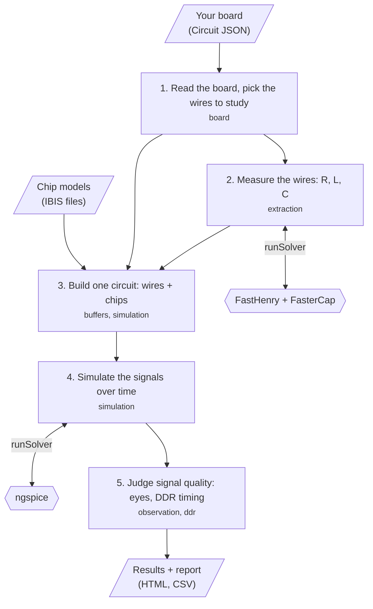
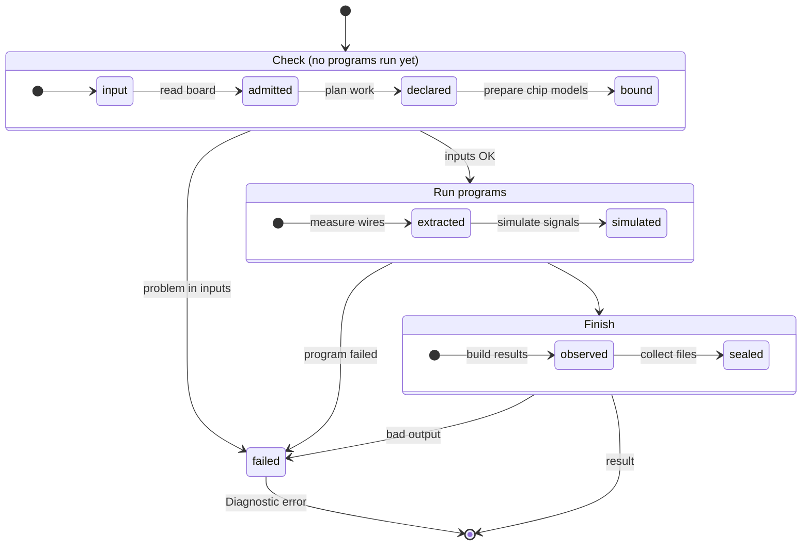

# @tscircuit/signal-integrity-pipeline

## What is it?

When a circuit board sends fast signals along its copper wires, the signals can get damaged on the way: they arrive late, they wobble ("ring"), or they leak into nearby wires. This library predicts how clean those signals will be, **before you build the board**.

You give it a tscircuit board (as Circuit JSON) and models of the chips on it (IBIS files). It gives you back **signal-integrity results**, meaning evidence of whether each signal arrives intact:

| Result | In plain words |
|---|---|
| Wire measurements (R, L, C) | How much each wire resists, stores and couples energy. This decides how it slows and bends a signal. |
| Waveforms | The voltage at chosen points, over time. |
| Eye diagrams | Many bits drawn on top of each other. A wide-open "eye" means the receiving chip can easily tell 0s from 1s. |
| DDR timing checks (optional) | Whether memory data arrives inside its allowed time window. |
| Report | One HTML page plus CSV files that open anywhere, with no internet needed. |

Three free programs do the heavy physics: **FastHenry** and **FasterCap** measure the wires, and **ngspice** simulates the circuit. The library never starts them itself. You pass it a `runSolver` function that does, so the same code runs in Node, Bun, a browser or on a server. On Node with the programs installed, the `/node` entry gives you a ready-made `runSolver`.

> Formerly `@tscircuit/pcb-spice-pipeline`. It still implements the `pcb_spice` simulation engine: boards keep declaring `spiceEngine="pcb_spice"`, so saved Circuit JSON does not change.

## How to use it?

**On Node, with the three programs installed:**

```ts
import { runPipeline } from '@tscircuit/signal-integrity-pipeline'
import { createNativeSolver, loadIbisSources, writePipelineOutput } from '@tscircuit/signal-integrity-pipeline/node'

const result = await runPipeline({
  circuitJson,                                                    // your board
  ibisSources: await loadIbisSources({ circuitJson, baseDir: projectDirectory }), // chip models from disk
  runSolver: createNativeSolver({ timeoutMs: 900_000 }),         // finds fasthenry, FasterCap, ngspice on PATH
  onProgress: console.log,
})
await writePipelineOutput({ result, outputDir: 'runs/example' }) // writes all files + results.html
```

**Anywhere else, with your own way of running the programs:**

```ts
import { runPipeline, generateReport, type RunSolver } from '@tscircuit/signal-integrity-pipeline'

const runSolver: RunSolver = async request => yourSolverService(request) // throw if the program fails
const result = await runPipeline({ circuitJson, ibisSources: { 'models/driver.ibs': driverIbisBytes }, runSolver })
const reportFiles = generateReport(result) // { 'results.html': '...', 'csv/...': '...' }
```

Settings (`modeling`) are optional; by default they are read from the board itself. If something is wrong, `runPipeline` throws a `Diagnostic` error with a short `code` (such as `vendor_hash` or `native_solver`), the part of the library that failed, and the log files that explain why.

## General workflow

What happens inside one `runPipeline` call (the small text under each step is the code module that does it):



Inside, `runPipeline` is a fixed state machine. It checks everything it can **before** running any slow program, and any problem stops the run with an error instead of a half-finished result:



How the code is organised, and the rules that keep it that way: [docs/ARCHITECTURE.md](docs/ARCHITECTURE.md).

## Reference

`ibisSources` is `Record<string, Uint8Array | string>`, keyed by each `ibis_model_asset.project_relative_path`. Callers prepare models and extract archives before calling the library. Asset URLs are metadata and never trigger downloads. Strings are encoded as UTF-8; byte inputs preserve BOM and CRLF. Optional `modeling.ibisModelAssetSha256` must contain an expected SHA-256 for every used asset when supplied.

The solver callback receives:

```ts
type SolverRequest = {
  solver: 'fasthenry' | 'fastercap' | 'ngspice'
  files: Record<string, string> // relative filenames and complete input contents
  args: string[]
  outputFiles: string[]        // requested output filenames
}
type SolverResult = {
  stdout: string
  stderr: string
  files: Record<string, string>
  exitCode?: number // omit when the callback rejects unsuccessful exits
}
```

Each request has an independent working directory. FastHenry gets coarse and refined extraction requests; FasterCap gets its automatic-refinement request; each experiment gets one ngspice transient shared by all its probes and eyes. The callback must reject unsuccessful process exits or return their nonzero `exitCode`. The library additionally checks stdout/stderr diagnostics, required outputs, conductor ordering, finite matrices, reciprocity, passivity, mesh convergence, analytic DC resistance, capacitance scaling and finite-return energy/charge reconstruction. Transients must contain finite, increasing timestamps and cover the declared recording. Recovered ngspice operating-point warnings are accepted only when the transient completes. No approximate solver or cached result replaces native physics.

`PipelineResult` exposes:

- `circuitJson`: original input records, preserved without schema normalization.
- `simulationResultCircuitJson`: input records with fresh transient graphs bound to probe IDs; reruns replace graphs for the executed experiments and preserve unrelated results. Circuit JSON timestamps use milliseconds.
- `geometry` and `matrices`: full extracted geometry, R/L/C in ohms/H/F, primitive matrices, checks and unit conversions.
- `experiments`: plan, probes, converter assembly, `waveform: { timeUnit: 's', voltageUnit: 'V', rows }`, and eyes with folded sample rows, metrics and optional DDR assessments. Waveform columns are bound by each probe's `column`; eye rows are `[window, folded_time_s, time_s, voltage_v]`.
- `modeling`, `limitations` and `files`: modeling inputs, explicit scope limits, and in-memory input decks, raw solver outputs/logs, JSON and CSV artifacts.

`generateReport(result)` synchronously returns HTML and CSV strings. The self-contained HTML keeps the full adaptive waveform samples and interactive controls, and uses no network assets. Its browser client is bundled at build time. Neither report generation nor package import reads the source tree.

### Node adapter details

Node 22+ applications can opt into filesystem access and native execution:

```ts
import { runPipeline } from '@tscircuit/signal-integrity-pipeline'
import {
  createNativeSolver, loadIbisSources, writePipelineOutput,
} from '@tscircuit/signal-integrity-pipeline/node'

const ibisSources = await loadIbisSources({ circuitJson, baseDir: projectDirectory })
const runSolver = createNativeSolver({
  tools: { fasthenry: '/tools/fasthenry', fastercap: '/tools/FasterCap', ngspice: '/tools/ngspice' },
  timeoutMs: 900_000,
})
const result = await runPipeline({ circuitJson, modeling, ibisSources, runSolver })
await writePipelineOutput({ result, outputDir: 'runs/example' })
```

Tools default to `fasthenry`, `FasterCap` and `ngspice` on PATH. The adapter executes only requests you pass it, in temporary directories cleaned up on success or failure. It captures stdout/stderr and requested outputs, rejects unsuccessful exits/timeouts, and does no setup, downloads or build-receipt enforcement. `loadIbisSources` loads local files only and rejects traversal and symlinks outside `baseDir`. `writePipelineOutput` writes the supplied artifacts plus `generateReport(result)`; existing files with the same names are overwritten.

The previous standalone CLI, entry loader, automatic model downloads, setup command and duplicate legacy pipeline have been removed. CLI integrations should render Circuit JSON with their normal renderer and explicitly supply the adapter. Historical receipt comparison/native-IBIS helpers remain internal test helpers under `tests/support/legacy`; the independent audit scripts read historical receipt formats and are not a current library API.

### Simulating a board

Declare simulations in the board's own TSX: IBIS models, `analog.transientsimulation` with `spiceEngine="pcb_spice"`, digital stimuli, voltage probes and eye diagrams are ordinary children of `<board>`. `tsci simulate` renders that Circuit JSON and runs this pipeline on it.

`ImportedBoard`/`serializeSimulation` in `tests/support/tsx.ts` are internal test helpers for driving the pipeline from saved Circuit JSON. They are not exported and are not supported in tsci projects.

React, `@tscircuit/core` and `@tscircuit/props` are optional peers, used here only by those internal helpers and their tests. Generating a stackup from a fabricator preset requires a core build containing merged [core #4826](https://github.com/tscircuit/core/pull/4826); a saved Circuit JSON stackup works with the committed core baseline.

### Modeling and limits

Modeling selects physical lanes, construction, extraction tolerances, explicit source rails and passives. Circuit JSON owns IBIS models, pin states, digital traffic, PCB-engine experiments, probes and eyes. Routed copper derives heights, dielectric thickness/permittivity and conductivity from the saved `pcb_stackup`. Straightened-stage modeling remains an explicit reduction with documented approximations.

`modeling.ddrAssessments` optionally binds a ground-referenced DQ probe/eye to a differential received DQS probe. Each configuration supplies its direction, sample offset, Vref, AC/DC thresholds, setup/hold times, minimum strobe amplitude and maximum interval error. Received DQS crossings center complete two-UI windows. Assessments retain configured limits, per-edge margins and unevaluated checks; uncharacterized limits are illustrative. Finite simulated observations do not establish DDR compliance, BER or hardware accuracy.

The historical saved AM3352 routed DDR case remains a separate FastHenry numerical failure. Successful synthetic strip/matrix tests do not resolve it. Existing locally prepared native tools may include historical source patches; this library makes no claim of unmodified physics provenance.

### Build and distribution

```sh
pnpm install --frozen-lockfile
pnpm typecheck
pnpm test
pnpm test:package
npm pack
```

Packages have scoped ESM `main`, `types` and exports pointing to compiled `dist`. `npm pack` runs the explicit build and includes compiled JavaScript/declarations, README and license. Prepared tarballs install with lifecycle scripts disabled and require no TypeScript source runtime. There is no `prepare`, `install` or `postinstall` script and no install-time solver action. Until publication, consumers should pin an immutable prepared tarball/archive; a Git source checkout must be built and packed explicitly. No npm publication is performed by these scripts.

The build bundles the pure entry with browser dependency resolution, pruning unused converter archive/worker support and fixing polygon-clipping's limits to its upstream browser defaults rather than consulting the host environment.

`pnpm test:package` checks an isolated npm install with no optional peers, root and `/node` imports, a complete in-memory run in Node and Bun when available, guarded host access, and NodeNext declarations. `BUN=/path/to/bun` selects Bun explicitly. Unit fixtures use canned solver responses to test orchestration; native regressions use real processes:

```sh
PCB_SPICE_FASTHENRY=/tools/fasthenry \
PCB_SPICE_FASTERCAP=/tools/FasterCap \
PCB_SPICE_NGSPICE=/tools/ngspice pnpm test:native
```

The native suite executes the full R + jωL/Maxwell-C regression and a complete real extraction/refinement/transient. Set `PCB_SPICE_TEST_MODEL_DIR` to a project root containing the exact `models/` files from `examples/vendor-models.lock.json` to additionally exercise the vendor examples. The suite never downloads those assets or builds native tools.

## Contributing

- `pnpm check:modules && pnpm typecheck && pnpm test` must pass. `check:modules` enforces module boundaries (imports only through `src/<module>/index.ts`, no cycles, `node:*` only in `src/adapters`) and that every declared error code has a test.
- Diagrams are Mermaid only, and are either a **workflow** (`flowchart`) or a **state machine** (`stateDiagram-v2`). See [AGENTS.md](AGENTS.md).
