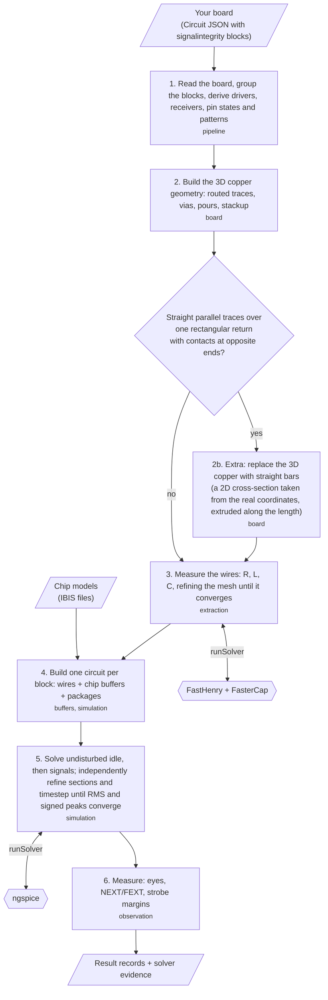
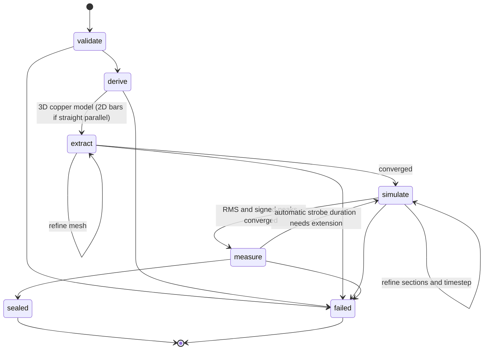

## What is it?

Native signal-integrity simulation for tscircuit boards. Describe each test with
`<signalintegrity>` and `<signal>`; the pipeline consumes the resulting Circuit JSON,
extracts coupled copper with FastHenry/FasterCap, and runs IBIS buffers in ngspice.
This draft implements the pipeline entry of [RFC #28](https://github.com/tscircuit/rfc/pull/28).

## How to use it?

```tsx
<signalintegrity name="DATA_TEST" bitRate="20Mbps">
  <signal name="DATA" driver=".TX > .Y" receiver=".RX > .A" />
</signalintegrity>
```

```ts
import { runPipeline } from '@tscircuit/signal-integrity-pipeline'
import { createNativeSolver, loadIbisSources, writePipelineOutput } from '@tscircuit/signal-integrity-pipeline/node'

const result = await runPipeline({
  circuitJson,
  ibisSources: await loadIbisSources({ circuitJson, baseDir: '.' }),
  runSolver: createNativeSolver(),
})
await writePipelineOutput({ result, outputDir: 'runs/si' })
```

Circuit JSON is the electrical input. `ibisSources`, `runSolver` and `onProgress`
are IO ports. There is no `modeling` option or separate simulation configuration.
Each `result.blocks` entry owns its matrices, results, numerical settings evidence
and limitations. `simulationResultCircuitJson` retains the input and appends only
the RFC's five new result record kinds. Re-running replaces prior SI results. A board with no SI blocks returns an empty block/result collection without invoking a solver. Automatic duration stays absent in source records and is reported on each result block.

The draft explicitly rejects extracted PDN, branched routes and coupled package matrices; the RFC lists these as not implemented yet.

See [the TSX levels](examples/levels) and [native evidence](docs/native-signal-levels.md).
The installed core predates the sibling intrinsic-element PRs: the native runner
uses a temporary adapter to render physical TSX and emit the new source records.
It never substitutes synthetic IBIS. Vendor files remain local and ignored by git.

```sh
pnpm install --frozen-lockfile
# While circuit-json#983 is unpublished, build that sibling and overlay its dist locally.
IBIS_MODEL_DIR=/path/to/vendor/models node --import tsx scripts/run-signal-levels.tsx
```

FastHenry, FasterCap and ngspice must already be installed. The evidence runner
uses `/opt/homebrew/bin`; the Node adapter accepts executable paths for other hosts.
No package install or solver download happens during `runPipeline`.

## General workflow





Missing electrical facts fail explicitly. Numerical settings come from selected
IBIS edge rates, bit rates, stackup and actual routes. Matrix order follows stable
physical pin identities, and coupling follows copper positions. The 3D routed
copper geometry is always built first. Only when the traces are verified straight,
parallel and over one rectangular return with opposite-end contacts is it replaced by straight bars (step 2b);
every other route is extracted from the 3D geometry. In that case `geometry.json`
holds the bars, not the 3D copper.

Every block produces an independent run. A differential endpoint drives opposite
physical levels and measures P minus N. Quiet signals remain connected, with
near/far probes and no eye. Single-ended probes use their chip's ground unless
`probe="global"` is requested. The settling gate is the largest switching offset plus 16 UI. Eyes use the RFC sampling instants and IBIS DC thresholds at the selected corner; differential DC thresholds override `[Diff_pin]`. Quiet peaks are signed deviations from a separate undisturbed idle solve, never the switching waveform mean.

Results describe finite observed simulations. They do not establish BER, protocol
compliance, hardware accuracy, or a validated DDR memory interface. The evidence
document distinguishes verified fixtures from outstanding implementation limits.
