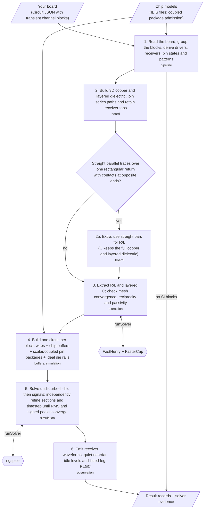
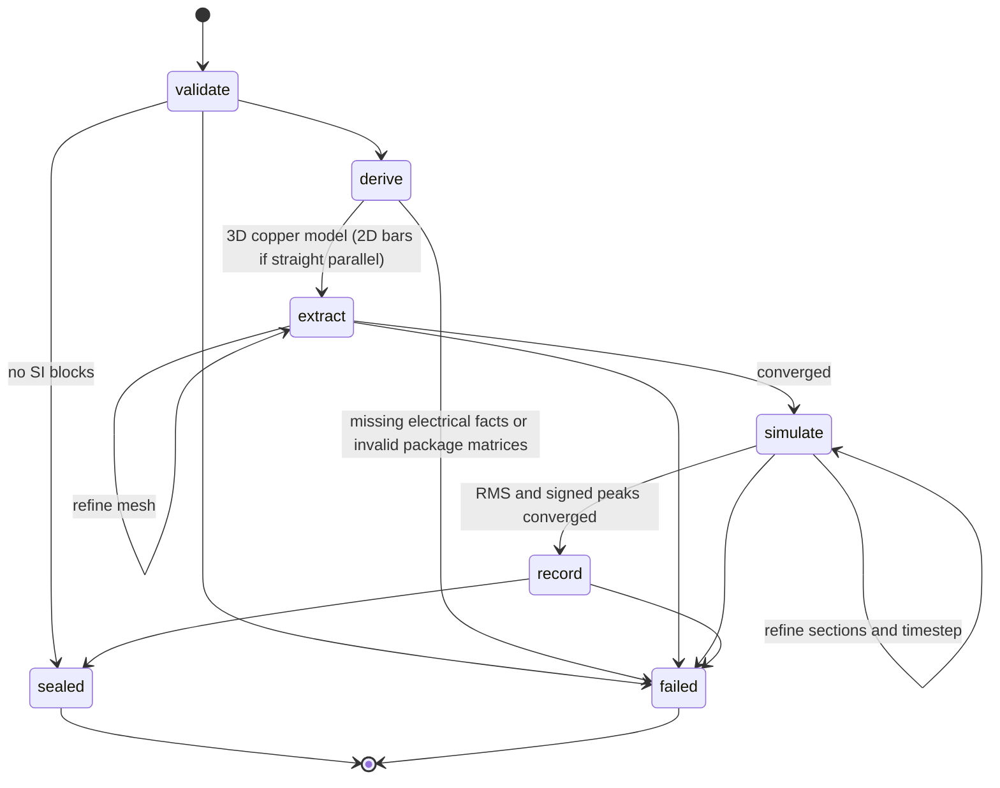

## What is it?

Native signal-integrity simulation for tscircuit boards. Describe each test with
`<simulation.pcbtransientchannelsimulation>` and `<signal>`; the pipeline consumes the resulting Circuit JSON,
extracts coupled copper with FastHenry/FasterCap, and runs IBIS buffers in ngspice.
This draft implements the pipeline entry of [RFC #28](https://github.com/tscircuit/rfc/pull/28).

## How to use it?

```tsx
import { simulation } from "@tscircuit/core"

<simulation.pcbtransientchannelsimulation name="DATA_TEST" bitRate="20Mbps">
  <simulation.pcbchannel name="DATA" driverRef=".TX > .Y" receiverRef=".RX > .A" />
</simulation.pcbtransientchannelsimulation>
```

```ts
import { runPipeline } from '@tscircuit/signal-integrity-pipeline'
import { createNativeSolver, loadIbisSources, writePipelineOutput } from '@tscircuit/signal-integrity-pipeline/node'

const result = await runPipeline({
  circuitJson,
  ibisSources: await loadIbisSources({ circuitJson, baseDir: '.' }),
  runSolver: createNativeSolver(),
})
await writePipelineOutput({ result, outputDir: 'runs/si' })
```

Circuit JSON is the electrical input. `ibisSources`, `runSolver` and `onProgress`
are IO ports. There is no `modeling` option or separate simulation configuration.
Each `result.blocks` entry owns its matrices, results, numerical settings evidence
and limitations. `simulationResultCircuitJson` retains the input and appends only
the RFC's waveform and RLGC result record kinds. Re-running replaces prior SI results. A board with no SI blocks returns an empty block/result collection without invoking a solver. Automatic duration stays absent in source records and is reported on each result block.

Branched routes remain unsupported. Inline IBIS coupled package matrices are
validated before extraction and lowered to a passive lumped package. Unlisted
pins follow the IBIS [Pin]/[Package] hierarchy and merged rail bus rules;
missing or invalid matrix definitions still fail. See the
[package model contract and DDR3 blockers](docs/coupled-package-model.md).
Die POWER/GND references always connect directly to perfect rails;
vendor package R/L/C remains between every mapped pin and its die node. See the [model rationale](docs/native-signal-levels.md).

See [the TSX levels](examples) and [native evidence](docs/native-signal-levels.md).
Local native verification uses the sibling core build through `SI_CORE_MODULE`;
its real TSX rendering emits the source records without a rendering adapter.
It never substitutes synthetic IBIS. Vendor files remain local and ignored by git.

```sh
pnpm install --frozen-lockfile
# While circuit-json#983 is unpublished, build that sibling and overlay its dist locally.
IBIS_MODEL_DIR=/path/to/vendor/models node --import tsx scripts/run-signal-levels.tsx
```

FastHenry, FasterCap and ngspice must already be installed. The evidence runner
uses `/opt/homebrew/bin`; the Node adapter accepts executable paths for other hosts.
No package install or solver download happens during `runPipeline`.

For an oversized full-resolution result, `files` stores waveform records in separate
`circuit-results/waveform-*.json` parts. `circuit-results.index.json` lists each
part's original record positions; `circuit-results.json` then holds the other
records. Reassembling those indexed parts preserves every sample and record.
Ordinary-sized aggregate artifacts keep their existing format, and
`simulationResultCircuitJson` always contains the complete in-memory result.
Consumers should write the supplied `files` map and its index for oversized data.
CLI #5736 still needs to guard its additional aggregate `JSON.stringify` so it can
use these indexed parts rather than hitting the same V8 string limit.

## General workflow





Missing electrical facts fail explicitly. Numerical settings come from selected
IBIS edge rates, bit rates, stackup and actual routes. Matrix order follows stable
physical pin identities, and coupling follows copper positions. The 3D routed
copper geometry is always built first. Only when the traces are verified straight,
parallel and over one rectangular return with opposite-end contacts is it replaced by straight bars (step 2b);
every other route is extracted from the 3D geometry. Capacitance retains the physical copper and finite dielectric slabs even when R/L uses the bar reduction. In that case `geometry.json`
holds the bars, not the 3D copper.

Every block produces an independent run. A differential endpoint drives opposite
physical levels and measures P minus N. Quiet channels remain connected and return
near/far waveforms with separately solved undisturbed idle levels. Single-ended
probes always use their chip's local ground. Numeric offsets
are seconds; automatic duration is startup plus 128 of the slowest UI (32 UI for
quiet-only blocks). Explicit durations are never extended. IBIS values always use the typical corner. Public RLGC matrices select only listed legs; all coupled
copper remains in the private model.
