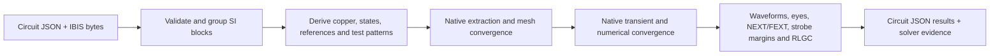
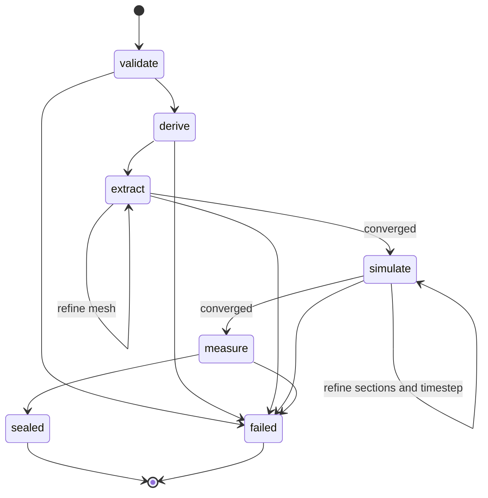

## What is it?

Native signal-integrity simulation for tscircuit boards. Describe each test with
`<signalintegrity>` and `<signal>`; the pipeline consumes the resulting Circuit JSON,
extracts coupled copper with FastHenry/FasterCap, and runs IBIS buffers in ngspice.
This is the pipeline implementation of [RFC #26](https://github.com/tscircuit/rfc/pull/26).

## How to use it?

```tsx
<signalintegrity name="DATA_TEST" bitRate="20Mbps">
  <signal name="DATA" driver=".TX > .Y" receiver=".RX > .A" />
</signalintegrity>
```

```ts
import { runPipeline } from '@tscircuit/signal-integrity-pipeline'
import { createNativeSolver, loadIbisSources, writePipelineOutput } from '@tscircuit/signal-integrity-pipeline/node'

const result = await runPipeline({
  circuitJson,
  ibisSources: await loadIbisSources({ circuitJson, baseDir: '.' }),
  runSolver: createNativeSolver(),
})
await writePipelineOutput({ result, outputDir: 'runs/si' })
```

Circuit JSON is the electrical input. `ibisSources`, `runSolver` and `onProgress`
are IO ports. There is no `modeling` option or separate simulation configuration.
Each `result.blocks` entry owns its matrices, results, numerical settings evidence
and limitations. `simulationResultCircuitJson` retains the input and appends only
the RFC's five new result record kinds. Re-running replaces prior SI results.

See [the TSX levels](examples/levels) and [native evidence](docs/native-signal-levels.md).
The installed core predates the sibling intrinsic-element PRs: the native runner
uses a temporary adapter to render physical TSX and emit the new source records.
It never substitutes synthetic IBIS. Vendor files remain local and ignored by git.

```sh
pnpm install --frozen-lockfile
IBIS_MODEL_DIR=/path/to/vendor/models node --import tsx scripts/run-signal-levels.tsx
```

FastHenry, FasterCap and ngspice must already be installed. The evidence runner
uses `/opt/homebrew/bin`; the Node adapter accepts executable paths for other hosts.
No package install or solver download happens during `runPipeline`.

## General workflow





Missing electrical facts fail explicitly. Numerical settings come from selected
IBIS edge rates, bit rates, stackup and actual routes. Matrix order follows stable
physical pin identities, and coupling follows copper positions. Verified parallel
rectangular copper can use a bar reduction; arbitrary routes keep routed geometry.

Every block produces an independent run. A differential endpoint drives opposite
physical levels and measures P minus N. Quiet signals remain connected, with
near/far probes and no eye. Single-ended probes use their chip's ground unless
`probe="global"` is requested. The eye excludes 16 UI of settling and uses receiver
thresholds; differential limits come from `[Diff_pin]`, never TTL leg thresholds.

Results describe finite observed simulations. They do not establish BER, protocol
compliance, hardware accuracy, or a validated DDR memory interface. The evidence
document distinguishes verified fixtures from outstanding implementation limits.
