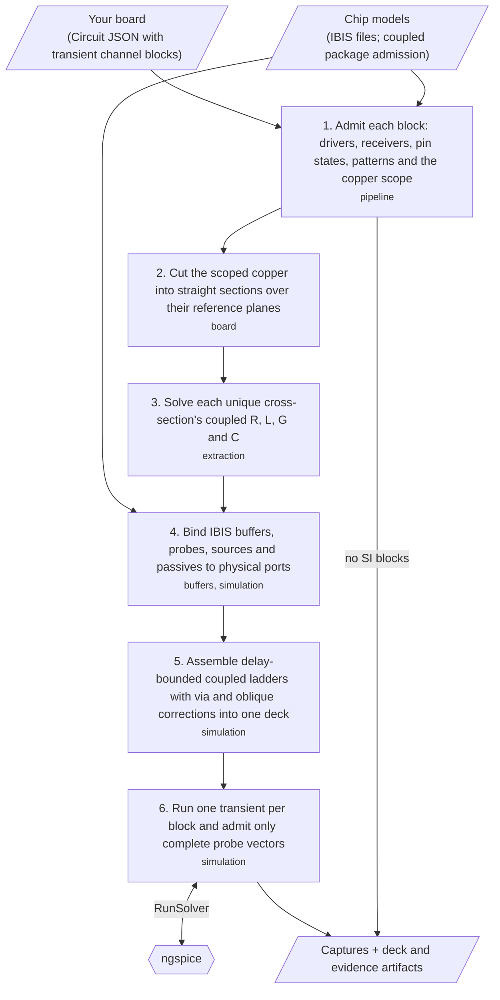
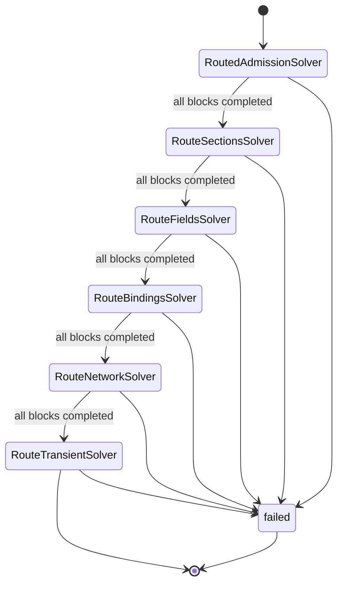

## What is it?

Native signal-integrity simulation for tscircuit boards. Describe each test with
`<simulation.pcbtransientchannelsimulation>` and `<simulation.pcbchannel>`. `RoutedPipelineSolver` consumes the
resulting Circuit JSON, solves quasi-TEM 2D cross-sections along the actual routed copper (2.5D), assembles
coupled ladders with the IBIS buffers, and runs one transient per block in ngspice.
This draft implements the pipeline entry of [RFC #28](https://github.com/tscircuit/rfc/pull/28).

## How to use it?

```tsx
import { simulation } from "@tscircuit/core"

<simulation.pcbtransientchannelsimulation name="DATA_TEST" bitRate="20Mbps">
  <simulation.pcbchannel name="DATA" driverRef=".TX > .Y" receiverRef=".RX > .A" />
</simulation.pcbtransientchannelsimulation>
```

```ts
import { RoutedPipelineSolver } from '@tscircuit/signal-integrity-pipeline'
import { createNativeSolver, loadIbisSources } from '@tscircuit/signal-integrity-pipeline/node'

const solver = new RoutedPipelineSolver(
  { circuitJson, ibisSources: await loadIbisSources({ circuitJson, baseDir: '.' }) },
  { runSolver: createNativeSolver({ timeoutMs: 600_000 }), progress: console.log },
)
await solver.solveAsync()
const { blocks, files } = solver.getOutput()
```

Circuit JSON is the electrical input. `ibisSources` and the `{ runSolver, progress }`
context are IO ports; there is no separate simulation configuration. Each `blocks`
entry holds its compiled ngspice deck with evidence and its completed probe capture.
Captures are candidate evidence without independent convergence qualification.
`files` maps every artifact path to its bytes; writing them is the caller's choice.
A board with no SI blocks completes after admission without invoking a solver.

Branched routes remain unsupported. Inline IBIS coupled package matrices are
validated before the deck is built and lowered to a passive lumped package. Unlisted
pins follow the IBIS [Pin]/[Package] hierarchy and merged rail bus rules;
missing or invalid matrix definitions still fail. See the
[package model contract and DDR3 blockers](docs/coupled-package-model.md).
Die POWER/GND references always connect directly to perfect rails;
vendor package R/L/C remains between every mapped pin and its die node.

ngspice must already be installed; `createNativeSolver({ tools: { ngspice } })`
accepts an executable path. No package install or solver download happens during
a solve. Native processes are serialized and run with `OMP_NUM_THREADS=1`.
Vendor IBIS files and board JSON remain local and ignored by git; see
[the routed examples](examples/routed/README.md) for the local runners.

## General workflow



The pipeline is inspectable with solver-utils. All six stage rows exist before the
first step; each stage processes all admitted blocks in order, with no nested block
pipelines. The site's `Step` input starts at 0 for the initial view. Enter 1–6 to
inspect a retained stage by table row number; the next pipeline advance updates the
input to the active stage. Unrun stages show a not-run note. Synchronous stages can
be stepped up to stage 6; `RouteTransientSolver` awaits one live ngspice run.

<!-- routed-stages:start -->
| # | Stage solver |
|---|---|
| 1 | RoutedAdmissionSolver |
| 2 | RouteSectionsSolver |
| 3 | RouteFieldsSolver |
| 4 | RouteBindingsSolver |
| 5 | RouteNetworkSolver |
| 6 | RouteTransientSolver |

```mermaid
flowchart LR
  s0["RoutedAdmissionSolver<br/>Admit one SI block per step"]
  s1["RouteSectionsSolver<br/>All admitted blocks, one item per step"]
  s2["RouteFieldsSolver<br/>All admitted blocks, one item per step"]
  s3["RouteBindingsSolver<br/>All admitted blocks, one item per step"]
  s4["RouteNetworkSolver<br/>All admitted blocks, one item per step"]
  s5["RouteTransientSolver<br/>All admitted blocks, one item per step"]
  s0 --> s1
  s1 --> s2
  s2 --> s3
  s3 --> s4
  s4 --> s5
  s5 <-->|"await RunSolver"| engine["local native ngspice"]
```




<!-- routed-stages:end -->

Missing electrical facts fail explicitly. Numerical settings come from selected
IBIS edge rates, bit rates, stackup and actual routes. Every block produces an
independent run. A differential endpoint drives opposite physical levels and
measures P minus N. Quiet channels remain connected and are probed at the far
receiver and at the near quiet driver. Single-ended probes always use their chip's
local ground. Numeric offsets are seconds; automatic duration is startup plus 128
of the slowest UI (32 UI for quiet-only blocks). Explicit durations are never
extended. IBIS values always use the typical corner.
