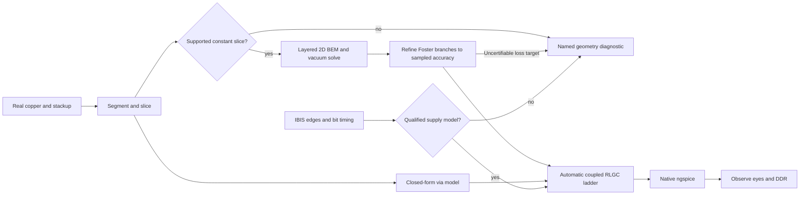

# Two dimensional extraction

The stage machine is unchanged: admit → declare → bind → extract → simulate → observe → seal.
Extraction now walks the actual copper. It does not launch FastHenry or FasterCap.

1. **Segment.** Resolve driver and receiver pads, bends, widths, layers, neighbours, pad boundaries
   and polygon edges. Intersect each perpendicular slice with metal on every layer and with the
   physical dielectric stack. Cutouts stay cutouts. Electrical junctions share nodes.
2. **Solve the slice.** A constant-panel boundary-element method solves conductor potentials and
   dielectric transmission boundaries in open space. A charge-neutral constraint determines the
   common potential. Solve again in vacuum and calculate L = μ0 ε0 C0⁻¹. Neutral floating pads are
   eliminated with a Schur complement. Repeated geometry is cached. Dense IEEE-double elimination uses the included WebAssembly kernel;
   `scripts/build-lu.mjs` rebuilds it from the readable C source.
3. **Model vias.** Use physical hole, pad, antipad, plating, active length and the weighted dielectric
   permittivity within that span. Exterior mask and layers outside a blind/buried via are excluded. A missing dimension
   raises a named diagnostic. TI's closed-form via approximation gives lumped R/L/C; it is not a
   full-wave discontinuity solution.
4. **Build the ladder.** The fastest selected IBIS edge and the bit timing determine the frequency
   band and number of cells. A passive experiment needs a declared finite-edge voltage pulse;
   a simulation timestep is never used as a physical rise time. Each cell has the complete coupled inductance matrix and physical C.
   Positive-real Foster RL branches approximate the current, unqualified skin/proximity target from the solved surface-current
   distribution. Series RC branches model dielectric loss from material sensitivity. Fit branches grow until the maximum sampled relative error is at most 2%; failure to certify raises `loss_fit`. Fit residuals
   and all mesh refinement steps are artifacts. This works with native ngspice primitives.
5. **Run and observe.** Native ngspice runs the IBIS experiment. The existing waveform, eye and DDR
   stages consume its output. No synthetic waveform replaces a native measurement.

All numerical policy is in `src/kernel/numerics.ts`. There are no solver process timeouts, mesh
attempt limits, lane caps, or maximum cell clamps. Refinement continues until every nonzero C/C0/L, surface-current-loss and dielectric-loss
**estimate** entry changes by less than 0.5%. Richardson extrapolation removes the leading panel error
(orders 2 then 4 for C/C0/loss, orders 4/3 then 2 for the quartic-graded corner-current integral). Both raw and
estimated residuals are logged; the raw skin-loss residual can exceed 0.5% at termination. Reciprocity
of the unprojected estimates must also pass. The entry-wise check compares the published reciprocal
matrices, including arbitrarily small mutual terms. No matrix-norm floor relaxes their relative
criterion. Two exact zeros count as unchanged; arrival at zero from a nonzero entry is a full change.
Physical Dk, loss tangent, copper conductivity, layer thickness and via plating come from the original
`pcb_stackup` (the examples declare it directly with the `pcbStackup` JSX prop), including solder mask; incomplete presets fail with field-specific diagnostics. The default example construction is
explicitly bare copper. A masked TSX variant and a layered dielectric energy check are unit-tested.

The model has explicit limits. Cross-sections are local quasi-TEM models, excluding radiation and
bend fringing. Magnetic coupling is distributed between parallel, co-propagating route pieces;
driven oblique metal without a connected propagation port raises `oblique_coupling`. Continuously varying slices raise `varying_cross_section`; unmodelled reference vias raise `reference_via`. Ideal DC
source rails are AC equipotential in this model. Their physical copper participates in the reference
surfaces; distributed supply/ground-connection impedance is not extracted. A split with no reference
metal in the whole slice is a named error, not an invented return strip. These limitations are also
recorded on every result; see `REPORT.md` for which requested checks actually pass.

References: [Hammerstad–Jensen single microstrip](https://qucs.sourceforge.net/tech/node75.html),
[coupled microstrip](https://qucs.sourceforge.net/tech/node77.html),
[TI Analog Engineer's Pocket Reference, via formulas](https://www.ti.com/lit/eb/slyw038c/slyw038c.pdf).
These references define validation oracles; they are not substituted for the BEM solution.

IBIS package mode retains vendor R/L/C for signal, power and ground pins. The standard lumped
capacitance is at the external pin relative to board ground; each pin’s R/L connects to the die.
Missing, negative or nonfinite resolved package values are errors; explicit zeros are accepted. Enabled outputs with inductive reference pins raise `ibis_supply_dynamics`: the classic converter lacks qualified supply-current and die-rail storage data. The synthetic input-buffer package check is narrower native evidence. See REPORT.md for remaining skin-loss, speed and example-qualification failures.

The measurement script checkpoints converged slices in its evidence directory before starting
ngspice. A solver-source fingerprint and the convergence/matrix checks guard restoration. This
helps resume interrupted measurements; it does not substitute a stored native waveform. Both
repeat simulations still execute ngspice, and restored extraction timings are marked as cached.

The current examples stop at the reference-via diagnostic. They do not presently provide qualified native end-to-end results. The finite-thickness loss target remains a known failing TODO; the adaptive fit certifies its sampled numerical approximation, not its physical accuracy.
