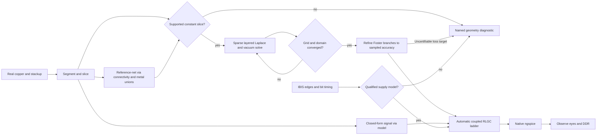

# Two dimensional extraction

The stage machine is unchanged: admit → declare → bind → extract → simulate → observe → seal.
Extraction now walks the actual copper. It does not launch FastHenry or FasterCap.

1. **Segment.** Resolve driver and receiver pads, bends, widths, layers, neighbours, pad boundaries
   and polygon edges, including reference-via pad/barrel/drill extents. Intersect each perpendicular slice with metal on every layer and with the
   physical dielectric stack. Cutouts stay cutouts. Electrical junctions share nodes.
2. **Solve the slice.** A conservative cell-centred finite-volume Laplace discretization replaces
   the dense boundary-element field solver. Metal rectangle faces are Dirichlet boundaries; each
   dielectric cell uses its actual Dk, including mask. Harmonic face weights enforce displacement
   continuity. The finite outer boundary is insulating (zero normal displacement), so total conductor
   charge remains neutral. Its extent doubles until every published matrix entry changes below 0.5%.
   A nested-dissection sparse LDL factorization is reused for every conductor excitation. Nodal Gauss
   balance is checked independently of mesh convergence. Vacuum C0 gives L = μ0 ε0 C0⁻¹. Floating pads
   are eliminated by a Schur complement. Dielectric loss comes from weighted face energy, rather than
   a repeated perturbed-permittivity solve. The old dense logarithmic panel kernel is deleted; the
   small conductor-matrix inversions still use the existing dense algebra backend.
   **This replacement is an incomplete candidate:** its grid is geometrically graded with global
   density refinement, not the requested adaptive field-energy refinement. Surface-current convergence
   can still demand over a million cells, and coupled accuracy qualification remains resource-blocked.
3. **Model vias.** Ground and ideal-DC supply stitches bind the copper of their physical reference net across the recorded layers. Tangent and centre cuts delimit their circular pad, plated barrel and drill; the exact chord at each midpoint enters the slice, with the drill removed from copper and dielectric. Existing pour voids retain their actual antipad clearances. Copper unions remove internal pad/barrel/pour seams. This remains a local prismatic approximation: longitudinal via-chord integration is not converged independently. A non-route via without a reference-net identity raises `reference_via`. Signal vias use physical hole, pad, antipad, plating, active length and the weighted dielectric
   permittivity within that span. Exterior mask and layers outside a blind/buried via are excluded. A missing dimension
   raises a named diagnostic. TI's closed-form via approximation gives lumped R/L/C; it is not a
   full-wave discontinuity solution.
4. **Build the ladder.** The fastest selected IBIS edge and the bit timing determine the frequency
   band and number of cells. A passive experiment needs a declared finite-edge voltage pulse;
   a simulation timestep is never used as a physical rise time. Each cell has the complete coupled inductance matrix and physical C.
   Positive-real Foster RL branches approximate finite-thickness one-face slab excess impedance, weighted by the solved PEC surface-current distribution. Each thickness/conductivity class has its own target, mesh convergence entries and fit; there is no shared skin transition frequency. Area-based DC resistance is retained. This is a perturbative surface-impedance model, not a frequency-dependent bulk eddy-current solution. Series RC branches model dielectric loss from material sensitivity. Fit branches grow until the maximum sampled relative error is at most 2%; failure to certify raises `loss_fit`. Fit residuals
   and all mesh refinement steps are artifacts. This works with native ngspice primitives.
5. **Run and observe.** Native ngspice runs the IBIS experiment. The existing waveform, eye and DDR
   stages consume its output. No synthetic waveform replaces a native measurement.

All numerical policy is in `src/kernel/numerics.ts`. There are no solver process timeouts, mesh
attempt limits, lane caps, or maximum cell clamps. Refinement continues until every nonzero C/C0/L, surface-current-loss and dielectric-loss
entry changes by less than 0.5%. C/C0/L and dielectric loss are compared without extrapolation.
The surface-current matrices retain a leading corner-error extrapolation; both raw and estimated
residuals are logged. This extrapolation on the new graded grid has not completed the full coupled
qualification. Grid and domain checks are separate and both must pass before a slice is returned.
The legacy `steps.panels` artifact field now counts dielectric grid cells; `kind` distinguishes
`mesh` from `domain`, and `extentMm` records truncation growth. There is no matrix-norm floor in
entry-wise comparisons. Two exact zeros count as unchanged; arrival at zero from a nonzero entry is
a full change. Checkpoints from the previous BEM lack independent grid/domain records and are rejected.
Physical Dk, loss tangent, copper conductivity, layer thickness and via plating come from the original
`pcb_stackup` (the examples declare it directly with the `pcbStackup` JSX prop), including solder mask; incomplete presets fail with field-specific diagnostics. The default example construction is
explicitly bare copper. A masked TSX variant and a layered dielectric energy check are unit-tested.

The model has explicit limits. Cross-sections are local quasi-TEM models, excluding radiation and
bend fringing. Magnetic coupling is distributed between parallel, co-propagating route pieces;
driven oblique metal without a connected propagation port raises `oblique_coupling`. Continuously varying polygon slices raise `varying_cross_section`; electrically unclassified non-route vias raise `reference_via`. Ideal DC
source rails are AC equipotential in this model. Their physical copper participates in the reference
surfaces; distributed supply/ground-connection impedance is not extracted. A split with no reference
metal in the whole slice is a named error, not an invented return strip. These limitations are also
recorded on every result; see `REPORT.md` for which requested checks actually pass.

References: [Hammerstad–Jensen single microstrip](https://qucs.sourceforge.net/tech/node75.html),
[coupled microstrip](https://qucs.sourceforge.net/tech/node77.html),
[TI Analog Engineer's Pocket Reference, via formulas](https://www.ti.com/lit/eb/slyw038c/slyw038c.pdf),
[NBS Journal of Research 84 (1979), 247, eqs. 2.3 and 3.3](https://nvlpubs.nist.gov/nistpubs/jres/84/jresv84n3p247_A1b.pdf).
These references define validation oracles; they are not substituted for the sparse field solution.

IBIS package mode retains vendor R/L/C for signal, power and ground pins. The standard lumped
capacitance is at the external pin relative to board ground; each pin’s R/L connects to the die.
Missing, negative or nonfinite resolved package values are errors; explicit zeros are accepted. Enabled outputs with inductive reference pins raise `ibis_supply_dynamics`: the classic converter lacks qualified supply-current and die-rail storage data. The synthetic input-buffer package check is narrower native evidence. See REPORT.md for the bounded native supply experiment, remaining speed failures and example qualification.

The measurement script checkpoints converged slices in its evidence directory before starting
ngspice. A solver-source fingerprint and the convergence/matrix checks guard restoration. This
helps resume interrupted measurements; it does not substitute a stored native waveform. Both
repeat simulations still execute ngspice, and restored extraction timings are marked as cached.

The examples no longer stop at `reference_via`. Differential and multilayer now stop at `varying_cross_section`; active and quiet crosstalk stop at `oblique_coupling`. The first single-ended slice converges in the sparse candidate but still takes about one minute. None has a new qualified native end-to-end result. The previous BEM loss/accuracy results are historical; they do not qualify this replacement. See REPORT.md for the current command results and the measured sparse-solver blocker.
