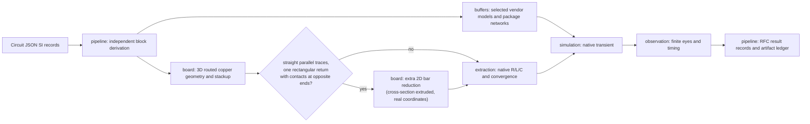
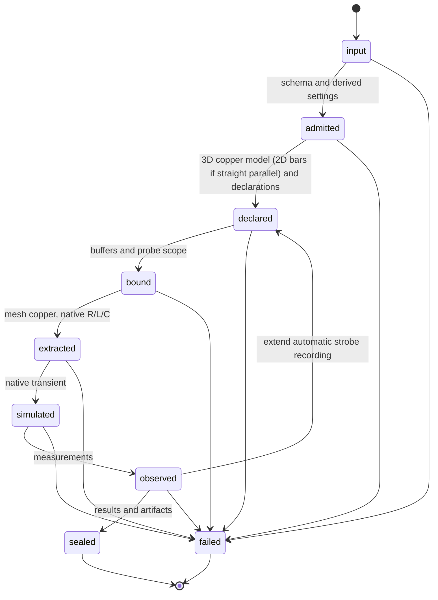

# Signal-integrity pipeline architecture

The public entry consumes Circuit JSON source records from RFC #28. It rejects the
removed modeling option. `pipeline/signals.ts` groups blocks and derives private
settings and native declarations. `pipeline/prepared.ts` runs the existing typed
stage chain after derivation. The lowered transient records are private and never
appear in the new result Circuit JSON.

Module boundaries remain enforced by `check:modules`: modules import one another
through their index, never internals; imports are acyclic; only adapters import
Node facilities. Domain modules return owned artifacts. The pipeline ledger
rejects path collisions and seals files in sorted order. Blocks have separate
artifact prefixes.

`board` owns physical admission and geometry; `buffers` owns vendor source bytes,
pin/model selection and package assembly; `extraction` owns meshes, solver decks,
parsing, passivity and convergence checks; `simulation` owns electrical sources,
node identity and ngspice; `observation` owns interpolation and measurements.
`report` reads sealed artifacts. `adapters` supplies explicit filesystem/process IO.

Tests use TSX for board reproductions. Numerical measurement oracles use analytic
waveforms; those synthetic waveforms are never claimed as native solver evidence.
Tests for the removed straightened-stage, legacy fold and DDR assessment paths were deleted. New shared schemas validate every public result. The RFC intentionally changes the public entry, records and artifact paths.

R/L use the signal-minus-return loop transform. C and G use the floating finite-return, charge-neutral Maxwell reduction; records contain total matrices indexed by physical conductors, with P/N entries for differential signals. Dielectric loss is currently zero, so G is the reduction of a zero primitive matrix. The transient uses first-order Gear, tight IBIS tolerances, adaptive native samples, and independent time/section refinement. Each probe must pass both integrated RMS and signed peak tolerances (1% + 1 mV). A failure produces no accepted measurements.

The runtime imports the shared circuit-json schemas. Local validation must build the sibling RFC branch until circuit-json#983 is released. No absolute local dependency links are committed. The render adapter exists only for the unpublished core#5286 intrinsics; unknown strobes are errors.

Core#5286 now emits JLC preset plating (0.018 mm), preserving explicit imported stackup plating. The temporary adapter matches the built core fork exactly for source SI/IBIS and stackup records in the SE, differential and three-block examples; `tests/evidence/signal-levels/core-adapter-parity.json` records the comparison. Pipeline via geometry requires the declared shared stackup thickness and never guesses it from dielectric dimensions.
