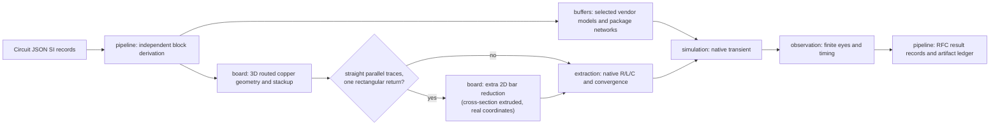
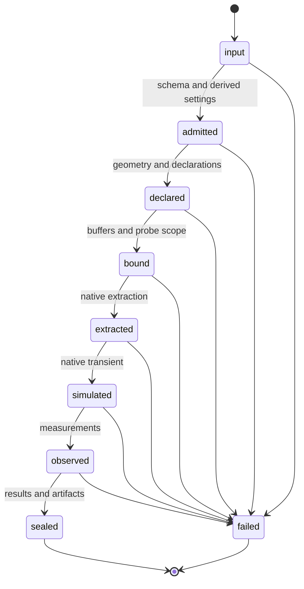

# Signal-integrity pipeline architecture

The public entry consumes Circuit JSON source records from RFC #26. It rejects the
removed modeling option. `pipeline/signals.ts` groups blocks and derives private
settings and native declarations. `pipeline/prepared.ts` runs the existing typed
stage chain after derivation. The lowered transient records are private and never
appear in the new result Circuit JSON.

Module boundaries remain enforced by `check:modules`: modules import one another
through their index, never internals; imports are acyclic; only adapters import
Node facilities. Domain modules return owned artifacts. The pipeline ledger
rejects path collisions and seals files in sorted order. Blocks have separate
artifact prefixes.

`board` owns physical admission and geometry; `buffers` owns vendor source bytes,
pin/model selection and package assembly; `extraction` owns meshes, solver decks,
parsing, passivity and convergence checks; `simulation` owns electrical sources,
node identity and ngspice; `observation` owns interpolation and measurements.
`report` reads sealed artifacts. `adapters` supplies explicit filesystem/process IO.

Tests use TSX for board reproductions. Numerical measurement oracles use analytic
waveforms; those synthetic waveforms are never claimed as native solver evidence.
The old compatibility snapshots for the removed modeling API require migration;
the RFC intentionally changes the public entry, records and artifact paths.
