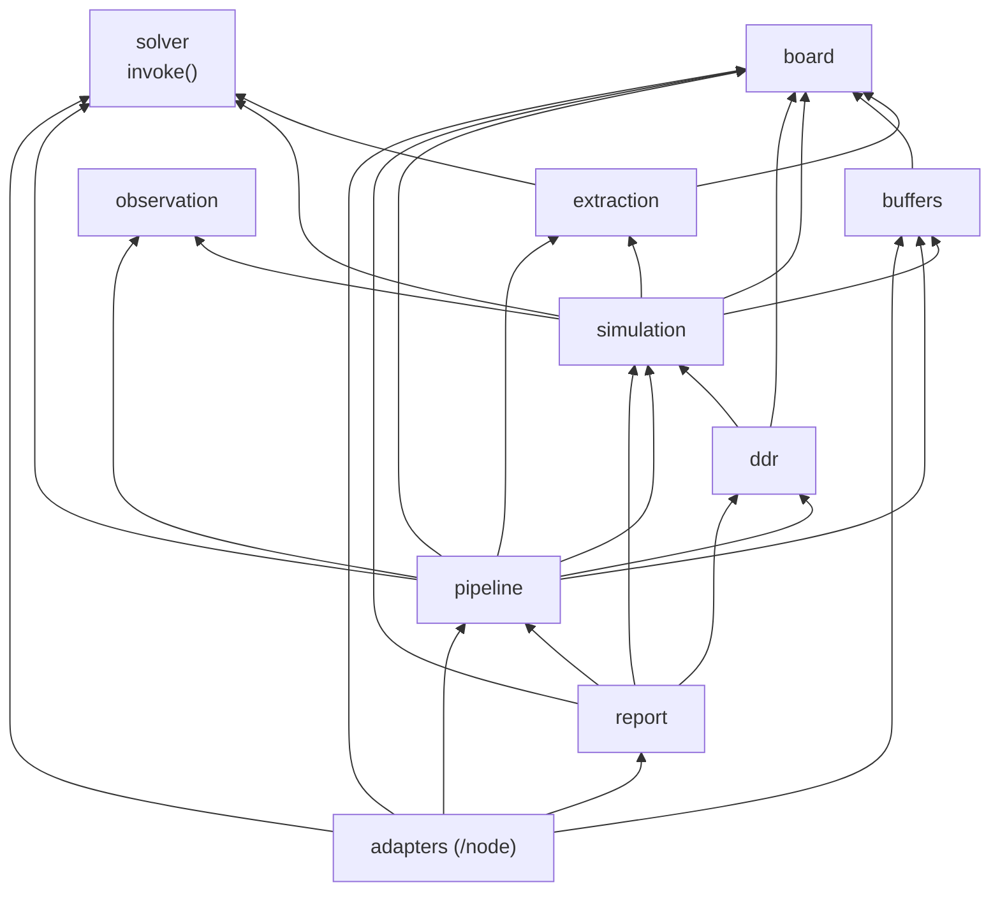
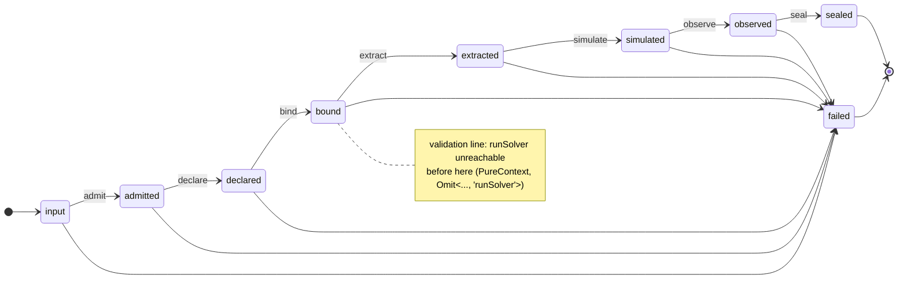

This document describes the module boundaries. The current extraction flow and changed contracts are in [2d-extraction.md](2d-extraction.md).

# signal-integrity-pipeline: domain-owned modules, stages as values, verification by types and oracles

## Problem

`signal-integrity-pipeline` (formerly `pcb-spice-pipeline`) turns Circuit JSON into native-solver extraction, IBIS buffers, ngspice transients, eyes and DDR checks. Today it is ~3.7k LOC in one flat `src/`. `runPipeline` is an 85-line function that owns every stage and the whole artifact layout. `matrices.mjs` mixes errors, math and parsers and is imported nearly everywhere. Three import cycles exist (`geometry↔copper`, `geometry↔ddr`, `modeling↔general-pipeline`). `Modeling` lives in `geometry.ts`, `PipelineResult` is inferred, error codes are ad-hoc strings, legacy and Node-only code is importable from pure code, and artifact paths are string literals in four files.

Must keep: the public names and signatures (`runPipeline`, `generateReport`, `modelingFromCircuitJson`, `assessDdr`, `resolveDdrAssessments(plans, geometry, configs)`, `stackupFromCircuitJson`, `transmittedBits`, listed types), the `/node` entry with its object-arg signatures, a root entry with no `node:*`, byte-identical output for identical inputs + solver outputs, today's error codes, artifact paths and `geometry.json` shape, and native physics only.

## Usage (caller's view)

Unchanged for callers. Errors become typed.

```ts
import { runPipeline, generateReport, Diagnostic } from '@tscircuit/signal-integrity-pipeline'
import { createNativeSolver, loadIbisSources, writePipelineOutput } from '@tscircuit/signal-integrity-pipeline/node'

const result = await runPipeline({
  circuitJson,
  ibisSources: await loadIbisSources({ circuitJson, baseDir: projectDir }),
  runSolver: createNativeSolver(),
  onProgress: console.log,
})
await writePipelineOutput({ result, outputDir: 'out/' })
```

```ts
try { await runPipeline({ circuitJson, ibisSources, runSolver: cannedSolver(fixtures) }) }
catch (e) {
  if (e instanceof Diagnostic && e.code === 'mesh_convergence')   // DiagnosticCode: closed union, same strings as today
    show(e.domain, e.subjects, e.artifacts)                          // 'extraction', [{kind:'cell',id:'2'}], ['stage-2/fasthenry.stdout.log']
}
```

```ts
// Contributor fixing straightened-stage returns (#49/#53/#54) touches one module and its tests:
//   src/board/geometry/straightened.ts        the code
//   tests/board/straightened.oracle.test.ts   fast-check: returns follow pcb_stackup planes; stripline gets both
//   tests/board/metamorphic.test.ts           translate/mirror the board -> identical cells
// `pnpm verify` = check:modules + typecheck + test. No JVM.
```

## Shape

**Modules are directories grouped by what they know.** Each has one public `index.ts`; everything else is unreachable from outside (S2).

| module | owns | artifacts |
|---|---|---|
| `kernel` | `Diagnostic` + code registry, `Artifact`/`ArtifactScope`/`ArtifactLedger`, `SafeId`, `sha256` | none (provides the ledger) |
| `solver` | `RunSolver` port; `invoke()` is the only way to run a solver: result shape, exit code, required outputs, log capture | `<scope>/<solver>.{request.json,stdout.log,stderr.log}` + I/O files |
| `board` | Circuit JSON admission → `Board`, stackup, port selection, lanes and **whole-board cross-sections** | `inputs/circuit.json`, `geometry.json` |
| `extraction` | layered 2D BEM, automatic refinement, loss fitting, via formulas, linear algebra and coupled RLGC ladders | today's `stage-N/**`, `channel.cir` |
| `buffers` | IBIS admission, SHA pinning, pinned converter, compiled libs | `vendor-sources.json`, `<exp>/native-ibis-assembly.json`, `<exp>/*.lib` |
| `simulation` | experiments, node map, probe scope, netlist, ngspice diagnostics, waveform coverage, result records | `electrical-node-map.json`, `experiments/<id>/…` |
| `observation` | `Signal`, `EyeRequest`, complete-window folding, metrics (leaf) | `<exp>/eyes/**`, `<exp>/eyes.json` |
| `ddr` | config binding (incl. receiver-pad check against geometry), DQS crossings, capture classification, status rule | none (embedded in eye JSON) |
| `pipeline` | `PipelineOptions`/`PipelineResult`, composite `Modeling`, `STAGES`, the ledger, `sealResult()` | `inputs/modeling.json`, `circuit-results.json` |
| `report` | HTML/CSV from a sealed result, bundled client | separate `FileMap` |
| `adapters` | `/node`: native solver workdir, fs IBIS loading, output writing | disk |



Arrows are imports, always downward. Every module also imports `kernel` (Diagnostic, ids, sha256, ledger); those edges are omitted. `check:modules` fails the build on any other edge shape: cycles, deep imports, `node:*` outside `adapters`.

Imports are acyclic and computed, not declared: kernel ← solver ← extraction; kernel ← board ← {extraction, buffers, ddr, simulation}; observation ← {simulation, ddr}; all ← pipeline ← report; adapters import public surfaces. `legacy/` and tsx helpers move to `tests/support/`.



**The pipeline is a typed fold over stage values** (`src/pipeline/{state,stages,run}.ts`). `PipelineState` is a discriminated union `input → admitted → declared → bound → extracted → simulated → observed → sealed`. `STAGES: Chain<typeof stages>` fails to compile if a stage is missing, duplicated or out of order. Before `bound`, a stage receives `PureContext` and the state holds `Omit<PipelineOptions,'runSolver'>`; `run.ts` is the only holder of `runSolver`. "Validate everything before spending solver work" is a compile-time fact, not a reviewed convention.

**Artifact ownership.** Domain modules return `Produced<T> = { value, artifacts }` written through an owner-stamped `ArtifactScope`. The pipeline's `ArtifactLedger` is the only writer of the output `FileMap`; a second write to a path fails `artifact_collision`; `seal()` sorts keys (determinism). Report reads files only through paths the result names; a missing one fails `report_missing_artifact` instead of rendering `undefined`.

**Error model.** One `Diagnostic` class (`domain`, `code`, `subjects`, `artifacts`, `hint`). Each module declares its codes once with `diagnostics('<dir>', [...] as const)`; codes may be shared across modules. `check-modules` generates the `DiagnosticCode` union from those tuples, and a compat test pins the set to today's raised codes. `fail` stays private to each module. Brands encode admitted states: `Board`, `SafeId`, `ArtifactPath`, `AdmittedBuffers`, `BoundExperiments`; `GeometryCell` is a union over `kind`.

## Verification

No TLA+. Nothing in this library is concurrent: stages run in order, experiments run one at a time, and no state is shared. TLA+ earns its cost on interleavings, and there are none. During the earlier pass the specs mostly restated their own guards, and a mutant that silently dropped eye windows passed the Observation spec. Each rule now lives in the cheapest tool that actually catches it being broken.

| What must hold | Enforced by |
|---|---|
| Stage order; no solver before validation; admitted-before-use | Types: `Chain<>`, `PureContext`, brands |
| Module fences: no unowned code, index-only imports, acyclic, `node:*` only in adapters | `check-modules` S1–S6 (from the filesystem and import graph) |
| Every module tested; every declared code raised by some test | `check-modules` M2–M3 |
| Single writer, sealed is final, sorted output | `tests/kernel/index.test.ts` |
| Temp dir always removed; only requested outputs read | `tests/adapters/native-solver.test.ts`: fault injection at each step |
| Geometry, meshing, extraction numerics (#44 #46 #49 #53 #54) | `fast-check` properties vs exact oracle; metamorphic tests (translate, mirror, mesh halving converges); existing `scripts/verification` audits |
| Eye folding keeps every complete window | Oracle: brute-force window enumeration vs closed-form fold |
| DDR status rule | Exhaustive decision-table test (small finite input space) |
| Public API, codes, artifact paths, byte determinism | `tests/compat/`: export snapshot, code-set equality, path snapshot, golden bytes on canned fixtures run twice |
| Real solver behaviour | Existing `test:native` suite (optional, env-gated) |

## Synthesis decision

Base: candidate A (domain-owned modules, typed stage chain). Taken from candidate B: derive spec↔code agreement from the source rather than from lists (now applied to code sets and module tests). Rejected from B: the content-addressed result cache (conflicts with "no cached result replaces native physics", and a forgotten version bump means stale extraction); the five-package workspace (the `exports` map plus S2 already fence internals); the generic DAG engine (seven stages and one fan-out fit a typed fold). A counter-review then fixed three blockers: `runSolver` reachable before validation, meshing put in `board`, and invented or renamed error codes. TLA+ was removed after review (see Verification).

## Tradeoffs accepted

- We accept no formal model of the pipeline protocol, in exchange for no JVM in CI and no spec-drift machinery. The protocol rules are enforced by types instead, and those are checked on every compile.
- We accept `simulation` importing `observation` types, in exchange for `observation` staying a leaf with no imports.
- We accept that the public `Modeling` is an intersection of slices each domain owns, in exchange for no caller churn.
- We accept writing oracle tests per domain module, in exchange for catching the numeric bug classes the open issues actually report.

## Alternatives considered

- **Stage-per-module layout** (`stages/01-admit.ts` with a shared context): temporal decomposition. The geometry and modeling invariants would be spread across stages. Rejected on interface depth.
- **Package-fenced dataflow graph** (candidate B): a deeper engine, but it adds a cache the README forbids and four internal packages to maintain.
- **TLA+ for every module, with trace validation**: built and model-checked, then removed. Most specs restated guards, the trace mapping was computed by the code under test, and it needed a JVM toolchain. It caught nothing the types and oracles don't.

## Open questions and risks

- DDR: today a strobe-gate failure turns the overall status into `not-evaluated`. Is that intended, or should a violation always win? The decision-table test will pin whichever behaviour you choose.
- PR #22 adds FastHenry retries. Should `solver.invoke` allow N retries with each attempt's logs recorded, or should a retry stay a caller concern?
- `RoutedCopperMm` must match today's `routedCopper` JSON exactly. Its shape needs to be copied from `copper.ts` before board moves.

## Staged migration (open PRs keep landing)

1. Add `kernel/diagnostic` with the typed `Diagnostic`, and re-export it from the old paths. No moves.
2. Break the three import cycles.
3. Land `check-modules` + `tests/compat/` with every module in `tools/exemptions.json` (30-day expiry).
4. Merge or rebase the meshing PRs (#45, #47, #4) **before** `copper.ts` is split.
5. Move one module per PR, leaves first: kernel → solver → observation → ddr → buffers → board → extraction → simulation → report → pipeline → adapters. Each PR removes its own exemption and adds its tests.
6. Delete the re-export shims, and move `legacy/` and the tsx helpers to `tests/support/`.

## Next implementation step

Write `tests/compat/` (export snapshot, code set, artifact-path snapshot, golden bytes) against today's `main`. That suite becomes the safety net for every later move.
