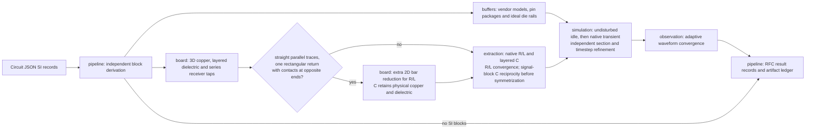
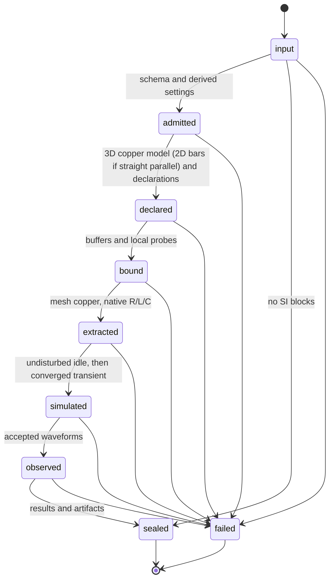

# Signal-integrity pipeline architecture

The public entry consumes Circuit JSON source records from RFC #28. It rejects the
removed modeling option. `pipeline/signals.ts` groups blocks and derives private
settings and native declarations. `pipeline/prepared.ts` runs the existing typed
stage chain after derivation. The lowered transient records are private and never
appear in the new result Circuit JSON.

Module boundaries remain enforced by `check:modules`: modules import one another
through their index, never internals; imports are acyclic; only adapters import
Node facilities. Domain modules return owned artifacts. The pipeline ledger
rejects path collisions and seals files in sorted order. Blocks have separate
artifact prefixes.

`board` owns physical admission and geometry; `buffers` owns vendor source bytes,
pin/model selection and package assembly; `extraction` owns meshes, solver decks,
parsing, passivity and convergence checks; `simulation` owns electrical sources,
node identity and ngspice; `observation` owns interpolation and convergence.
`report` reads sealed artifacts. `adapters` supplies explicit filesystem/process IO.

Tests use TSX for board reproductions. Numerical convergence oracles use analytic
waveforms; those synthetic waveforms are never claimed as native solver evidence.
Tests for the removed straightened-stage, legacy fold and DDR assessment paths were deleted. New shared schemas validate every public result. The RFC intentionally changes the public entry, records and artifact paths.

R/L use the signal-minus-return loop transform. C and G use the ground-referenced primitive signal blocks, with all GND pours and GND-connected conductors held at 0 V. The raw C signal block must pass max|C−Cᵀ|/max|C| ≤ 2.5% before (C+Cᵀ)/2 is passed to the symmetric capacitor writer; records contain total matrices indexed by physical conductors, with P/N entries for differential signals. Dielectric loss is currently zero, so G is the signal block of a zero primitive matrix. The transient uses first-order Gear, tight IBIS tolerances, adaptive native samples, and independent time/section refinement. Each probe must pass both integrated RMS and signed peak tolerances (1% + 1 mV). A failure produces no accepted waveforms.

The runtime imports the shared circuit-json schemas. Local validation must build the sibling RFC branch until circuit-json#983 is released. No absolute local dependency links are committed. TSX tests and examples use the built core directly.

Core#5286 emits JLC preset plating (0.018 mm), preserving explicit imported stackup plating. The native runner uses real core. RFC pours now request ground escape routing with `unbroken`; the differential example uses manual paths and retains its original autorouter reproduction. Degree-two copper paths are joined for native extraction, with intermediate receiver pins exposed at their physical arc-length fractions in the uniform pi model. Branches and cycles remain unsupported. The native capacitance deck models each declared dielectric slab and air outside; conductor/dielectric contacts are emitted once. Numerical acceptance, including reciprocity, remains mandatory. See `native-signal-levels.md` for accepted and rejected evidence.
