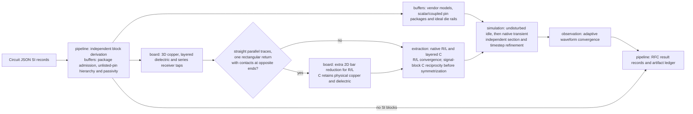
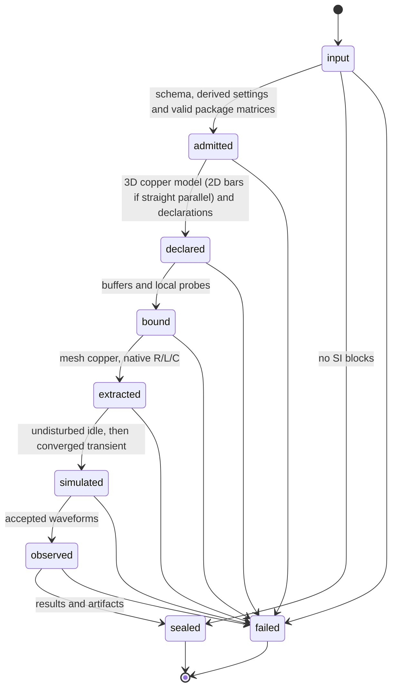
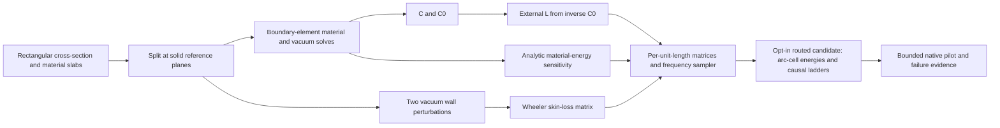
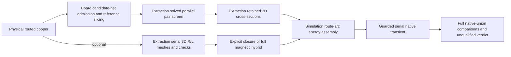
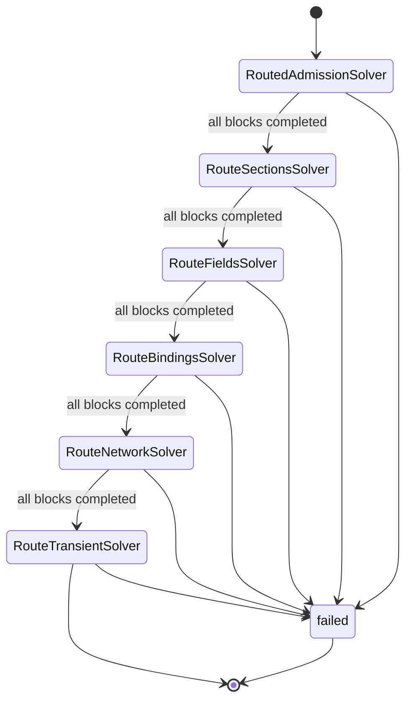
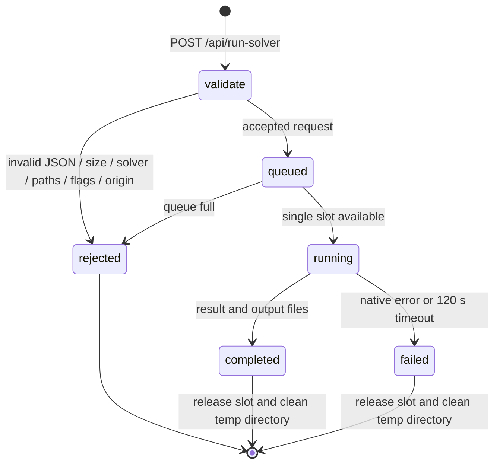

# Signal-integrity pipeline architecture

The public entry consumes Circuit JSON source records from RFC #28. It rejects the
removed modeling option. `pipeline/signals.ts` groups blocks and derives private
settings and native declarations. `pipeline/prepared.ts` runs the existing typed
stage chain after derivation. The lowered transient records are private and never
appear in the new result Circuit JSON.

Module boundaries remain enforced by `check:modules`: modules import one another
through their index, never internals; imports are acyclic; only adapters import
Node facilities. Domain modules return owned artifacts. The pipeline ledger
rejects path collisions and seals files in sorted order. Blocks have separate
artifact prefixes.

`board` owns physical admission and geometry; `buffers` owns vendor source bytes,
pin/model selection and package assembly; `extraction` owns meshes, solver decks,
parsing, passivity and convergence checks; `simulation` owns electrical sources,
node identity and ngspice; `observation` owns interpolation and convergence.
`report` reads sealed artifacts. `adapters` supplies explicit filesystem/process IO.

`buffers/package-model.ts` parses local IBIS package definitions;
`package-matrix.ts` validates the complete matrices and reduces unused floating
pins; `coupled-package.ts` emits the coupled lumped pi circuit. Admission runs
during signal derivation, before extraction. Assembly records selected matrices,
original self terms, unused pins, merged rail associations and the termination policy.
Unlisted pins follow the IBIS scalar hierarchy or implicit merged rail bus rules.
Core only checks declaration/model bindings, capabilities and routing. The converter still
supplies die buffers with its package omitted; the pipeline must then realize
the selected vendor package. See [the electrical contract](coupled-package-model.md).

Tests use TSX for board reproductions. Numerical convergence oracles use analytic
waveforms; those synthetic waveforms are never claimed as native solver evidence.
Tests for the removed straightened-stage, legacy fold and DDR assessment paths were deleted. New shared schemas validate every public result. The RFC intentionally changes the public entry, records and artifact paths.

R/L use the signal-minus-return loop transform. C and G use the ground-referenced primitive signal blocks, with all GND pours and GND-connected conductors held at 0 V. The raw C signal block must pass max|C−Cᵀ|/max|C| ≤ 2.5% before (C+Cᵀ)/2 is passed to the symmetric capacitor writer; records contain total matrices indexed by physical conductors, with P/N entries for differential signals. Dielectric loss is currently zero, so G is the signal block of a zero primitive matrix. The transient uses first-order Gear, tight IBIS tolerances, adaptive native samples, and independent time/section refinement. Each probe must pass both integrated RMS and signed peak tolerances (1% + 1 mV). A failure produces no accepted waveforms.

The runtime imports the shared circuit-json schemas. Local validation must build the sibling RFC branch until circuit-json#983 is released. No absolute local dependency links are committed. TSX tests and examples use the built core directly.

Core#5286 emits JLC preset plating (0.018 mm), preserving explicit imported stackup plating. The native runner uses real core. RFC pours now request ground escape routing with `unbroken`; the differential example uses manual paths and retains its original autorouter reproduction. Degree-two copper paths are joined for native extraction, with intermediate receiver pins exposed at their physical arc-length fractions in the uniform pi model. Branches and cycles remain unsupported. The native capacitance deck models each declared dielectric slab and air outside; conductor/dielectric contacts are emitted once. Numerical acceptance, including reciprocity, remains mandatory. See `native-signal-levels.md` for accepted and rejected evidence.

## 2D extraction and routed candidate

`extraction/cross-section.ts`, exported by `extraction/index.ts`, owns a separate
quasi-TEM numerical interface. It consumes rectangles, infinite solid references,
and dielectric/mask slabs and returns per-unit-length C/C0/L and frequency-dependent
R/G. The staged `RoutedPipelineSolver` now consumes it; see
[routed 2D candidate and execution blockers](routed-2d.md). It is not wired into
the public stage chain above. The root API, 3D extraction,
artifact paths and simulation behaviour remain unchanged. The routed root owns its own single ledger fold after all block stages complete. See
[method, validation and the DDR3 slice demo](2d-cross-section.md).

## Routed coupling and optional finite-return experiments

`board` admits candidate nets within 32 mm for routed 2D. `extraction/route-coupling.ts`
solves parallel pairs before assembling final cross-sections; either normalized
mutual C or L at least 0.5% retains the pair. The cap, 40-conductor guard and
omissions are recorded. This does not alter the public 3D scope.
`extraction/route-return.ts` optionally extracts two serial FastHenry R/L meshes
from the existing two-contact 3D geometry, without native C. `simulation/route-ladder.ts`
adds its passive shared-return closure or replaces series magnetics with full
3D loop R/L. Both modes are explicit unqualified hybrids; they are not automatic
fallbacks or substitutes for a multi-contact return.

## Inspectable routed compiler

Stage classes live with their domain knowledge. Root admission calls
`prepareBlockById`, also used by `prepareBlocks`, once per SI block. Each admitted
block is passed through the same six static top-level stages. The entire
`pipelineDef` exists before admission starts; no step creates stages at runtime.
`RoutedStageSolver` steps each domain algorithm across all admitted blocks in
order, one domain item per step, and publishes an immutable array in admission
order. It is a `BaseSolver`, with no nested pipeline or child debugger rows.
The single `routedStages` tuple supplies the debugger order, tests, artifact
manifest and generated docs below.
Regenerate with `pnpm exec tsx scripts/document-routed-stages.ts`.

<!-- routed-stages:start -->
| # | Stage solver |
|---|---|
| 1 | RoutedAdmissionSolver |
| 2 | RouteSectionsSolver |
| 3 | RouteFieldsSolver |
| 4 | RouteBindingsSolver |
| 5 | RouteNetworkSolver |
| 6 | RouteTransientSolver |

```mermaid
flowchart LR
  s0["RoutedAdmissionSolver<br/>Admit one SI block per step"]
  s1["RouteSectionsSolver<br/>All admitted blocks, one item per step"]
  s2["RouteFieldsSolver<br/>All admitted blocks, one item per step"]
  s3["RouteBindingsSolver<br/>All admitted blocks, one item per step"]
  s4["RouteNetworkSolver<br/>All admitted blocks, one item per step"]
  s5["RouteTransientSolver<br/>All admitted blocks, one item per step"]
  s0 --> s1
  s1 --> s2
  s2 --> s3
  s3 --> s4
  s4 --> s5
  s5 <-->|"await RunSolver"| engine["local native ngspice"]
```

<!-- routed-stages:end -->

`RouteFieldsSolver` owns its geometry-keyed BEM cache; completed snapshots contain
numeric coefficients without Maps or frequency callbacks. `routedSimulation`,
its bulk `extractRoutes` loop and caller-owned field cache are deleted. Segmentation
and ladder generators retain one canonical algorithm, also drained by existing
numerical primitive callers. Network stepping creates one route run's cells;
its final step assembles the coupled global matrices, oblique/via terms and deck.
One BEM solve is atomic. The 40-conductor limit remains enforced. Route-arc
energies store only nonzero entries integrated from common slices, capped at
500,000 entries across R/L/skin/C/dielectric matrices. A non-dominant shunt
requiring dense modal realization separately caps its allocation at 500,000
entries. Neither guard depends on a raw 1,024-cell limit.

Coupled series resistance uses a normalized reciprocal multiport. For
`S = diag(sqrt(Rii))`, its auxiliary node voltages are `x = S I`, its
unit-diagonal conductance matrix is `S^-1 R S^-1`, and opposite VCCS stamps
enforce `V = R I`. This congruence preserves signed mutual resistance and
passivity without dense inversion. Uncoupled rows use ordinary resistors.
The former zero-volt sensors and series CCVS chains lost numerical accuracy
at near-zero Foster voltages on large, weakly anchored neighbour networks.
Replacing that realization deliberately changes routed deck bytes and their
pins; field coefficients, loss poles, topology and solver tolerances stay fixed.

Causal skin loss is one coupled layer, not nine. Every Foster pole scales the
same matrix, so `Z(s) = z(s) S`. Rows without mutual terms keep scalar R || L pole
stages. Coupled rows share one normalized multiport: a series VCCS carries
`I = x / sqrt(Sii)`, the auxiliary KCL is `sum_j Sn_ij u_j = V / sqrt(Sii)`, and a
grounded unit Foster stage sequence gives `u = z(s) x`. The former per-pole multiports
and `K` layers stacked nine copies of the coupling graph, which caused 8.9M LU fill
on the DDR3 deck. Those auxiliary rows have no diagonal, so routed decks set
`pivrel=0.1`. `klu_refactor` reuses the pivots chosen on the first transient
iteration, and the default `1e-3` lets the first time point fail. Measurements are in
`docs/research/ngspice-step-profile.md`.

Completed domain values are copied and frozen. Only the root folds the six stages'
`Produced` artifacts into `ArtifactLedger`; runtime timings stay in `stats`.
Original assumptions, coupling decisions, reference omissions, external ports,
model provenance, node maps, via/oblique policies and deck evidence remain visible.

The site's `Step` input starts at 0 for the initial board, then synchronizes to
stages 1–6, matching table rows 01–06. Entering a number
selects that retained stage until the next pipeline advance. Each flat stage
retains its last completed block's domain solver and final drawing; selecting
an earlier stage never recomputes it. Each domain solver draws its physical input
before its first step. Stage wrappers construct that domain solver when admitted,
and root transitions preview the incoming immutable input before the next step.
Fields preview the first physical cross-section without solving coefficients.
Pending transients show the board with probe marks and empty plot axes; curves
appear only after complete samples arrive. Future stages whose inputs are
incomplete draw the selected copper faintly. Values outside 0–6 are clamped silently; clicking
a table row also selects that stage. Selection lives in fixture component state.
The page starts with this input and the debugger; local asset loading remains,
while only blocking load, backend and solver errors appear inline.

Every stage draws in board millimetres, y up, and draws only what it computes:
selected copper at real width in one bright hue per net, endpoint and probe marks
(dots at drivers, rings at receivers), rail and neighbour copper cut to the
selected-copper focus, section gaps, the amber slice cut, ladder-cell ticks,
violet oblique links and orange via transitions. Fields and transient add an
opaque pane beside the focus (right of a tall focus, below a wide one) for the
to-scale cross-section and the waveform plot. There are no titles, legends or
footers; only Z0 values, axis ticks and a one-line failure reason are written.
Nothing depends on a particular board: camera, colours, sizes and layer side
come from the drawing and the circuit.

`src/board/board-picture.ts` puts the real board under that drawing.
`circuit-to-svg` renders a dimmed top view (soldermask, pads, silkscreen)
through a `viewport` equal to the camera; graphics-debug's SVG export fits the
same camera through an invisible frame, so both layers align to the pixel. The
camera is the drawing's bounds, or the whole board when the drawing is empty,
and each board's last few renders are cached. The site stacks the two SVG layers
and pans or zooms them together; scripts write the combined SVG and PNG. Only
the site, scripts and tests import the module, so `circuit-to-svg` stays a
development dependency outside the library bundle. Neighbour copper and waveform
drawings are capped for display only; numerical inputs and native samples remain
complete.

`RouteTransientSolver` awaits one `solver.invoke` call in `_stepAsync`. Its
self-contained `.save` + `.tran` deck keeps KLU and Gear in native batch ngspice.
Native batch emits ASCII raw vectors (`SPICE_ASCIIRAWFILE=1`). Diagnostics, finite
samples, start and final simulated time are checked before publishing a capture.
Errors leave the stage failed without partial output. Native adapter instances
share a process queue and set OMP_NUM_THREADS=1. Large DDR3 transients remain
unverified. Completion is candidate evidence without independent convergence
qualification. `runPipeline` and the 3D path are unchanged.

Async stepping uses solver-utils PR #62 at `127f17012c7c391005254993864b26801f418249`
through an integrity-locked pkg.pr.new URL. Switch to a release after #62 ships.

### Cosmos development backend

`vite.config.ts` installs `createSolverMiddleware` in Cosmos's Vite renderer.
The Cosmos UI listens on 127.0.0.1:5000; the renderer and API listen on
127.0.0.1:5050. The plugin's config hook overrides Cosmos 6's inline wildcard
host. The renderer URL is explicitly IPv4 loopback, matching the API's Host and
Origin checks. `createHttpSolver` is a browser-safe adapter inside `adapters`;
it adds no Node imports to the fixture graph.

Version probes share the queue, and the existing native adapter enforces
OMP_NUM_THREADS=1. The request cannot override tools or cwd. Local asset reads
are limited to the four known example IBIS filenames under IBIS_MODEL_DIR and
the board file selected by SI_DDR3_BOARD; URLs cannot select filesystem paths.
These assets are loaded at runtime and never part of a published static bundle.
