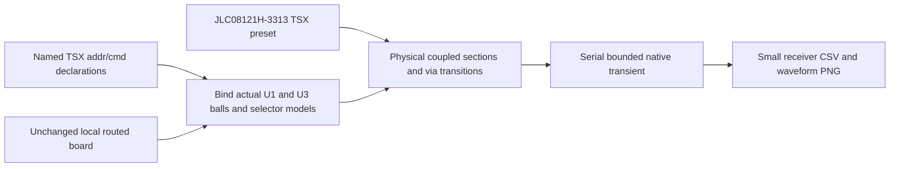

# AM3352 / W631GG6MB addr/cmd experiment

`tests/support/full-board-ddr3.tsx` declares `DDR3_ADDR_CMD` in TSX and maps
U1/U3 ball names onto the caller's unchanged board. The 22 command/address
nets are A0–A12, BA0–BA2, CASn, RASn, CSn0, CKE, ODT and WEn. Both CK legs
are retained as coupled copper too. RESETn is a separate slow control net,
not one of these 22. Nearby physical copper is retained by the existing
scope policy rather than cropped out of the source board.

The fixture supplies the requested `jlcpcb_standard`, eight-layer, 1.2 mm
stackup from a real TSX render: **JLC08121H-3313**, with dielectric thicknesses
0.0994/0.2/0.1088/0.2/0.1088/0.2/0.0994 mm and 0.018 mm via plating.
All existing trace, pad, via and pour records remain identical. The routed
compiler retains the real layer changes, barrel/stub/pad models and local
reference changes. No vendor files or board JSON are committed.

## IBIS selector evidence

The local TI `sprm552c.ibs` SHA-256 is
`23011a68eb8ff35562615b5b108edcb9f017c5e61f4f68e32f35c5fb88f163be`.
The component is `am335x_zcz`; the [Pin] table assigns address/control and
CK/CKn to Selector_4, DQ to Selector_11, DQS positive to Selector_1 and
DQS negative to Selector_6. Reading the actual selector rows resolves the
investigations' conflicting numbers:

| Use | Selected model | Selector-row meaning at 1.5 V |
|---|---|---|
| Addr/cmd | Model_352 | ODT off, **slow**, 1.00×RExt, 5% family |
| DQ write | Model_336 | ODT off, **slow**, 1.00×RExt, 10% family |
| CK and CKn | Model_343 | ODT off, **slow**, 0.88×RExt, 5% family |
| DQS positive | Model_655 | ODT off, **slow**, 0.88×RExt, PADP, 5% family |
| DQS negative | Model_847 | Same ratio/slew/family, **PADN** |

With the TI-recommended 50 Ω calibration interpretation, 1.00×RExt selects
50 Ω and 0.88×RExt selects 44 Ω. These are requested configuration choices,
not a readback of this board's firmware. `343/655/847` are thus suitable for
44 Ω CK/DQS, not 50 Ω DQ/addr. Models 648 and 664 are both **PADP** with
1.00×RExt; they differ in the 10%/5% family and are not a P/N pair.
The old Model_257 row says **slowest**, not slow. Both 336 and 352 occur in
Selectors 4 and 11, so either investigation's distinction by selector alone
was insufficient. The selected tolerance families are recorded explicitly.

Winbond `W631GG6MB-12` maps every command and both clock pins to `CMD`, an
input with 1.2 pF typical die capacitance, package parasitics and clamp I/V.
It supplies no VTT termination. Write DQ/DQS use `ODT_60`; reads would use
`DATA_40`, but this experiment does not implement a read burst.
The TI file has no CK [Diff Pin] entry, so CK/CKn are two explicit complementary
single-ended channels with their actual coupled routes. DQS's existing
0.5 UI write offset remains unchanged.

## Reproduction

With the branch's built local core/props/Circuit JSON/IBIS converter peers
and local vendor files available:

```sh
export OMP_NUM_THREADS=1 TSX_TSCONFIG_PATH=examples/tsconfig.json
export IBIS_MODEL_DIR=models
export SI_DDR3_BOARD=/absolute/path/to/am3352-ddr-track-a-local-dfm-wip-20261007/dist/index/circuit.json
export SI_ROUTE_RUN_DIR=runs/addr-cmd/before
node --import tsx scripts/run-routed-ddr3.tsx addr-cmd
```

The runner finds the requested block **by name** (`SI_ROUTE_BLOCK`), not
array position. Addr/cmd defaults to 400 Mbps (one command per 400 MHz CK
cycle), complementary clock legs to 800 Mbps, and an 8 ns recording.
The explicit duration bounds IBIS switching history too. Default PRBS7 seeds
are deterministic and phase varied, beginning low with the first command
edge at 2.5 ns. `SI_ROUTE_PATTERN=simultaneous` switches the 22 nets together;
`quiet` holds them low while CK switches. These are electrical stress
patterns, not JEDEC command protocol traffic or a DDR timing/eye test.

Each native solve has a single thread, an exclusive ngspice lock, admission
checks for all four native solvers, and the existing 20 minute runtime /
1 GiB sampled memory budget. Raw decks/dumps stay ignored under `runs/`.
The [terminal-control qualification limits](terminal-inductance.md) still
apply: completing this capture cannot certify a whole board or close the
remaining full-wave crosstalk disagreement.


