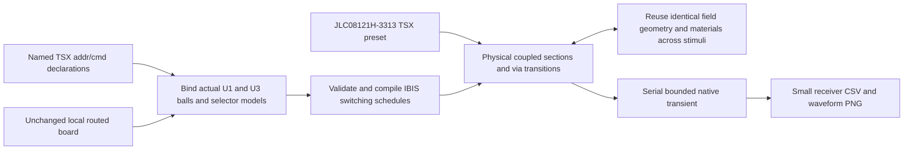

# AM3352 / W631GG6MB addr/cmd experiment

`tests/support/full-board-ddr3.tsx` declares `DDR3_ADDR_CMD` in TSX and maps
U1/U3 ball names onto the caller's unchanged board. The 22 command/address
nets are A0–A12, BA0–BA2, CASn, RASn, CSn0, CKE, ODT and WEn. Both CK legs
are retained as coupled copper too. RESETn is a separate slow control net,
not one of these 22. The source board is unchanged; the capture's recorded
scope determines which nearby copper is admitted to the solver.

The fixture supplies the requested `jlcpcb_standard`, eight-layer, 1.2 mm
stackup from a real TSX render: **JLC08121H-3313**, with dielectric thicknesses
0.0994/0.2/0.1088/0.2/0.1088/0.2/0.0994 mm and 0.018 mm via plating.
All existing trace, pad, via and pour records remain identical. The routed
compiler retains the real layer changes, barrel/stub/pad models and local
reference changes. No vendor files or board JSON are committed.

The full group exposed touching same-net 0.3 mm DDR power strips that had
been left as separate solver rectangles. `route-union` now includes edge
contacts within its existing 0.0000001 mm geometry tolerance in the union.
The TSX regression also verifies that touching **different** nets still fail.
An aligned pair of edges on different layers then exposed floating-point
copies of one dielectric-interface projection. The mesh now coalesces
horizontal coordinates with the same existing tolerance as vertical
boundaries, avoiding microscopic singular panels. Its separate TSX
regression checks physical reflection symmetry of the resulting RLGC.

## IBIS selector evidence

The recommendation itself was checked in SPRACK4's bundled
`AM335x_EMIF_Configuration_Tool.xlsx`, sheet 2: G67–G69 specify slow slew,
and G70–G73 specify 44/50/44/50 Ω for CK, addr/control, DQS and data.
G47–G49 specify RZQ/4, RZQ/4 and RZQ/6 for DRAM RTT_NOM, RTT_WR and
drive impedance. These are recommendations, not a board-register readback.

The local TI `sprm552c.ibs` SHA-256 is
`23011a68eb8ff35562615b5b108edcb9f017c5e61f4f68e32f35c5fb88f163be`.
The component is `am335x_zcz`; the [Pin] table assigns address/control and
CK/CKn to Selector_4, DQ to Selector_11, DQS positive to Selector_1 and
DQS negative to Selector_6. Reading the actual selector rows resolves the
investigations' conflicting numbers:

| Use | Selected model | Selector-row meaning at 1.5 V |
|---|---|---|
| Addr/cmd | Model_352 | ODT off, **slow**, 1.00×RExt, 5% family |
| DQ write | Model_336 | ODT off, **slow**, 1.00×RExt, 10% family |
| CK and CKn | Model_343 | ODT off, **slow**, 0.88×RExt, 5% family |
| DQS positive | Model_655 | ODT off, **slow**, 0.88×RExt, PADP, 5% family |
| DQS negative | Model_847 | Same ratio/slew/family, **PADN** |

With the TI-recommended 50 Ω calibration interpretation, 1.00×RExt selects
50 Ω and 0.88×RExt selects 44 Ω. These are requested configuration choices,
not a readback of this board's firmware. `343/655/847` are thus suitable for
44 Ω CK/DQS, not 50 Ω DQ/addr. Models 648 and 664 are both **PADP** with
1.00×RExt; they differ in the 10%/5% family and are not a P/N pair.
The old Model_257 row says **slowest**, not slow. Both 336 and 352 occur in
Selectors 4 and 11, so either investigation's distinction by selector alone
was insufficient. The selected tolerance families are recorded explicitly.

Winbond `W631GG6MB-12` maps every command and both clock pins to `CMD`, an
input with 1.2 pF typical die capacitance, package parasitics and clamp I/V.
It supplies no VTT termination. Write DQ/DQS use `ODT_60`; reads would use
`DATA_40`, but this experiment does not implement a read burst.
The TI file has no CK [Diff Pin] entry, so CK/CKn are two explicit complementary
single-ended channels with their actual coupled routes. DQS's existing
0.5 UI write offset remains unchanged.

## Reproduction

With the branch's built local core/props/Circuit JSON/IBIS converter peers
and local vendor files available:

```sh
export OMP_NUM_THREADS=1 TSX_TSCONFIG_PATH=examples/tsconfig.json
export IBIS_MODEL_DIR=models
export SI_DDR3_BOARD=/absolute/path/to/am3352-ddr-track-a-local-dfm-wip-20261007/dist/index/circuit.json
export SI_ROUTE_RUN_DIR=runs/addr-cmd/capture-c05-r1 SI_ROUTE_BATCH=1
export SI_ROUTE_CELLS_PER_RISE=0.5 SI_ROUTE_DISTANCE_MM=1
node --import tsx scripts/run-routed-ddr3.tsx addr-cmd
python scripts/summarize-addr-cmd.py "$SI_ROUTE_RUN_DIR"
```

The runner finds the requested block **by name** (`SI_ROUTE_BLOCK`), not
array position. Addr/cmd defaults to 400 Mbps (the DDR3-800 command cadence),
clock legs use 1.25 ns bit slots with **one complementary diagnostic edge**
at 3.75 ns, and the recording is 8 ns. This is not a periodic-clock capture.
Continuous 400 MHz CK is rejected by the existing inactive-tail guard:
Model_343's typical rising-table endpoint has KU=0.98705175, outside its
1% steady-coefficient band. The measured fixture voltages themselves settle
in about 0.695 ns. No tolerance is relaxed and no active edge is interrupted
to get a demo. Buffer compilation now precedes expensive field extraction.
The explicit duration bounds IBIS switching history too. Default PRBS7 seeds
are deterministic and phase varied, beginning low with the first command
edge at 2.5 ns. `SI_ROUTE_PATTERN=simultaneous` switches the 22 nets together;
`quiet` holds them low while CK switches. These are electrical stress
patterns, not JEDEC command protocol traffic or a DDR timing/eye test.
`victim-even` and `victim-odd` alternately hold each parity half of the
declaration order low while the other half runs the same seeded PRBS7.
Those two captures measure quiet-victim crosstalk without conflating it
with a victim's own switching/ringing. They are representative aggressor
patterns, not a worst-case crosstalk bound.

Each native solve has a single thread, an exclusive ngspice lock, admission
checks for all four native solvers, and the existing 20 minute runtime /
1 GiB sampled memory budget. Raw decks/dumps stay ignored under `runs/`.
The [terminal-control qualification limits](terminal-inductance.md) still
apply: completing this capture cannot certify a whole board or close the
remaining full-wave crosstalk disagreement.

The default two-cells-per-rise attempt completed field extraction but needed
1,205 ladder cells, exceeding the unchanged 1,024-cell memory guard. The
bounded capture command above uses 0.5 cells per rise, the existing permitted
minimum. Its spatial convergence is **not established**.

The 32 mm scope retained 541 traces. After the ladder guard was satisfied,
a geometry-only count found **218,036 distinct oblique field sections** and
1,100,446 encounters. The first 12,609 field solves took 562 s, projecting
roughly 2.7 hours for the oblique stage alone. That run was stopped before
native simulation, with completed fields checkpointed outside git.
The bounded capture instead uses a **1 mm lateral coupling radius**,
configured by `SI_ROUTE_DISTANCE_MM` (addr/cmd runner default 1 mm;
`prepareBlocks` itself retains its previous 32 mm 2D default). All 24
selected routes remain, including their layer changes. The radius limits
neighbour admission and oblique encounters; it is not an electromagnetic
error bound. Distant coupling remains an unqualified omission. No native
cell, memory or runtime guard is lifted. Reuse rejects a different scope.

Batch mode runs the main and both quiet-victim experiments **serially** in
one process. An explicit in-memory cache reuses only identical field
geometry/material keys, with matching panel resolution, including oblique
surrogates. Changing stimuli still recompiles the vendor buffers; native
solves are separate. This avoids three repeated ten-minute field passes.

## Validation

The focused TSX fixture, route-contact union, dielectric mesh, terminal
geometry and native control tests pass. The three terminal controls were
also run serially with 16 and 32 sections; their remaining full-wave gate
failures are recorded in `terminal-inductance.md`. The field-cache test
checks exact matrix reuse and rejection at a different panel resolution.
Type checking, lint, module boundaries and vocabulary checks pass (lint
retains the existing cross-section mesh file-length warning).

The full suite reports **217 passed, 29 skipped, one failed**. The failure
is `tests/extraction/mesh.test.ts:20`, the pre-existing FastHenry plane
deck-string assertion. Running that test in an `a732001` source snapshot
with the same runtime reproduces it. Native/model/board tests require
their explicit environment variables; the default suite skips those
external dependencies rather than claiming native validation.


