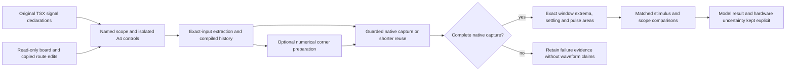

# Addr/cmd qualification and board-fix experiment

This is a qualification of the **simulation candidate**, not a measurement of
the physical PCB. The source board remains read-only. The original result and
all attempted comparisons retain the [terminal-control limitations](terminal-inductance.md)
and [routed-model omissions](routed-2d.md). In particular, ideal die supplies,
approximate oblique coupling, open unmodeled neighbour endpoints, finite pour
edges and the package model's unused-pin reduction remain assumptions.

## Fixed experiment

The baseline is `runs/addr-cmd/capture-c2-r1`, commit `3d547bb`: AM3352
Model_352, Winbond CMD, no VTT, JLC08121H-3313, 1.5 V, 400 Mbps command
slots, deterministic seed-varied PRBS7 and the same two parity quiet-victim
experiments. CK/CKn remain the original complementary diagnostic edge,
not continuous DDR3 clock traffic. The full experiment retains 24 selected
routes; command metrics exclude the two clock legs. No protocol/timing
compliance or functioning DDR interface is inferred from these stress patterns.

The seeds are `32 + (7 * index) % 32`: all command seeds start with bits
`0,1`, so all 22 commands first rise together at 2.5 ns. The quoted first
crests are a coherent simultaneous-switching stress, not a statistical
distribution over a long PRBS traffic run. The complete 8 ns capture includes
later mixed data. All native cases use the same typical vendor corner.

Native solves run serially with `OMP_NUM_THREADS=1`, the exclusive lock,
all-native-solver admission, 1,024-cell guard, 20-minute per-run runtime and
1 GiB sampled native RSS cap unchanged. Incomplete captures, ngspice errors
and budget stops do not enter metric tables. Field-cache reuse requires the
same panel resolution and exact geometry/material keys. Reusing a deck also
requires matching board/vendor hashes, stimuli, duration bound and scope.
What-if transforms are recorded separately and cannot be silently removed
or applied twice during reuse.

Overshoot and undershoot use the nominal 1.5 V rails. Quiet-victim disturbance
removes the pre-edge DC baseline; it includes both routed copper and package
coupling. Settling uses the earlier 5% band and 0.5 ns confirmation/censoring
rule. Pulse area integrates native piecewise-linear samples above 1.5 V or
below 0 V, inserting exact rail crossings and the comparison-window endpoint.
The endpoint is interpolated between recorded samples when necessary; a
requested window beyond the native capture is rejected. Both the largest contiguous lobe
and the complete capture's sum are retained; they are different quantities.
Areas are observed within the stated capture window. A lobe touching its
boundary can continue outside it, so its recorded area is not an upper bound.

## Spatial and coupling-radius checks

The full 818-cell, four-cells-per-rise, 4.999 ns retry was stopped by the
existing runtime projection at 965.030 s (projected 1,201 s), after its last
saved 2 ns checkpoint. Its sampled RSS maximum was 596.234 MiB. It supplies
**no peak, overshoot or crosstalk comparison**.

A TSX subset selects A4, A5, A7, A9, A11 and CASn by their original names,
retaining the original seeds/parity indices and all admitted nearby copper.
Its two/four-cells-per-rise attempts used 218/403 cells. Both ngspice runs
aborted near 2.5 ns with “timestep too small”; code 0 and later control-script
progress echoes do not make them complete captures. The source copper is
unchanged, but nonselected modeled bidirectional pins follow the existing
inactive-pin policy, so this subset is also a different electrical boundary
condition from the full bus. It must not be substituted for a converged
full-bus result.

The geometry-only reduced control declares all 24 original channels and
stimuli in TSX, and reduces only physical copper admission.
All 24 modeled routes are still completely present in the six-net neighbourhood;
the helper rejects a scope that omits any declared quiet channel. It retains
176 traces and 805 vias at 1 mm, versus the full scope's 256/901. This is a
geometrically reduced full-bus stress experiment. Matching its
two/three-cells-per-rise and one/two-mm cases avoids the earlier inactive-driver
confound without changing the switching pattern.

A separate six-aggressor control holds the other 18 drivers low. Its complete
218-cell main capture reaches 1.659537 V maximum (A9); A4 reaches 1.628178 V,
versus 2.024868 V in the original full-bus capture. Its native solve took
202.142 s. This is evidence of switching-activity sensitivity **inside the
model**, not spatial convergence. Its fine-mesh batch was stopped before
starting; the spatial experiment retains the full-bus stimuli instead.

The complete geometry-only two-cells-per-rise main case retains the original
24 stimuli. Its maximum is 2.098165 V (A9), 5.288 mV above the original.
For A4/A5/A7/A9/A11/CASn, peak changes are respectively
+5.623/+6.509/+7.068/+5.288/+2.234/+1.142 mV. The smaller copper admission
therefore retains the large modeled overshoot. This scope check is separate
from cells-per-rise and radius sensitivity. Although the original deck was
compiled for 8 ns and this deck for 4.999 ns, all 48 controller Ku/Kd profiles
agree through the comparison window to 7.9e-13 absolute coefficient units,
for both main and even-victim patterns. `switching-prefix-check.json` retains
that check and both deck hashes.

The reduced full-bus odd-victim capture aborted at 2.5 ns (50.568 s native,
139.859 MiB peak sampled RSS). Later progress echoes are invalid after that
abort. The bounded spatial/radius comparison therefore covers the main pattern
and worst even-victim pattern; odd-victim convergence remains unverified.
The 403-cell four-cells-per-rise main retry was manually stopped at 323.770 s:
its observed 1 ps-to-2 ns CPU rate, scaled against the completed coarse
profile, projected 1,599 s. That heuristic exceeds the per-run 1,200 s budget.
The completed bounded refinement uses three cells per rise on the same scope
and stimuli, without changing timestep, tolerance or native guards.

| Control | Cells | Maximum cell delay | Native main / even-victim time | Main maximum |
|---|---:|---:|---:|---:|
| 2 cells per rise, 1 mm | 218 | 112.640 ps | 404.625 / 432.440 s | 2.098165 V |
| 3 cells per rise, 1 mm | 304 | 75.075 ps | 453.116 / 438.454 s | 2.096157 V |
| 2 cells per rise, 2 mm | 250 | 112.640 ps | 748.863 / 761.627 s | 2.098000 V |

| Net | Fine peak | Peak change, fine minus coarse | Overshoot change |
|---|---:|---:|---:|
| A4 | 2.029161 V | -1.331 mV | -0.089 percentage points |
| A5 | 2.093520 V | -1.321 mV | -0.088 percentage points |
| A7 | 1.992238 V | -2.435 mV | -0.162 percentage points |
| A9 | 2.096157 V | -2.008 mV | -0.134 percentage points |
| A11 | 1.982869 V | -2.217 mV | -0.148 percentage points |
| CASn | 2.025822 V | -0.484 mV | -0.032 percentage points |

In the matched even-victim pattern, A4 remains the largest disturbance:
431.026 to 431.049 mV (+0.023 mV). Across all 11 quiet nets, the largest
absolute peak-disturbance change is 4.562 mV (CSn0). These are completed native
sensitivity results, not extrapolated zero-cell-size errors or hardware
qualification. The large main overshoot and worst A4 crosstalk persist at
the tested refinement. Odd-victim spatial convergence remains unverified.
See the small [spatial receiver overlay](../runs/addr-cmd/qualification/summary/spatial-overlay.png).

Changing the radius from 1 to 2 mm at two cells per rise changes the selected
six main peaks by at most 0.522 mV and overshoot by at most 0.035 percentage
points. Per-net peak changes for A4/A5/A7/A9/A11/CASn are
+0.175/+0.183/+0.142/-0.166/-0.522/+0.257 mV. A4 remains the worst quiet
victim: 431.026 to 430.890 mV (-0.136 mV). The largest quiet-net disturbance
change is +0.739 mV (A2). Both captures completed; this is a measured numerical
sensitivity, not a bound on omitted physics. See the small
[radius receiver overlay](../runs/addr-cmd/qualification/summary/radius-overlay.png).

The intermediate full-bus three-cells-per-rise run used 633 cells and reached
the 4 ns checkpoint, but hit the unchanged 1,200 s native limit before the
requested 4.999 ns end. Full-scope convergence remains **unverified**;
no incomplete capture enters the comparison tables. The native RSS maximum
was 320.828 MiB. This is an execution limit, not evidence that refining the
mesh changes the peaks by zero.

The saved **partial 0-4 ns prefix only** gives the following diagnostic. It
is separate from accepted case metrics and is not a crest-convergence result.
All six original crests occur later than the saved fine checkpoint. Shorter
capture declarations can also change the existing bounded inactive IBIS-tail
policy; this prefix is not a proof of byte-identical switching coefficients.

| Net | Prefix peak change, 633 minus 444 cells | Prefix overshoot change | Original full crest time |
|---|---:|---:|---:|
| A4 | -1.124 mV | -0.075 percentage points | 4.474 ns |
| A5 | -0.998 mV | -0.067 percentage points | 4.430 ns |
| A7 | -0.398 mV | -0.027 percentage points | 4.434 ns |
| A9 | -1.345 mV | -0.090 percentage points | 4.442 ns |
| A11 | +0.539 mV | +0.036 percentage points | 4.343 ns |
| CASn | +0.932 mV | +0.062 percentage points | 4.312 ns |

This partial diagnostic predates the complete reduced-scope refinement above.
It and its timeout provenance are separate in `partial-spatial-prefix.json`.

The full 517-cell, 2 mm radius case also reached only its 4 ns saved
checkpoint: native time 1,200.067 s, sampled peak RSS 402.625 MiB. It provides
no complete peak/crosstalk comparison. The completed reduced radius experiment
uses the geometry-only full-bus control above.

## Driver, package and switching sanity checks

`scripts/addr-cmd-driver.py` reads the typical columns of the local vendor
I/V tables without committing them. At 0.75 V pullup drop, Model_352 sources
15.902691 mA: `R = 0.75 / 0.015902691 = 47.162 ohms`. The pulldown value is
47.164 ohms. A selector's nominal 50-ohm calibration label is not a constant
linear resistance across the entire I/V table.

For an ideal step into an isolated open-ended lossless line,
`Vlaunch = VDD * Zo / (Rdriver + Zo)` and the first far-end arrival is
`2 * Vlaunch`. Solving the *nonlinear* pullup table's launch load line gives:

| Line Zo | Effective driver R at launch | First far-end arrival | Predicted overshoot |
|---|---:|---:|---:|
| 50 ohms | 47.043 ohms | 1.54571 V | 3.047% |
| 65 ohms | 46.569 ohms | 1.74780 V | 16.520% |

The analogous falling-step excursions are 3.196% and 17.227%. These are
**hand estimates**, omitting finite slew, loss, input capacitance, clamps,
vias and packages. They do not explain a 31% inner-net median by themselves.
The existing 2D diagonal integrated L/C proxy is 52.36 ohms for A4 and
59.33/59.83 ohms for A9/A5; these proxies omit transitions and added oblique
C and are not measured or modal impedances.

The selected vendor package has A4-to-A9 mutual L = 3.158 nH, A4-to-A5
2.248 nH, A4-to-A3 2.239 nH and A4-to-BA0 2.270 nH. Simultaneous-switching
package coupling can therefore affect inner and outer routed nets alike.
These are package-model parameters, not extracted PCB coupling. The isolated
A4 TSX control holds **all other 23 drivers low**, including both clock legs.
Package-off replaces only package series R/L with micro-ohm links and removes
package C/mutual terms, keeping vendor die I/V, C_comp, clamp and ideal die-rail
models. Package-off is a diagnostic, not a possible board fix.

| A4 control, full 1 mm copper scope | A4 peak | Overshoot | A4 confirmed settling | Largest other quiet command disturbance |
|---|---:|---:|---:|---:|
| Original full-bus activity, package on | 2.024868 V | 34.991% | See per-net CSV | No quiet command nets in this main pattern |
| A4 alone, package on | 1.538546 V | 2.570% | 1.054 ns | 111.096 mV, A9 |
| A4 alone, package off | 1.540398 V | 2.693% | 0.976 ns | 27.528 mV, A8 |

The isolated packaged result is close to the ideal 50-ohm hand estimate.
Removing package self/coupling terms changes its own peak by only +1.852 mV,
while reducing disturbance on other quiet nets. The large full-bus inner peak
therefore depends on simultaneous interaction. These controls change the
activity deliberately; they are not a proposed quiet-bus board fix. The
[isolated package overlay](../runs/addr-cmd/qualification/summary/isolated-package-overlay.png)
shows A4 driven and A9 held low.

`package-control-check.json` verifies the actual transformed deck: 48 die
capacitance blocks, four ideal die-rail sources and all switching controls
remain identical; no nonideal package R/L/C/K/H elements remain, with 104
micro-ohm series links. The package model itself uses open unused leads,
floating-charge C reduction, neglected unused die loads/circulating currents,
one lumped pi section and ideal die rails. Those [package approximations](coupled-package-model.md)
have no physical board-level error bound here.

The supplemental full-bus package-off 8 ns main and even-victim captures reached
the 1,200 s runtime limit (255.156 / 254.125 MiB sampled maximum RSS), with their
last saved checkpoints at 4 ns. They supply no accepted full-window peak or
noise metric. The supplemental odd-victim capture was skipped after these two
runtime failures. The single 4.999 ns main retry completed in 841.865 s,
using 254.375 MiB sampled maximum RSS. It preserves the original compiled
switching history and all 24 physical nets. Required board-fix comparisons
still use all three original patterns.

| Full-bus first event, 0–4.999 ns | Package on | Package off diagnostic |
|---|---:|---:|
| Largest command peak | 2.092877 V, A9 | 1.675180 V, CASn |
| Median outer overshoot | 27.592% | 10.540% |
| Median inner overshoot | 30.916% | 4.838% |
| A4 peak / overshoot | 2.024868 V / 34.991% | 1.572576 V / 4.838% |

The A4 peak changes by -452.292 mV with only the package network removed.
The [full-bus package overlay](../runs/addr-cmd/qualification/summary/package-off-prefix-overlay.png)
shows this sensitivity. `main-package-control-check.json` verifies that the
entire circuit body equals the package-only transformation of the original;
only transient control duration changes separately. This strongly implicates
package interaction in the simulated inner-net overshoot. It is not a linear
decomposition of nonlinear driver/package/line effects, a package error bound,
or an implementable fix. Full-bus package-off quiet noise remains unverified.

An algebraic check of the emitted original and failed reduced odd-victim
decks found no nonpositive self-inductors or duplicate mutual pairs. For
every mutual-connected component, the normalized L matrix (unit diagonal,
off-diagonal K values) is positive definite; the smallest eigenvalue is
0.339880. No component was skipped. This excludes an indefinite inductor
energy matrix in those two decks, not physical package/model errors.
`inductor-matrix-check.json` retains the deck hashes and counts.

### What the terminal controls can and cannot bound

All saved quiet-victim extrema in both the original and corrected terminal
fixtures **underpredict absolute noise**. Corrected positive-peak errors are
-5.883/-12.983 mV in the tight near/far cases and -2.702/-3.319 mV in the short
cases. The original uncorrected far errors are -21.990 and -3.949 mV. Relative
to the corresponding fine-reference extrema, the largest corrected magnitude
error is 3.685%; including the uncorrected fixtures raises it to 4.384%
(3.949/90.077). `terminal-error-envelope.json` checks positive and negative
extrema, preserving the error sign.

If that larger fractional envelope transferred to A4, it would be 18.83 mV
at 429.42 mV; even hypothetically subtracting it leaves about 410.59 mV. This
is **conditional arithmetic, not a validated board-level error bound**. The
largest saved corrected quiet waveform point error is 15.380 mV, a separate
quantity from the extrema errors. No new openEMS solve is claimed.

The terminal correction is for the referee's explicit vertical current paths.
Ordinary routed BGA pads receive no inferred post; this board keeps its existing
geometry-derived via/barrel/pad/return-loop models. The fixture source,
termination, geometry and excitation differ from this board. No finite general
crosstalk inflation bound follows from those partially agreeing controls.
Radius truncation, oblique surrogates, package assumptions and missing endpoint
loads are not bounded by 18.83 mV. The known terminal errors offer no evidence
that they create a 400 mV spurious noise result.

## Winbond peak and area limits

The local W631GG6MB datasheet A02 (2017-11-23), section 10.12.1, page 121,
was text-extracted and visually checked. The later [Winbond A03 datasheet,
section 10.12.1, page 122](https://media.digikey.com/pdf/Data%20Sheets/Winbond%20PDFs/W631GG6MB_A03.pdf)
has the same limits. These are **address/control** limits, not the smaller
DQ/clock area limits in section 10.12.2.

| Quantity | Verified W631GG6MB value | DDR3-800 qualification |
|---|---|---|
| Peak above VDD / below VSS | 0.4 V / 0.4 V in every listed column | No separate DDR3-800 column; applying the speed-independent peak ceiling is an explicit assumption |
| Addr/control area, DDR3-1333 | 0.40 V ns above / below rails | Verified for the printed column only |
| Addr/control area, DDR3-1600 | 0.33 V ns above / below rails | Verified for the printed column only |
| Addr/control area, DDR3-1866 / 2133 | 0.28 / 0.25 V ns above / below rails | Verified for the printed columns only |
| Addr/control area, DDR3-800 | **Not specified in these copies** | **Unverified; no extrapolated pass/fail** |
| Absolute any-pin voltage | -0.4 to 1.975 V (A02 section 10.1, p.98) | Independent absolute-rating comparison |

At nominal 1.5 V, the printed 0.4 V excursion ceiling corresponds to
1.9 V / -0.4 V. Twelve of the 22 command nets exceed 1.9 V in the saved
before capture, eight exceed 1.975 V, and none falls below -0.4 V. A9 reaches 2.092877 V, 192.877 mV
above 1.9 V and 117.877 mV above the absolute upper rating. A5's largest
positive lobe is 0.495778 V ns; its largest negative lobe is 0.217829 V ns.
A9's *sum* of positive lobes is 0.520941 V ns. A DDR3-800 area-compliance
claim cannot be made from a missing W631GG6MB table column.

In the two quiet-victim captures, the largest absolute range is A4:
-0.397358 to +0.429419 V. Its largest below-ground lobe is 0.195778 V ns.
The negative peak is only 2.642 mV inside the printed -0.4 V ceiling in this
candidate; that small margin does not establish a hardware pass. Quiet
disturbance is measured from its DC baseline, whereas the positive AC
overshoot area is measured above VDD. Its +0.429419 V noise peak is therefore
below the positive overvoltage threshold.

## Physical feasibility and fix classes

`scripts/prepare-addr-cmd-routes.py` copies route data and patches matching
physical copper only. The A10 reference-relief delta is applied to the copied
route data before matching; ignoring it would silently miss A10. Original
board SHA-256 is `a42c0458378a91ac975c72af6e4e2c3c7f5d407ac8fb4fad5ac0434e2b52ecd7`.
No original board, route data or vendor IBIS is written or committed.

| Candidate | Change class | Physical feasibility evidence |
|---|---|---|
| Outer bodies widened from 0.10 to 0.18 mm on all 13 outer command nets, retaining necessary 0.10 mm neckdowns | Trace edit; AI-route-editable | Uniform widening adds 13 pad/trace and one via/trace clearance errors. Local stepped neckdowns around those obstacles restore exactly the original 118 findings. Electrical results use this corrected copy. |
| 50-ohm parallel resistors to ideal 0.75 V VTT at all 22 receiver balls | Components/topology and VTT supply | No route edit; no resistor-pad, escape or regulator/PDN model; clocks excluded. Firmware/board implementation remains separate. |
| Model_345: slow, 1.14 x RExt, 5% family | Firmware/calibration what-if | Selector_4 row verified in the local TI file; register readback/programming not verified. |
| Model_273: slowest, 1.00 x RExt, 5% family | Firmware/slew what-if | Same I/V tables as Model_352; different measured edge tables. Register implementation not verified. |
| BA2 body shifted +0.25 mm over its longest vertical span | Trace edit; AI-route-editable | A4/BA2 centre spacing increases 0.75 to 1.00 mm over their overlapping body; endpoints, layers and vias fixed. BA2 length increases 0.2071 mm. Routing checks retain exactly the original 118 findings, with no new findings. |

Routing checks use the supplied prototype's `@tscircuit/checks` 0.0.268.
The original 118 findings are 95 disconnected-port and 23 via-clearance
findings; “no new findings” does not mean a clean whole board. A preliminary
A4 shift increased A4/A8 spacing without adding findings, but A8 is also quiet
in the worst A4-victim experiment. The final candidate instead moves active
BA2 away from A4. Its BA2 reference-relief delta is applied before matching
the copied route, as well as the A10 delta. This targets a real aggressor/victim
pair; the package mutual terms are unchanged.

The width script uses each reported pad's bounding circle, with 0.75 mm
additional distance along the trace and 0.5 mm for selecting nearby segments.
It inserts explicit constant-width sections and co-located width-step vertices;
there is no unsupported linear taper. Narrow lengths are 4.095 mm (CSn0),
3.629 mm (CASn), 7.531 mm (A10) and 10.942 mm (RASn). Source paths, endpoints,
layers and vias stay fixed. Synthetic tests check width-step length/endpoints
and layer isolation; the routing check uses the actual copied board. The final
copy SHA-256 is `a47befc73e97330db43da0415278042cd51692b0790fd119ac344673a1ba884f`.
The copied route data's `point_widths_mm` is local review metadata. The actual
stepped-width `circuit.json` copy is what the solver and routing checks consume;
integration of variable-width data into the upstream route schema is not shipped.

The full-geometry width copy has 455 cells. Its 8 ns main and even-victim
captures reached the 1,200 s guard (265.188 / 263.969 MiB sampled native maxima)
with their last saved checkpoint at 4 ns; neither enters accepted metrics.
The newly started 8 ns odd-victim capture was stopped after those failures,
before two minutes elapsed. All three width patterns are retried over
0–4.999 ns using their original compiled 8 ns switching histories and copied
full copper geometry. This is a first-event comparison against the matching
before prefixes; later width behavior remains unverified.
In the original completed 8 ns captures, every main-pattern command positive
peak and every quiet-victim absolute maximum already occurs within this prefix; the comparison
is recorded in `before-window-coverage.json`. Later main-pattern undershoot
does occur outside it; the odd-victim pattern also has a per-net positive
peak 0.985 mV higher later. This coverage check does not bound later candidate
peaks or make the short-window areas complete pulses.

The width main retry completed in 1,092.119 s with 264.453 MiB sampled native
maximum RSS. All following values compare the same 0–4.999 ns first event:

| Main-pattern metric | Before | Width correction |
|---|---:|---:|
| Largest command peak | 2.092877 V, A9 | 1.994739 V, A4 |
| Median outer overshoot | 27.592% | 21.657% |
| Median inner overshoot | 30.916% | 29.271% |
| A5 outer peak | 2.088331 V | 1.979272 V |
| A4 inner peak | 2.024868 V | 1.994739 V |

The [width receiver overlay](../runs/addr-cmd/qualification/summary/width-overlay.png)
shows a modest improvement, with substantial inner ringing remaining. Even
the first-event maximum remains 19.739 mV above the absolute upper rating.
The even-victim retry completed in 1,111.028 s with 263.078 MiB sampled native
maximum RSS. Its full-geometry, first-event noise comparison is:

| Even-victim metric, 0–4.999 ns | Before | Width correction |
|---|---:|---:|
| Worst quiet absolute disturbance | 429.418 mV, A4 | 427.458 mV, A4 |
| Median quiet absolute disturbance | 260.057 mV | 239.029 mV |
| A4 positive peak | +0.429419 V | +0.408483 V |
| A4 negative peak | -0.397358 V | -0.427458 V |
| A4 observed below-ground lobe | 0.195778 V ns | 0.210368 V ns |

Worst noise barely changes, while the negative excursion worsens by 30.100 mV
and crosses -0.4 V. The width overlay includes this held-low waveform in mV
relative to DC. The odd-victim retry also completed, in 1,136.492 s with
263.266 MiB sampled native maximum RSS; its worst quiet disturbance is
388.276 mV on A7, versus 399.576 mV before. Across both parity experiments,
median quiet noise changes from 259.768 to 242.167 mV, while the maximum
changes from 429.418 to 427.458 mV. All three width first-event captures are
complete. `width-prefix-check.json` verifies identical circuit bodies and
original switching profiles between each 8 ns compilation and shorter retry.
Width behavior after 4.999 ns remains unverified.

TI explicitly says a [single-x16 point-to-point AM335x DDR3 connection does
not require VTT](https://www.ti.com/lit/an/sprabn2a/sprabn2a.pdf), while discussing
VTT for larger topologies. The requested ideal receiver-ball termination is
therefore a topology what-if, not evidence that TI requires a fly-by/VTT
redesign of this board. Static VTT load, level swing and power must accompany
any ringing reduction; no regulator performance is simulated here.

At the original 10 ps maximum step, all three ideal-VTT patterns abort
numerically at their first 2.5 ns command transition. The guard rejects the
ngspice error despite process exit code zero and later control-script progress
echoes. These captures supply no accepted peak, area or noise result. A bounded
control-corner experiment is prepared for after the independent sweep. The
generated Ku/Kd controls splice their small initial measured mismatch onto
the held state over 1 fs. The prototype moves only that preceding flat-state
point to 1 ps before the edge, preserving every measured edge timestamp and
coefficient. Four synthetic tests verify these invariants, including a redundant
flat PWL guard; they do not prove
native convergence or physical accuracy. A successful VTT capture would need
a matched before control with the same numerical preparation. VTT is not yet
ranked as a demonstrated improvement.

The Model_345 main capture completed the original 8 ns window in 1,006.650 s,
using 239.266 MiB sampled native maximum RSS. Its largest peak is 1.986697 V
on A9; median outer/inner overshoot is 21.013% / 24.068%. A4 peaks at
1.913228 V, versus 2.024868 V before. The same global peak and group medians
occur in the matched first-event prefix. The
[weaker-drive overlay](../runs/addr-cmd/qualification/summary/weak-overlay.png)
shows the complete 8 ns main capture. The maximum remains 11.697 mV above the
absolute upper rating. Its even-victim capture also completes the full 8 ns,
in 1,030.198 s with 238.328 MiB sampled native maximum RSS. A4 quiet noise
falls from 429.418 to 376.330 mV, its minimum changes from -0.397358 to
-0.358066 V, and even-pattern median noise falls from 260.057 to 229.207 mV.
The odd-victim capture completes in 1,004.711 s with 238.172 MiB sampled native
maximum RSS. Its worst quiet disturbance is 355.289 mV on A7. Across both
quiet patterns, worst noise falls from 429.418 to 376.330 mV and median noise
from 259.768 to 227.278 mV. These global noise metrics and main peaks are the
same in the matched 4.999 ns prefixes. This candidate improves both peak and
noise more than width correction in that event; actual firmware/calibration
implementation remains unverified.
`driver-passive-control-check.json` verifies that both compiled driver-row
what-ifs retain exactly the original PCB and package elements. It is a circuit
control check, separate from waveform acceptance.

The Model_273 slowest-slew main capture completes 8 ns in 946.509 s, with
238.844 MiB sampled native maximum RSS. Its maximum is 2.028645 V on A9;
A4 reaches 1.966262 V. Median outer/inner overshoot is 24.425% / 27.526%.
The even- and odd-victim captures also complete 8 ns. Worst quiet disturbance
is respectively 361.592 mV on A4 and 342.166 mV on A7. Across both patterns,
median quiet noise is 217.492 mV and worst noise is 361.592 mV, versus
259.768 / 429.418 mV before. These main and aggregate noise metrics also occur
in the matched first-event prefixes. The
[slowest-slew overlay](../runs/addr-cmd/qualification/summary/slowest-overlay.png)
shows the full 8 ns comparison. Slower slew lowers worst quiet noise more than
Model_345, but leaves a higher maximum driven voltage. Its A4 largest positive
lobe is 0.431916 V ns versus 0.444789 before: lower peak height does not imply
an equally large decrease in area. The register mapping remains unverified.

The spacing main and even-victim prefixes complete in 314.640 and 679.525 s,
with 238.484 and 238.172 MiB sampled native maximum RSS. The maximum driven
peak is 2.092926 V, only 0.049 mV above before. Median outer/inner overshoot is
27.587% / 30.945%. A4 worst quiet disturbance is 429.279 mV versus 429.418 mV
before; its minimum is -0.397692 V. These changes do not demonstrate a useful
remedy. The [spacing overlay](../runs/addr-cmd/qualification/summary/spacing-overlay.png)
shows the matched 4.999 ns comparison. The odd-victim prefix remains pending;
there is no combined two-pattern spacing result yet.

## Reproduction and validation

All declarations and selectors originate in `tests/support/full-board-ddr3.tsx`.
Set `SI_DDR3_BOARD` and `IBIS_MODEL_DIR` to local read-only inputs. The staged
runner `bash scripts/run-addr-cmd-qualification.sh <stage>` runs serial native
experiments, retains individual failures and continues independent patterns,
then returns nonzero if a capture failed. Stages include `refine`, `radius`,
`scope-refine`, `scope-fine`, `scope-radius`,
`isolate`, `package-off`, `width`, `vtt`, `weak`, `slowest`, `spacing`,
`width-prefix`, and `spacing-prefix`.
`refine-reduced` preserves the original signal-removal reproduction of the
inactive-buffer failure; it is not the corrected quiet-driver control.
The width/spacing stages require the copied boards prepared with
`scripts/prepare-addr-cmd-routes.py`; use `--width .18` or `--spacing .25`, plus
`--route-delta <source-folder>/data/cloud-a10-trace-reference-delta.json`.
The spacing stage additionally needs `--spacing-net BA2` and
`--route-delta <source-folder>/data/cloud-ba2-trace-reference-delta.json`.
Prepare the uniform width copy and run the prototype routing check first;
pass that report as `--neckdown-clearance-report <drc-width.json>` when
preparing the final width copy. `python3 scripts/prepare-addr-cmd-routes.test.py`
runs the independent synthetic profile tests without native tools.
Use the source's `data/cloud-ddr-routes.json` as the route-data input.
An optional `SI_ROUTE_FIELD_CACHE` points to a local saved geometry cache;
vendor data and large decks/fields stay ignored under `runs/`.

The bounded copied-route stages compile missing 8 ns histories without native
execution, then reuse each over 4.999 ns. Existing compilations must pass the
same exact-input reuse checks. After preparing the copied boards:

```sh
bash scripts/run-addr-cmd-qualification.sh width-prefix
bash scripts/run-addr-cmd-qualification.sh spacing-prefix
```

The summary script takes a JSON manifest of complete case directories and
comparison windows. It rejects incomplete native captures and writes compact
metrics, provenance and optional receiver overlays. Synthetic triangle and
split-lobe checks verify exact rail-crossing integration; these checks are
not native circuit evidence.
`scripts/summarize-addr-cmd-qualification.test.py` adds three analytical window
checks. The reproduction exposed up to 4.983 ps missing from the sliced before
prefix. Interpolating its endpoint corrects prefix areas without changing the
main first-event peaks or quiet-noise extrema. The complete 8 ns before areas
are unchanged. These are post-processing corrections, separate from native
solver qualification.

Lint, module rules, vocabulary and typecheck pass; lint retains the existing
535-line `src/extraction/mesh.ts` warning. With
`TSX_TSCONFIG_PATH=examples/tsconfig.json pnpm test`, 219 tests pass, 32 skip,
and the pre-existing `tests/extraction/mesh.test.ts:20` FastHenry plane-deck
assertion fails. The opt-in real-board scope/control file has four passing
tests; the copied-width profile file has two passing synthetic tests.
One stage-shell parse error occurred after both fine native captures had
completed; `orchestration-note.json` distinguishes that runner-edit error from
native failures. The runner was syntax-checked and frozen before subsequent
stages. `guard-failures.json` retains rejected captures separately from the
accepted metrics and compact provenance.
The spacing full-window main run records a late timeout at 1,258.792 s despite
the unchanged 1,200 s timer. Its rejected record is retained; timer delay is
not validated as a physical circuit effect. The remaining full-window spacing
batch was stopped after its native failure and lock cleanup. The bounded
prefix retry runs under a temporary idle-sleep assertion. This does not change
the solver or its admission, memory and runtime guards.
Stopping the width batch also left its exclusive lock behind. That lock
correctly denied six subsequent attempts before any native solver started.
`stale-lock-note.json` records those attempts and recovery after verifying
the owner and all native processes had exited; none contributes metrics.


