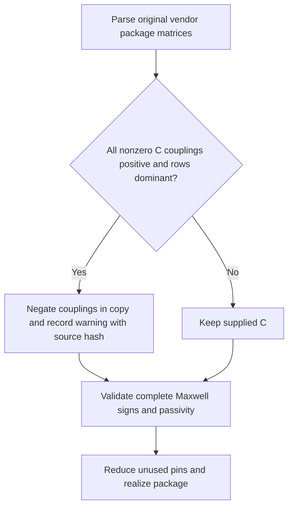

# Coupled IBIS package contract

The parser follows [IBIS 5.1 section 7](https://ibis.org/ver5.1/ver5_1.pdf#page=129).
The sign rule also appears in the AM335x file's own revision, IBIS 4.1.
Vendor bytes remain local in ignored `models/` and are never copied into fixtures.

## Specification decisions

### Capacitance signs

[IBIS 4.1 section 7, RLC Matrix Notes, printed page 121](https://ibis.org/ver4.1/ver4_1.pdf#page=121)
states:

> Note that Kij ( when i /= j) will be a negative number and should be entered as such.

[IBIS 5.1 section 7, page 135](https://ibis.org/ver5.1/ver5_1.pdf#page=135)
retains this rule. These are Maxwell coefficients, not positive mutual capacitor
magnitudes. [IBIS 6.1 section 7, pages 147–148](https://ibis.org/ver6.1/ver6_1.pdf#page=147)
also specifies nonnegative diagonal coefficients and diagonal dominance for C.
The SPICE pair capacitor is therefore `-C_ij`, and its capacitance to the reference
is `C_ii + sum(C_ij, j != i)`.

The user-approved vendor correction accepts exactly one non-Maxwell convention:
every nonzero off-diagonal entry is positive **and** each diagonal is at least
the sum of absolute off-diagonal entries in its row. The pipeline negates those
off-diagonal entries in a copy, then runs the existing full-matrix Maxwell sign
and passivity checks before reduction. Mixed signs, non-dominant rows, nonfinite
values and nonpassive matrices still fail explicitly. An all-zero off-diagonal
matrix needs no correction. Vendor bytes and their source SHA-256 stay unchanged.

The warning is logged during preflight and conversion, and retained in admission
error diagnostics, compiled buffer warnings, assembly JSON and result limitations. It names the declared IBIS file, original SHA-256,
package model and number of symmetric matrix entries negated. The local TI
`am335x_zcz` has 175 diagonally dominant rows and 15,225 positive pairs:
**30,450 entries** are corrected. H4 has diagonal 1.19047 pF and off-diagonal
magnitude sum 0.61153091044 pF; the smallest row margin is 0.05923748524 pF (P1).
This is an explicit interpretation of vendor magnitudes, not a modification to
the IBIS standard or a claim of vendor confirmation.



### Pins absent from the matrix definition

[IBIS 7.2 section 7.3, `[Pin Numbers]`, page 181](https://ibis.org/ver7.2/ver7_2.pdf#page=181)
explicitly permits a package definition to cover only part of a component's pin
table. For unlisted pins, its hierarchy instruction includes this exact excerpt:

> the EDA tool is expected to use the RLC values from the [Pin] or [Package] keywords

The complete rules also appear in [IBIS 6.1 section 7, pages 142–143](https://ibis.org/ver6.1/ver6_1.pdf#page=142).
Ordinary unlisted pins use each specified R_pin/L_pin/C_pin; a missing or NA value
uses the corresponding [Package] default. Pins listed in the matrix retain their
matrix data. This is the specification's per-pin precedence rule, **not a silent
scalar fallback for missing, unsupported or invalid coupled data**. Such coupled
definitions still fail explicitly.

For a POWER/GND bus declared by [Pin Mapping], unlisted bus members are instead
shorted at the board side to the first member in [Pin Numbers] order, when that
bus has any listed member. That member's merged package data is used, including
when the merging member itself was not explicitly mapped by TSX. Its row is kept
in the selected matrices. If no member is listed, the scalar hierarchy applies.
Explicit [Merged Pins] sections remain unsupported and fail in parsing.

AM335x has no [Pin Mapping] section, no rail rows in its package matrix, and no
individual [Pin] R/L/C values for E5 (VDDS_DDR) or A1 (VSS). Both therefore use the
[Package] typical defaults: 0.163002954285714 ohm, 4.14298268571429 nH and
1.2259796 pF. The ideal die rails remain behind these parasitics.

## Parsing and explicit limits

Each selected local [Define Package Model] requires Manufacturer, OEM,
Description, Number Of Pins, Pin Numbers, Model Data, inductance and capacitance
matrices, End Model Data and End Package Model. The optional resistance matrix
defaults to zero. Metadata, names, counts, unique definitions, matrix sizes and
required ordering are checked. Keywords accept spaces or underscores and are
case insensitive; pin/model names remain case sensitive. The package parser
recognizes Comment Char and standard IBIS numeric suffixes; the pinned die-buffer
parser independently rejects non-pipe comment characters. External `.pkg` lookup
is unsupported and fails explicitly if the named local definition is absent.

Full_matrix stores the diagonal and upper triangle, not N values per row.
Sparse_matrix stores one named column/value pair per line, with unspecified
entries zero. Sparse column order within a row need not be sorted, but every
column must be on/above the diagonal in **Pin Numbers order**, never lexical
order or an invented one-based numeric index. All formats require Row blocks
in the declared pin order.

Banded_matrix requires Bandwidth before rows. Ordinary row lengths are
`min(B+1, N-i)` with zero-based row `i`. Circular bands have B+1 values in every
row, with columns past N wrapping to the first pins; `B <= floor((N-1)/2)` prevents
duplicates. Consistent row lengths distinguish the forms (B=0 is identical).
Mixed/truncated row lengths are errors. Full/Banded continuation lines are supported.

Number Of Sections and section syntax under Pin Numbers (Len, L/R/C, slash,
Fork/Endfork) are explicitly unsupported, even for one section. They are never
misread as pin labels or reduced to scalar data.

## Selection and unused pins

Every mapped signal participates, including quiet/steady neighbors, together
with mapped power/ground references and any required merging pins. Converter
terminals are permuted explicitly from package order. Matrix metadata identifies
selected rows, scalar-only pins remain in mappedPins, and mergedPins records
unlisted-to-merging-pin associations. One shared pulldown reference per chip is
required; independent ground banks remain unsupported.

Unused matrix leads are externally open and have no modeled die load or drive.
For series terms, `I_unused = 0`, so R and L use principal submatrices. For
floating electrostatic conductors, incremental net charge is zero, so retained C
is `C_ss - C_su * inverse(C_uu) * C_us`. Sequential symmetric elimination avoids
forming an inverse. Principal C would instead clamp omitted conductors to AC ground.

This low-frequency open-lead approximation neglects unused external terminations,
die capacitance/clamps, switching and resonant circulating currents along internal
stubs. It is not exact broadband elimination. Pins needed for those effects must
be explicitly mapped. Selected matrices, unreduced self terms, unused pin names
and termination policy are recorded in assembly metadata.

## Passivity and SPICE realization

Complete source matrices, including unused blocks, are checked before reduction.
A diagonal-scale normalized LDL check requires R positive semidefinite and L/C
positive definite; extracted L/C are checked again. The relative pivot threshold
is 1e-12. Singular/nearly singular L/C, including reference-free semidefinite C,
remain an explicit implementation limit. Non-finite data fails. C off-diagonals
must be nonpositive and every row sum nonnegative.

The circuit is one lumped pi section per selected package pin:

- Self R is series resistance. Zero-volt sources sense board-to-die current;
  signed current-controlled voltage sources realize off-diagonal R.
- Self L uses inductors with positive terminals facing the board.
  Signed `K_ij = L_ij / sqrt(L_ii * L_jj)` realizes mutual inductance.
- Pair capacitance is `-C_ij`; reference capacitance is the row sum. Both are
  split equally between board and die ends. This is an explicit lumped placement
  approximation; IBIS matrices do not specify the distributed lead profile.

POWER/GND die nodes retain ideal voltage sources behind their packages. Scalar
and matrix element names are disjoint. Merged rail aliases share a single die
rail source, and incompatible rail voltages fail. Pin-value comparison warnings
use the original matrix diagonal, before floating-pin reduction. Missing coupled
definitions never enable the scalar path. Components without Package Model retain
their existing scalar package behavior.

## DDR3 admission evidence and remaining blockers

Core checks declarations, pin/model binding, roles, differential identity and
routing. It no longer rejects Package Model or parses numerical package data.
Channel receiver model overrides survive the additional on-net pin scan.
The pipeline owns package parsing, validation and realization.

```sh
# Build the sibling core with its package.json build script first: bun run build
IBIS_MODEL_DIR=models TSX_TSCONFIG_PATH=examples/tsconfig.json \
SI_CORE_MODULE="$(cd ../core && pwd)/dist/index.js" \
node --import tsx scripts/check-ddr3.tsx
```

The unchanged, routed DDR3 TSX renders through real core: nine signals,
14 traces, 16 vias and two pours. Original vendor package bytes now pass
preflight with the production warning. TSX buffer-conversion tests cover package
realization and checked [inactive-tail scheduling](ibis-switching.md).
`scripts/check-ddr3.tsx` records source hashes, waveform inspection, correction
warnings and actual stage/error evidence in ignored `runs/ddr3-boundary.json`.
The old source rewrite and `SI_DIAGNOSTIC_MAXWELL_SIGNS` option are deleted.
With the new copper scope, this cropped example's nearby VDDQ rail copper
and plane are explicit multi-net extraction limits at declare (the first error
is two routed rail traces); the diagnostic records the boundary instead
of claiming bind passed. No native solver is invoked.

The full source board, DQM0 addition, spatial neighbour scope, geometry inventory
and ordered remaining admission gates are documented in [full-board-ddr3.md](full-board-ddr3.md).

Inline TSX tests use original small fixtures. The opt-in package-only ngspice
AC oracles check full R, signed mutual L and Maxwell C against their equations,
and validate mixed scalar/matrix and merged-rail netlists:

```sh
SI_TEST_PACKAGE_NGSPICE=1 node --import tsx --test tests/buffers/coupled-package.test.tsx
```
