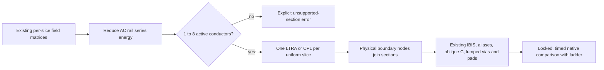

# Distributed routed line research

This spike adds `compileRouteCpl(input)` without changing the routed pipeline's
default ladder. Its coefficients and native results are research candidates.

## Device constraints

The [ngspice manual](https://ngspice.sourceforge.io/docs/ngspice-manual.pdf),
sections 6.2 and 6.4 (version 47+, September 2026), documents CPL for at most eight
conductors, constant losses and transient analysis only. TXL is its single-line
relative. LTRA handles one uniform line with RLC, RC, LC or RG parameters;
general nonzero RLGC combinations are explicitly unsupported. LTRA interpolation,
history compaction and timestep controls trade accuracy for runtime.

`Pname in1 ... inN 0 out1 ... outN 0 model` references
`.model model CPL length=<metres> R=... L=... G=... C=...`. Coefficients use SI
units per metre and Maxwell C (negative mutual entries). Contrary to the manual's
diagonal-only R/G wording, [ReadCpL in the current source mirror](https://github.com/imr/ngspice/blob/master/src/spicelib/devices/cpl/cplsetup.c#L425-L443)
reads **all four** matrices as row-major upper triangles: 11, 12, 13, 22, 23, 33
for three conductors. It reflects them symmetrically and clamps every R entry,
including zero mutual entries, to at least 1e-4 ohm/m. This input layout does not
establish support for arbitrary coupled R/G physics: modal construction uses
diagonal loss terms. The research emitter uses diagonal DC R and G=0.

There is no frequency-dependent R, skin-effect or dispersive dielectric input.
Dropping the ladder's causal skin/Foster and dielectric/Debye networks changes
the physics, even if distributed delay is more accurate. A fixed-frequency loss
fit would require a separate accuracy study and would alter DC behavior.

[CPLload](https://github.com/imr/ngspice/blob/master/src/spicelib/devices/cpl/cplload.c#L55-L61)
quantizes its stored history to integer picoseconds. Its
[delay check](https://github.com/imr/ngspice/blob/master/src/spicelib/devices/cpl/cplload.c#L116-L140)
can reduce the global maximum step to 90% of a section's modal delay. Consequently
chaining tiny sections can be both slow and inaccurate; sub-picosecond geometry
requires particular attention. Padé/modal approximation, nearly degenerate
modes, DC initialization and shared junctions also require native validation.
The eight-line limit is independently fixed by
[`MAX_CP_TX_LINES`](https://github.com/imr/ngspice/blob/master/src/include/ngspice/swec.h#L32).

## Spike workflow

Conductor sets may change at each boundary. Existing physical coordinate node
identity connects continuing wires and branches; no modal basis is propagated
between sections. Grounded rails use the same L Schur reduction as the ladder;
C uses the active principal block. Bends join at actual endpoints, retaining the
existing omission of bend excess capacitance. Vias and pads retain their lumped
transitions. Oblique C is still placed at the nearest available node; with only
section ends this placement changes and remains unqualified. Hybrid return
matrices and sections above eight active conductors fail explicitly.

## Native evidence

Benchmarks are pending in the initial draft. Vendor IBIS, board records, decks,
raw samples and execution logs stay in the requested external evidence directory.
No native accuracy or runtime claim is made by the initial compiler tests.
