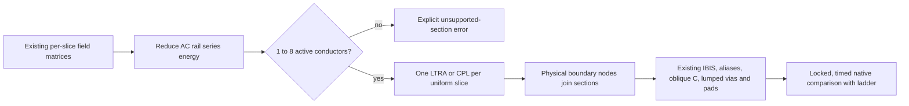

# Distributed routed line research

This spike adds `compileRouteCpl(input)` without changing the routed pipeline's
default ladder. Its coefficients and native results are research candidates.

## Device constraints

The [ngspice manual](https://ngspice.sourceforge.io/docs/ngspice-manual.pdf),
sections 6.2 and 6.4 (version 47+, September 2026), documents CPL for at most eight
conductors, constant losses and transient analysis only. TXL is its single-line
relative. LTRA handles one uniform line with RLC, RC, LC or RG parameters;
general nonzero RLGC combinations are explicitly unsupported. LTRA interpolation,
history compaction and timestep controls trade accuracy for runtime.

`Pname in1 ... inN 0 out1 ... outN 0 model` references
`.model model CPL length=<metres> R=... L=... G=... C=...`. Coefficients use SI
units per metre and Maxwell C (negative mutual entries). Contrary to the manual's
diagonal-only R/G wording, [ReadCpL in the current source mirror](https://github.com/imr/ngspice/blob/ngspice-47/src/spicelib/devices/cpl/cplsetup.c#L466-L482)
(tag `ngspice-47`, commit `a80f6e3`) reads **all four** matrices as row-major upper triangles: 11, 12, 13, 22, 23, 33
for three conductors. It reflects them symmetrically and clamps every R entry,
including zero mutual entries, to at least 1e-4 ohm/m. This input layout does not
establish support for arbitrary coupled R/G physics: DC branch initialization
uses diagonal R. The research emitter uses diagonal DC R and G=0.

There is no frequency-dependent R, skin-effect or dispersive dielectric input.
Dropping the ladder's causal skin/Foster and dielectric/Debye networks changes
the physics, even if distributed delay is more accurate. A fixed-frequency loss
fit would require a separate accuracy study and would alter DC behavior.

[CPLload](https://github.com/imr/ngspice/blob/ngspice-47/src/spicelib/devices/cpl/cplload.c#L62-L68)
quantizes its stored history to integer picoseconds. Its
[delay check](https://github.com/imr/ngspice/blob/ngspice-47/src/spicelib/devices/cpl/cplload.c#L132-L150)
can reduce the global maximum step to 90% of a section's modal delay. Consequently
chaining tiny sections can be both slow and inaccurate; sub-picosecond geometry
requires particular attention. Padé/modal approximation, nearly degenerate
modes, DC initialization and shared junctions also require native validation.
The eight-line limit is independently fixed by
[`MAX_CP_TX_LINES`](https://github.com/imr/ngspice/blob/ngspice-47/src/include/ngspice/swec.h#L32).

## Spike workflow

Conductor sets may change at each boundary. Existing physical coordinate node
identity connects continuing wires and branches; no modal basis is propagated
between sections. Grounded rails use the same L Schur reduction as the ladder;
C uses the active principal block. Bends join at actual endpoints, retaining the
existing omission of bend excess capacitance. Vias and pads retain their lumped
transitions. Oblique C is still placed at the nearest available node; with only
section ends this placement changes and remains unqualified. Hybrid return
matrices and sections above eight active conductors fail explicitly.

## Native evidence

Measured with local ngspice 47 (KLU), `OMP_NUM_THREADS=1`, the shared
`ngspice-lock.sh`, and a hard native deadline on every invocation. Wall time
excludes lock waiting. These are single observations, not repeated statistical
benchmarks. Probe differences use linear interpolation at the union of actual
adaptive native timestamps. Differences include changed losses, spatial
resolution and oblique placement; they do not isolate CPL's numerical error.

| Experiment | Max probe difference | Ladder wall s | CPL/LTRA wall s | Ladder deck bytes | CPL/LTRA deck bytes |
|---|---:|---:|---:|---:|---:|
| TwoTraceBoard, 0–40 ns | 15.439 mV | 0.287 | 0.189 | 38,450 | 23,656 |
| level1-differential physical board, 0–400 ns | unavailable: incomplete | 0.132 | 120.016, timed out | 33,438 | 24,882 |
| DDR uniform two-conductor section, 0–1 ns | 51.037 mV | 0.267 | 0.046 | 167,931 | 826 |

The differential board's copper and vendor models are unchanged; the benchmark
changes its declared experiment to 10 Mbps/400 ns. Its distributed network has
one CPL and 17 LTRA sections. After the 120 s cap, only 18,162 complete samples
through 4.846 ns were written. This partial startup is not a complete switching
comparison. The ladder completed all 400 ns with 408 points. The mixed chain's
shortest single-line segment is 0.25 mm, and history/convolution cost makes this
direct section-per-slice mapping impractical here.

A separate 30 s diagnostic changed those single-line LTRA devices to TXL, using
the same constant R/L/C and lengths. It aborted after 16.669 s at 18.935 ns with
`timestep too small`; the last raw samples had divergent voltages around 1e272 V.
TXL is therefore not an established fallback. This diagnostic is not the emitter
or a completed accuracy comparison.

The DDR fixture uses the **actual extracted matrices** of the longest supported
uniform two-conductor section (29.0200011 mm). It has a 1.5 V pulse with a 100 ps
edge, a 50-ohm source on each conductor, and 50-ohm loads. These are synthetic
test terminations, not IBIS-driven full-route or full-system evidence. The
ladder has 42 cells and 210 K terms; CPL has one distributed section. The 545
ladder samples average 0.490 ms/sample and 520 CPL samples average
**0.0880 ms/sample** including process startup. This is much below the supplied
full-scope ladder baseline of approximately 6 s/step, but the scope and loads
are different, so no full-scope speedup is established. Both DDR native runs had
600 s hard caps and completed well within them.

The existing addr/cmd extracted artifact has 1,835 ladder cells, 4,563 uniform
slices, a 17,518,974-byte deck, and **29 slices above eight active conductors**
(maximum 33, after excluding ideal AC rail wires). It cannot be emitted faithfully
as CPL without a further reduction. A fresh full-scope compile-only attempt was
stopped by its 300 s deadline; the section experiment instead reused the existing
full-scope extracted artifact. No full-scope distributed transient was run.

All raw evidence is outside the repository in the requested `si-research/cpl/`
directory: `compile.json`, `run.json`, `comparison.json`, raw captures, stdout,
stderr, source copies, checks and the DDR input artifact hash. Vendor IBIS,
board records, decks and raw samples are not committed.

## Conclusion: negative result for direct replacement

CPL provides a compact and fast constant-loss representation of supported uniform
sections. It is **not a viable direct replacement for the routed DDR ladder**:
full-scope conductor groups exceed its hard limit, broadband losses disappear,
the differential CPL/LTRA chain does not finish, and the completed comparisons
already differ by 15–51 mV. The ladder itself has not been independently refined
in this experiment; its waveform is a comparator, not a ground-truth oracle.

A production design would first coalesce physically equivalent sections without
removing junctions/ports, retain explicit via/pad transitions, and use a
passivity-preserving broadband multiport model for larger groups and dispersive
R/G. It would need independent time/space refinement and comparison against
converged ladders and external field/S-parameter references. Sub-picosecond
history, modal degeneracy, discontinuity/oblique placement, initialization and
nonlinear IBIS interaction remain accuracy/stability risks. Splitting a
33-conductor coupled section into arbitrary eight-line devices silently loses
couplings and is not an acceptable production reduction.

Validation: `lint`, `check:modules`, `check:vocabulary`, `typecheck`, and the
lock-wrapped full `test` suite pass (279 passed, 37 skipped, zero failures).
Lint retains the pre-existing 537-line warning in `extraction/mesh.ts`.
