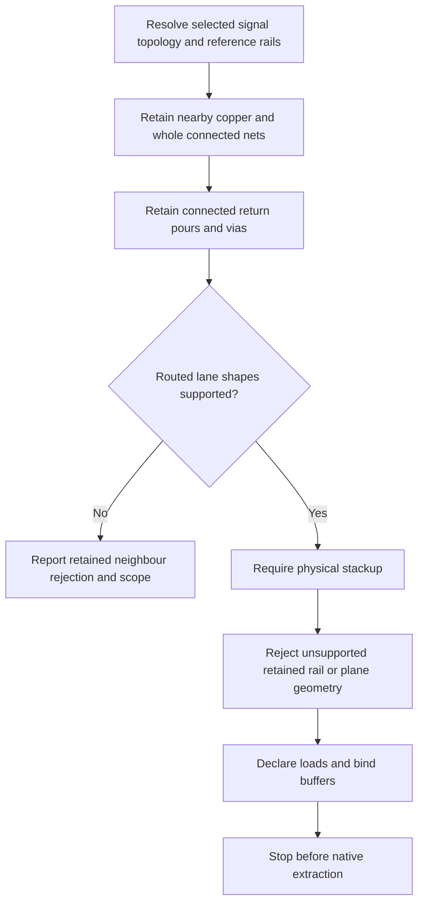

# Full-board DDR3 admission boundary

This is an admission/derivation audit, **not a simulated board**. No FastHenry,
FasterCap or native board ngspice run is used. The owning repository is
`tscircuit/signal-integrity-pipeline`; sibling core is built at `fcbd51b`.

## Reproduction and data provenance

`tests/support/full-board-ddr3.tsx` renders ordinary SI TSX declarations and
appends only their SI records to the caller's complete Circuit JSON. U1/U3
bindings are remapped by component name and physical ball name. The metadata
render's placeholder footprints, nets, routes, board and illustrative preset
stackup are all discarded. No source-board copper, connectivity, placement,
outline or stackup is edited or synthesized. The supplied route-name map has
ambiguous overlapping matches; actual ball endpoints and source-trace names
identify the eleven lane conductors instead.

The local board is the built `0hmX/am3352-ddr-track-a-local-dfm-wip-20261007`
source package, SHA-256
`a42c0458378a91ac975c72af6e4e2c3c7f5d407ac8fb4fad5ac0434e2b52ecd7`.
It contains 355 source components, 651 PCB traces, 1,210 vias and 165 pours on
the complete 98 × 65.5 mm eight-layer board. Neither its JSON nor vendor IBIS
is committed. The test skips unless both `SI_DDR3_BOARD` and `IBIS_MODEL_DIR`
are set. The compact unrelated-copper reproduction is
`tests/support/channel-scope.test.tsx`, with a labelled three-pad trace 20 mm
from the selected DATA channel.

```sh
cd ../core && bun run build
cd ../pipeline-si
export SI_CORE_MODULE="$(cd ../core && pwd)/dist/index.js"
export TSX_TSCONFIG_PATH=examples/tsconfig.json IBIS_MODEL_DIR=models
export SI_DDR3_BOARD="$(cd ../ddr3-route && pwd)/source-pkg/am3352-ddr-track-a-local-dfm-wip-20261007/dist/index/circuit.json"
node --import tsx scripts/check-full-board-ddr3.tsx
node --import tsx --test tests/support/full-board-ddr3.test.tsx
```

The check writes ignored `runs/full-board-ddr3-boundary.json`: input hashes,
actual first error, independent capability gates, retained/omitted IDs, physical
lane layers and barrels, every retained pour and the unbound endpoint inventory.
It has no solver capability and cannot advance beyond bind. The production
package warning is logged before the geometry rejection and retained on the
admission error and in the JSON, including the original file hash and 30,450
negated entries.

## Coupling scope

Selected signal topology includes series passives. A conductor is a spatial
neighbour when its wire-segment XY bounding box, expanded by half its width,
is within **1 mm Euclidean box distance** of selected copper on the **same or
an immediately adjacent copper layer**. Selected pad bounds also seed this horizon; neighbour pad bounds select their nets.
Pad bounds circumscribe rotated shapes, and plated-hole spans use every declared layer.
Physical via disks use their complete
declared barrel spans, including inactive stubs, for selection. Layer order
comes from `pcb_board.num_layers`; this establishes adjacency without inventing
dielectric heights. Unknown-layer or unsupported pour geometry is kept
conservatively for explicit validation. Segment boxes are a conservative lower
bound on actual copper distance, so diagonal routes can retain extra neighbours.

The whole electrically connected net is retained once any of its copper is
nearby, including remote branches and continuation through two-terminal series
passives. This does not grow a new spatial horizon around those neighbours. All pours and reference vias connected to
the selected ground are kept, preserving the return network and its stitching
requirements. Neighbours use existing IBIS input/disabled/steady-output states
and placed passive terminations. Missing loads, unsupported multiport routes,
nearby rail copper and other-net planes are explicit limits; they are not
discarded to obtain admission. Distant pin excitations and unrelated passive
electronics are removed from the lowered simulation.

The graph connectivity check now builds its physical graph from selected signal
nets, rather than joining unrelated board copper into it. Lane admission uses
the spatially retained set. Geometry scans use those retained trace/via/pour IDs.
Ground geometry rejects multiple retained regions because this implementation
cannot extract their stitching network; it no longer assumes all such regions
are equipotential for a scoped channel.



This finite horizon omits coupling to more distant or nonadjacent-layer nets;
it has no demonstrated electromagnetic error bound. Existing pad simplification
also remains: pads select neighbouring nets, but only return-contact pad area
is extracted. Connected pad-only neighbours without a routed conductor fail explicitly;
electrically unconnected unused pads have an explicit open-body omission count.
Unused through-via stubs in extraction, soldermask, dielectric loss and roughness
remain omitted by the existing routed-wire approximation. The scope and these approximations are
visible in modeling/geometry diagnostics and successful result limitations.
No claim of full-board field convergence or hardware accuracy is made.

## Current ordered rejection evidence

The original full board plus SI records passes Circuit JSON schema validation.
`prepareBlocks` stops at the first item below. Subsequent items are **independent
gate audits against the same input**, in pipeline order, not claims that later
stages ran or passed. A physical fabrication stack and the preceding capability
fixes are needed before further downstream errors can be determined.

1. Exact current first error:

   ```text
   Signal "RN5_INPUT_SYS4_CPU_PULL": branched routed graphs are not implemented yet.
   ```

   This is `source_trace_2673` / `pcb_trace_538`, one source port plus SYSBOOT4
   net membership, not a complete two-terminal route. It must stay in scope:
   its inner4 segment bounding box is only **0.21667067288485153 mm** from a
   DQ7 segment (`pcb_trace_424`) on inner4. The simple unrelated reproduction
   passes; this full-board test intentionally asserts the retained-neighbour
   rejection rather than pretending the board was admitted.

2. Physical stackup gate:

   ```text
   Board pcb_board_0 has no pcb_stackup. Set fabricatorPreset (e.g. "jlcpcb_standard") on <board> so the JLC stackup template is resolved into Circuit JSON.
   ```

   Eight layer names and nominal 1.2 mm thickness are available, but dielectric
   heights, permittivity, copper thickness and plating are not. The separate
   cropped example's preset is an assumption, not fabrication evidence for this board.

3. Retained rail-copper capability gate:

   ```text
   Channel scope requires multi-net rail copper extraction for 80 routed rail traces
   ```

4. Retained other-net plane capability gate:

   ```text
   Channel scope requires multi-net plane extraction for 5 nearby non-reference pours
   ```

   These are inner5 DDR_1V5 (one), V3V3 (two) and DDR_VREF (two) regions.

5. Return-network capability gate:

   ```text
   Reference leads must reach one connected pour; inter-pour stitching extraction is not supported
   ```

   The retained ground has 81 BREP regions: inner1 **33**, inner3 **41**, inner6
   **7**. There are **514 ground-associated vias**, including 55 inner1–inner6,
   29 inner1–inner3 and 52 full top–bottom barrels. A same-net label is not a
   modeled inter-region current path. The retained 86 pours contain 1,206 rings
   and 51,021 vertices; extracting them would be a substantial workload.

The 97 nearby pads include five electrically unconnected ports: U1.H3, U1.H4,
U1.M5, U3.J9 and U_CLOCK_GATE.1. Their pad bodies follow the existing open
unused-lead approximation, with the count recorded in the scope warning; no die
load or switching is inferred. A **connected** pad-only neighbour with no routed
conductor remains an explicit `Channel scope requires pad-only neighbour
extraction for N physical ports` limit, tested separately from open pads. An
explicit `allow_unrouted_traces` selected net keeps its existing ideal policy.

The endpoint inventory contains 99 unbound candidate endpoint identities: 12
are supported passive contacts, and 87 require chip/via binding or junction
handling. Additional endpoint/load requirements are inventoried without claiming a later
bind error was observed: adjacent DDR upper-byte, address/control, SYSBOOT,
clock, reset and HDMI nets include unbound chip and via endpoints and passive
contacts. Those pins need real quiet-state/load bindings or supported junction
handling before the coupled channel can be bound. No output drivers are silently
assigned ideal terminations.

## Copper and lane inventory

The selected write lane has **10 logical signals / 11 conductors**, 800 Mbps:
eight DQ, DQM0 and differential DQS0. U1 is AM3352BZCZ100 at (0,0); U3 is
W631GG6MB-12 at (0,-27). The source's within-byte DQ swaps are preserved.

| Signal | U1 → U3 balls | PCB trace | Signal layer | Vias |
|---|---|---|---|---:|
| DQ0 | M3 → F2 | pcb_trace_387 | top | 0 |
| DQ1 | M4 → G2 | pcb_trace_388 | top | 0 |
| DQ2 | N1 → E3 | pcb_trace_386 | inner2 | 2 |
| DQ3 | N2 → H3 | pcb_trace_389 | top | 0 |
| DQ4 | N3 → F8 | pcb_trace_423 | inner4 | 2 |
| DQ5 | N4 → H7 | pcb_trace_383 | top | 0 |
| DQ6 | P3 → F7 | pcb_trace_384 | inner4 | 2 |
| DQ7 | P4 → H8 | pcb_trace_424 | inner4 | 2 |
| DQM0 | M2 → E7 | pcb_trace_385 | top | 0 |
| DQS0 P | P1 → F3 | pcb_trace_381 | inner2 | 2 |
| DQS0 N | P2 → G3 | pcb_trace_382 | inner2 | 2 |

All six inner-layer routes include top endpoint copper and complete top→inner2
or top→inner4 physical spans. Their **12 signal vias** have 0.15 mm holes and
0.3 mm pads. Ground is available on inner1/inner3/inner6; inner2 and inner4
routes therefore encounter multiple adjacent return regions, not the cropped
example's single newly scoped inner1 plane.

Scope retains **166 traces, 793 vias, 86 pours**, omitting **485 / 417 / 79**
respectively. Among retained traces, **65 two-terminal candidate conductors**
comprise 11 selected and 54 neighbouring conductors; one additional nonrail
route has unsupported endpoint topology, and 100 traces belong to retained
rail networks (80 non-reference). These are candidate geometry counts, **not
an extracted matrix dimension**: the branched/junction and return networks
still prevent building a valid coupled extraction problem.

## Test-count audit

At the supplied `9a437b2` head, these commands use the same test glob and
one-at-a-time runner, with all native solver opt-ins disabled:

```sh
env -u IBIS_MODEL_DIR -u SI_CORE_MODULE -u NGSPICE_BIN -u PCB_SPICE_FASTHENRY \
  TSX_TSCONFIG_PATH=examples/tsconfig.json pnpm test
# 227 tests: 202 passed, 25 skipped, 0 failed

env -u NGSPICE_BIN -u PCB_SPICE_FASTHENRY \
  IBIS_MODEL_DIR=models SI_CORE_MODULE="$PWD/../core/dist/index.js" \
  TSX_TSCONFIG_PATH=examples/tsconfig.json pnpm test
# 227 tests: 222 passed, 5 skipped, 0 failed
```

Historical `runs-tests-vendor-coupled.log` had **226 tests: 221 passed / 5 skipped**.
The corresponding unconfigured log had **201 passed / 25 skipped**. The 20
extra skips are 19 vendor-dependent tests plus the sibling-core escape-via test.
The added switching-tail test in `9a437b2` accounts for the one-test increase to
227. No tests were deleted or newly skipped unintentionally.

Final verification adds four single-test files: **231 total tests**. The same
unconfigured command passes **204 / skips 27**; the configured command with
`SI_DDR3_BOARD` also set passes **226 / skips 5**, both with zero failures.
`pnpm typecheck`, explicit typechecking of both diagnostic scripts, `pnpm lint`,
`pnpm check:modules` and `pnpm check:vocabulary` pass. Lint retains the existing
535-line `src/extraction/mesh.ts` warning. Vendor bytes and the complete board
remain untracked; core has no implementation changes from this task.

## Step-1 2D slice demo

A standalone, local cross-section solver and reproducible DQ0 demo now exist;
[the report](2d-cross-section.md#ddr3-preset-geometry-and-dq0-demo) records their
geometry, accuracy and timing. This does not change the admission outcome above.
The demo reads the original board and route bytes and **assumes** core's selected
JLC preset and solid reference planes; it neither supplies a fabrication record
nor performs a board extraction or native transient run.
