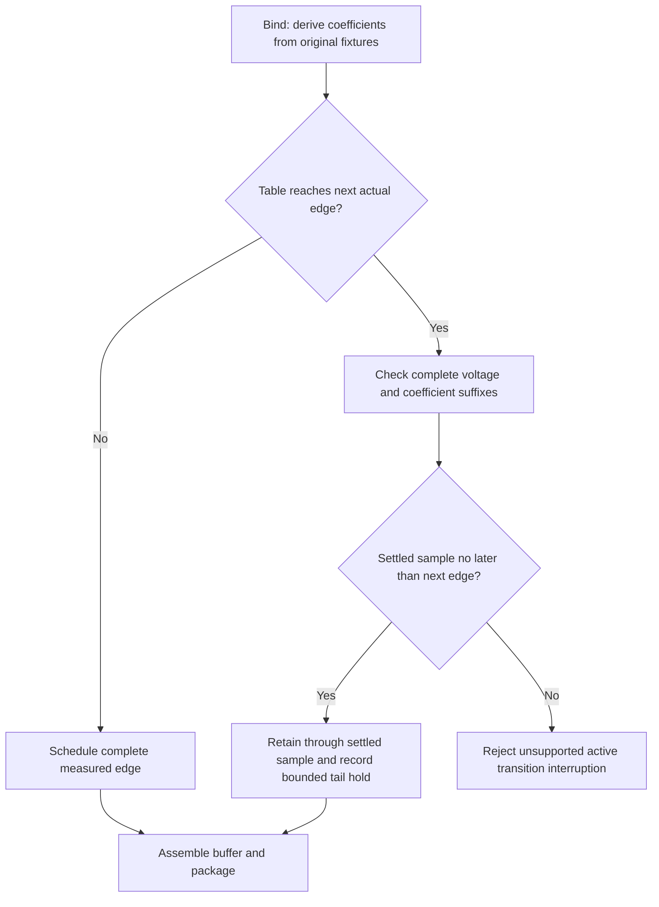

# IBIS switching windows and the DDR3 bind check

## Ownership and electrical assumptions

The former rejection comes from the pinned `@tscircuit/ibis-to-spice`
`lib/general.ts`, `bitWeights`, lines 51–53, called by
`convertIbisModelToSpice` during pipeline `bind`. It compared each **actual**
transition's start plus the last extracted coefficient timestamp against the
next actual transition, rejecting equality too. Repeated equal bits did not
retrigger. The longest fixture acquisition therefore limited edge spacing even
when its final part was inactive.

This is not voltage-waveform playback into the board. The converter extracts
two switching coefficients, Ku(t) and Kd(t), from the first two resistive V/T
fixtures for each direction. At each time, the two fixture KCL equations solve
for the two coefficients, including C_comp*dV/dt and separate clamp currents.
SPICE then multiplies the nonlinear pullup/pulldown I/V currents by those
coefficients. Board voltage remains a solved circuit quantity. The pipeline now
owns coefficient scheduling in `src/buffers/switching.ts`; upstream still owns
source validation, pin/model/reference resolution, coefficient extraction and
die-buffer primitives. No dependency patch or modified IBIS text is involved.

## Specification and practice

- [IBIS 4.1 §6, Rising/Falling Waveform, printed p.55](https://ibis.org/ver4.1/ver4_1.pdf#page=55):
  “A waveform table must include the entire waveform”; its endpoint must be
  “the final DC value of the output after switching”. This specifies acquisition
  coverage, not a minimum usable UI equal to table duration. The same section
  requires common input-trigger timing and preserves differing rising/falling
  internal delays. The [7.2 revision, §6.1, pp.105–106](https://ibis.org/ver7.2/ver7_2.pdf#page=105)
  retains these rules, strongly recommends resistive fixtures, and notes that
  normally two fixtures per direction are needed for accurate modeling.
- [IBIS Modeling Cookbook v4, §3.2.2, printed pp.18–19](https://ibis.org/cookbook/cookbook-v4.pdf#page=19)
  asks for a “duration long enough to ensure steady-state DC behavior” at both
  ends. It recommends resistive loads, removal of package/fixture reactances,
  and time-correlated fixture captures. It also warns that the previous edge's
  settling history can affect a real buffer. It does not prescribe a numerical
  settling tolerance for a simulator.
- [Biernacki/Yan, Keysight, and Wolff/Butterfield, Micron, IBIS Summit 2014,
  slides 2–3](https://ibis.org/summits/nov14a/biernacki.pdf#page=3)
  explicitly label a “long flat tail can be ignored”. They distinguish such
  inactive tails from true interrupted transitions. Slides 7–12 discuss removing
  initial delay and explain why the model maker must specify that delay.
- [IBIS 7.2 §6.1, Initial Delay, pp.113–114](https://ibis.org/ver7.2/ver7_2.pdf#page=113)
  specifies a subtraction from the relevant V/T or I/T time columns paired with
  an equal delay of their trigger events. That preserves physical timing; simply
  sliding the next output edge forward would not. This change does not infer or
  remove initial delay. The AM335x file is IBIS 4.1 and declares none.
- [Bhagwath et al., DDR4 board design and signal integrity verification
  challenges, Siemens/Fujitsu/Micron, pp.11–12](https://static.sw.cdn.siemens.com/siemens-disw-assets/public/82737/en-US/Siemens-SW-DDR4-board-design-and-signal-WP-82737-C1.pdf#page=11)
  separate initial delay, active switching and inactive regions. Their operating
  condition compares half-cycle length with **initial delay plus active area**,
  excluding the inactive tail. Power-aware composite current prevents casually
  discarding a voltage waveform's lead-in.
- [Schaeder/Faferko/Buecker, Zuken, IBIS Summit 2024, slides 4–10](https://ibis.org/summits/may24/buecker.pdf#page=9)
  describe genuinely interrupted k-parameter switching: “Determine starting
  point of the next transition from switching coefficients of the opposite edge”.
  Their method also determines branch currents and maintains output voltage
  continuity. Slide 15 characterizes behavior outside the supplied data as a
  simulator inference. Replaying the opposite full edge from its original start,
  or adding two full transitions, does not establish a physically correct
  interrupted transition.

Thus IBIS specifies the data and timing references, not a unique physical answer
for active-transition interruption. A simulator-specific method would need
validation against a transistor model or hardware. That inference is unnecessary
for this DDR3 case and remains explicitly unsupported here.

## Bounded inactive-tail handling

The stated engineering tolerance is **1% of each fixture's initial-to-final
voltage swing**, and **0.01 absolute** for each dimensionless switching
coefficient relative to its destination (Ku,Kd = 1,0 or 0,1). These are pipeline
acceptance tolerances, not limits mandated by IBIS or accuracy bounds for arbitrary
board loads.

Only when a table would reach the next actual trigger does the scheduler seek
the earliest original coefficient sample after which **every remaining sample**
in both fixture voltages and both coefficients stays in tolerance. Linear
interpolation also stays in the checked bounds. It retains the original samples
through that timestamp and holds the retained endpoint coefficients until the
next trigger. It preserves all initial delay, active shape, real bit times,
inversion/polarity, and finite-window interpolation. Equal bits never retrigger.
It does not substitute Ramp data or compress time.

No coefficient normalization is applied. Existing fixture/I-V endpoint mismatch
can cause a small coefficient change when the next measured edge starts, as in
the upstream full-table scheduler. `metadata.switchingTails` records each affected
pin/model/direction, original and retained durations, tolerance, maximum discarded
coefficient residual, maximum error from holding the retained coefficients, and
each fixture's voltage tolerance and tail deviation. A warning accompanies it.
These records survive `ibisAssembly` into results and assembly JSON. Inputs and
source hashes still refer to the unchanged admitted bytes. Unaffected PWL tables
remain identical to upstream. Active or ringing tails fail with `overlapping_edges`.



## Actual selected models, typical corner

800 Mbps gives a 1.25 ns UI. Every AM335x fixture is 50 ohms, tied to either
0 V or 1.5 V, with C_comp = 1.865048 pF. Times below are original sampled times
in ns, measured from the unchanged input trigger; “settled” means the whole
remaining suffix, not its first crossing. DQS models 579 and 771 contain the
same waveform values for these measurements.

| Model | Edge | Fixture V | Rows | Table end ns | Voltage settled ns |
|---|---|---:|---:|---:|---:|
| 257, DQ | rise | 1.5 | 98 | 2.6200 | 0.9781 |
| 257, DQ | rise | 0 | 99 | 2.6306 | 1.1001 |
| 257, DQ | fall | 1.5 | 97 | 2.6200 | 1.0948 |
| 257, DQ | fall | 0 | 95 | 2.6306 | 0.9727 |
| 579/771, DQS | rise | 1.5 | 96 | 1.7866 | 0.7988 |
| 579/771, DQS | rise | 0 | 100 | 1.8076 | 0.8562 |
| 579/771, DQS | fall | 1.5 | 99 | 1.7866 | 0.9035 |
| 579/771, DQS | fall | 0 | 100 | 1.8076 | 0.7786 |

Fixture voltage tolerances range from 7.703 to 7.732 mV (they are 1% of the
**loaded swing**, not 15 mV = 1% of VDD).

| Model | Edge | Coefficients settled ns | Both criteria: retained end ns | Max coefficient hold error |
|---|---|---:|---:|---:|
| 257 | rise | 1.0140 | 1.1001 | 0.008215 |
| 257 | fall | 1.0046 | 1.0948 | 0.007808 |
| 579/771 | rise | 0.9202 | 0.9202 | 0.006767 |
| 579/771 | fall | 0.8905 | 0.9035 | 0.008947 |

[Ramp] is 20–80% loaded-swing dV/dt, **not** complete settling time. The typical
R_load is 50 ohms. It is reported for comparison and never used instead of V/T:

| Model | Rising typical dV/dt | Falling typical dV/dt |
|---|---|---|
| 257 | 0.46615487 V / 0.33013842 ns | 0.46642421 V / 0.32239162 ns |
| 579/771 | 0.46586951 V / 0.23027501 ns | 0.465956 V / 0.23612352 ns |

Winbond's selected `ODT_off` is **Input**, with 1.5 V typical voltage and 1.5 pF
C_comp. It has **zero** Rising/Falling Waveform tables and **no Ramp**. Its
transmit-capable alternatives are not used for this write lane.

## Verification and boundary

`tests/buffers/switching.test.tsx` is one test with an original inline two-fixture
model bound from TSX. It covers the exact upstream error, settled tails, late
excursions, inconsistent coefficients, selected corner, repeated bits, inversion,
offset, finite measurement windows, unchanged long-bit PWL and preserved hashes.
The opt-in two buffer-only ngspice transients compare 1.25 ns and 5 ns bit
responses against a 2 mV limit; they do not solve a board:

```sh
SI_TEST_SWITCHING_NGSPICE=1 node --import tsx --test tests/buffers/switching.test.tsx
```

An additional local diagnostic ran 12 AM335x **die-buffer-only** transients:
models 257/579/771, 50-ohm fixtures to 0/1.5 V, and 1.25/5 ns UIs. The 5 ns case
retains the full acquisition. Comparing corresponding first-rise and first-fall
windows at 10 ps samples gave a maximum difference of 5.109 mV (model 257,
grounded fixture, falling edge). Every 10 ns transient completed. This measures
the tail-hold effect against the same untrimmed IBIS model, not against silicon
or a transistor-level reference. Local details are in ignored
`runs/check-buffer-only.ts` and `runs/ddr3-buffer-only.json`.

After building the sibling core, run the existing documented DDR3 diagnostic
command with `SI_DIAGNOSTIC_MAXWELL_SIGNS=1`. `runs/ddr3-boundary.json` now includes
source hashes, original waveform/ramp inspection, all 20 per-pin/direction
truncation records, and passing admit/declare/bind stages. Native solver calls
remain zero. The next stage is extraction, deliberately not run; no later error
is claimed. Raw vendor admission still fails with the exact unchanged error:

```text
am335x_zcz: Maxwell capacitance has positive off-diagonal entries; vendor sign conversion is forbidden
```
