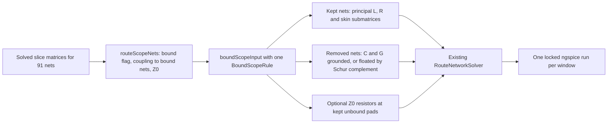

# Bound-signal scope rules for the DDR3 level-4 deck

Research branch stacked on `fix/routed-ddr3-level4` (PR #75, head 329a32c). It is opt-in and changes no default deck.

**Status: native measurements in progress.** The deck statistics and the full-deck reference below are measured; the rule rows are filled in as each locked run finishes.

## Question

The DDR3 addr/cmd block declares 24 signals with real IBIS bindings. The 1 mm copper scope adds 67 more routed nets that have no endpoint binding. They are open-ended passive lines. The full deck has 91 nets, 1,835 cells and 36,814 K terms. It needs about 5.6 s per saved point. PR #79 showed that exact connected components do not split it, and that per-victim windows mostly abort. This track keeps **one** deck with all 24 driven signals and applies one explicit rule to the 67 unbound neighbours.

## Where scope is decided

| Step | Code | What it does |
|---|---|---|
| Copper scope | `channelCopperScope` in `src/board/geometry/scope.ts` | Keeps whole nets with copper within 1 mm XY of selected routes, pads or barrels, on the same or adjacent layers. |
| Admission | `prepareBlock` in `src/pipeline/signals.ts` | Uses that scope; 2D lanes are only the selected traces. Neighbours have no lanes. |
| Fields | `RouteFieldsSolver` | Solves every slice with every scoped conductor. |
| Network | `RouteNetworkSolver` | Builds cells for every non-rail wire, including neighbours. Neighbour pads stay open, with 1 GΩ DC anchors. |

The rule is applied to the solved `RouteNetworkInput`, between fields and network. It needs no new field solve.



## Rules

`BoundScopeRule` has no enum. It is three optional fields:

| Field | Meaning |
|---|---|
| `couplingThreshold` | Keep an unbound net only when its largest local `|k|` or normalized mutual C to any bound net is strictly above this value. Omit it to keep every net; `Infinity` drops all unbound nets. |
| `foldRemoved` | Removed conductors float locally: C, C0 and G are Kron-reduced (Schur complement). Without it they are AC-grounded (principal submatrix). In both cases they carry zero current. |
| `terminateKept` | Each contacted pad of each kept unbound net gets a resistor to ground equal to that net's length-weighted `sqrt(L/C)`. |

| Case | Rule |
|---|---|
| full | none |
| drop | `{ couplingThreshold: Infinity }` |
| fold | `{ couplingThreshold: Infinity, foldRemoved: true }` |
| k-0 | `{ couplingThreshold: 0 }` (any direct parallel coupling) |
| k-0.1 | `{ couplingThreshold: 0.1 }` |
| k-0.1-fold | `{ couplingThreshold: 0.1, foldRemoved: true }` |
| k-0.03 | `{ couplingThreshold: 0.03 }` |
| k-0.1-z0 | `{ couplingThreshold: 0.1, terminateKept: true }` |
| z0 | `{ terminateKept: true }` |

All 24 bound nets, both IBIS models, the package matrices, the quiet states and the 24 probes are unchanged by every rule.

## Measurement method

| Item | Choice |
|---|---|
| Board | Local AM3352 DDR3 board JSON (not committed), `DDR3_ADDR_CMD` block from `examples/routed/ddr3-signals.tsx`, 1 mm scope. |
| Compile | One compile to `RouteNetworkInput` (170 s), saved outside git. Each rule is applied to that saved input. |
| Quiet window | Original stimulus, `.tran` stopped at 1 ns. No driver changes state before 2.5 ns. |
| Edge window | Every PWL switching schedule advanced by 2.45 ns, so the first edge (22 addr/cmd lines rising together) starts at 0.05 ns; `.tran` stopped at 1.05 ns. This is 1 ns after the first edge. CK and CKn stay quiet until 1.3 ns, so they are victims here. The same advance is applied to every deck. |
| Native run | `scripts/research-bound-signal-native.py` under the shared `ngspice-lock.sh` (`OMP_NUM_THREADS=1`), 600 s hard deadline, ngspice 47 with KLU. |
| Cost | The runner polls the streamed ASCII rawfile every 0.25 s and records wall time against saved points, using a monotonic clock that excludes system sleep. Setup is the time to the first saved point. Steady s/point excludes setup. |
| Accuracy | Maximum absolute difference of each of the 24 receiver probes against the full deck, on the union of both adaptive time grids, linearly interpolated, up to the time both runs reached. |

Raw waveforms, decks and logs stay in `SI_SCOPE_DIR`. They contain vendor-derived data and are never committed.

## Reproduce locally

```sh
export IBIS_MODEL_DIR=/path/to/models SI_DDR3_BOARD=/path/to/ddr3-board.json SI_SCOPE_DIR=/path/outside/git
export SI_NGSPICE_LOCK=/path/to/ngspice-lock.sh
node --import tsx scripts/research-bound-signal-scope.tsx compile
node --import tsx scripts/research-bound-signal-scope.tsx decks
node --import tsx scripts/research-bound-signal-scope.tsx measure drop quiet   # one locked run, <= 600 s
node --import tsx scripts/research-bound-signal-scope.tsx compare
```
