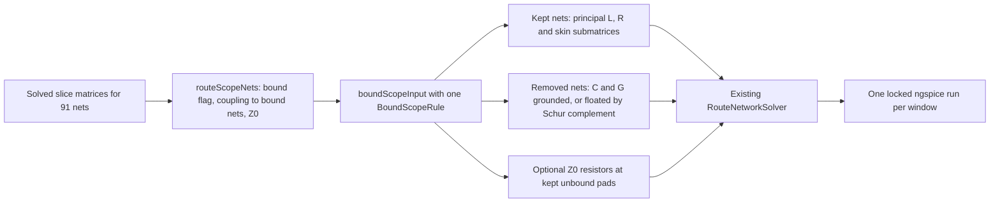

# Bound-signal scope rules for the DDR3 level-4 deck

Research branch stacked on `fix/routed-ddr3-level4` (PR #75, head 329a32c). It is opt-in and changes no default deck.

## Verdict

**Scope limiting is necessary but not sufficient.** The best rule keeps the 24 IBIS-bound nets plus the 4 unbound neighbours with local `k > 0.1` (`k-0.1`). It cuts the quiet cost from 4.64 to 0.59 s per point (the 0–1 ns run takes 57 s instead of 499 s) and is the only measured deck that completes 1 ns of switching inside the 600 s limit (505 s). Its measured accuracy cost is 0.0004 mV quiet against the full deck. Under switching it is at most 2.7 mV against the full deck at the driver pads through 0.18 ns (a floor shared by every reduced deck), 0.26 mV against `k-0` through 0.22 ns, and 1.63 mV against `k-0.03` through 0.52 ns.

Dropping **every** unbound net is not safe. The 4 strong neighbours change bound waveforms by up to 23.4 mV (A6 receiver, through 0.66 ns); folding them in as floating C does not recover that. Dropping them is also not faster than keeping them: per-point cost here does not follow deck size.

A full 8 ns transient still does not fit in 10 minutes for any rule. The extrapolated time for `k-0.1` is 35–45 min, against about 2–7 h for the full deck. The limit is the point density during switching (about 1,700 saved points per ns at the driver swing, against 90 per ns quiet). That density is the same for every rule, so scope cannot remove it.

| Rule | Nets | Cells | K | Quiet s/point (0–1 ns wall) | Switching s/point and 600 s outcome | Quiet delta vs full, mV | Switching delta, mV |
|---|---:|---:|---:|---|---|---:|---|
| full | 91 | 1,835 | 36,814 | 4.64 (499 s) | 1.67; reaches 0.187 ns (switch window); stalls at 0.168 ns in the first-edge window | — | reference through 0.18 ns |
| drop | 24 | 577 | 18,314 | 0.90 (84 s) | 1.10; reaches 0.37 ns | 0.0004 | 3.1 vs full; 6.1 vs k-0.1 |
| fold | 24 | 577 | 18,314 | 0.82 (79 s) | 0.77; reaches 0.66 ns | 0.0004 | 3.1 vs full; 23.4 vs k-0.1 |
| k-0 | 47 | 1,082 | 27,467 | 1.41 (134 s) | 1.59; reaches 0.22 ns | 0.0001 | 2.8 vs full |
| **k-0.1** | 28 | 659 | 19,204 | **0.59 (57 s)** | **0.47–0.56; completes 1.05 ns in 419–505 s** | 0.0004 | **2.7 vs full; 0.26 vs k-0; 1.63 vs k-0.03** |
| k-0.03 | 34 | 767 | 20,894 | 1.02 (97 s) | 0.87; reaches 0.52 ns | 0.0004 | 2.7 vs full; 0.26 vs k-0 |
| k-0.1-z0 | 28 | 659 | 19,204 | 0.45 (44 s) | 0.49; completes 1.05 ns in 438 s | 0.0004 | 2.7 vs full; 7.1 vs k-0.1 (termination sensitivity) |
| z0 | 91 | 1,835 | 36,814 | 1.95 (188 s) | 2.16; reaches 0.139 ns | < 0.0001 | 0.03 vs full (through 0.14 ns) |

Switching deltas are the largest absolute difference over all 24 receivers and 24 driver pads, through the time both runs reached.

## Question

The DDR3 addr/cmd block declares 24 signals with real IBIS bindings. The 1 mm copper scope adds 67 more routed nets that have no endpoint binding. They are open-ended passive lines. The full deck has 91 nets, 1,835 cells and 36,814 K terms. It needs about 5.6 s per saved point. PR #79 showed that exact connected components do not split it, and that per-victim windows mostly abort. This track keeps **one** deck with all 24 driven signals and applies one explicit rule to the 67 unbound neighbours.

## Where scope is decided

| Step | Code | What it does |
|---|---|---|
| Copper scope | `channelCopperScope` in `src/board/geometry/scope.ts` | Keeps whole nets with copper within 1 mm XY of selected routes, pads or barrels, on the same or adjacent layers. |
| Admission | `prepareBlock` in `src/pipeline/signals.ts` | Uses that scope; 2D lanes are only the selected traces. Neighbours have no lanes. |
| Fields | `RouteFieldsSolver` | Solves every slice with every scoped conductor. |
| Network | `RouteNetworkSolver` | Builds cells for every non-rail wire, including neighbours. Neighbour pads stay open, with 1 GΩ DC anchors. |

The rule is applied to the solved `RouteNetworkInput`, between fields and network. It needs no new field solve.



## Rules

`BoundScopeRule` has no enum. It is three optional fields:

| Field | Meaning |
|---|---|
| `couplingThreshold` | Keep an unbound net only when its largest local `|k|` or normalized mutual C to any bound net is strictly above this value. Omit it to keep every net; `Infinity` drops all unbound nets. |
| `foldRemoved` | Removed conductors float locally: C, C0 and G are Kron-reduced (Schur complement). Without it they are AC-grounded (principal submatrix). In both cases they carry zero current. |
| `terminateKept` | Each contacted pad of each kept unbound net gets a resistor to ground equal to that net's length-weighted `sqrt(L/C)`. |

| Case | Rule |
|---|---|
| full | none |
| drop | `{ couplingThreshold: Infinity }` |
| fold | `{ couplingThreshold: Infinity, foldRemoved: true }` |
| k-0 | `{ couplingThreshold: 0 }` (any direct parallel coupling) |
| k-0.1 | `{ couplingThreshold: 0.1 }` |
| k-0.1-fold | `{ couplingThreshold: 0.1, foldRemoved: true }` |
| k-0.03 | `{ couplingThreshold: 0.03 }` |
| k-0.1-z0 | `{ couplingThreshold: 0.1, terminateKept: true }` |
| z0 | `{ terminateKept: true }` |

All 24 bound nets, both IBIS models, the package matrices, the quiet states and the 24 probes are unchanged by every rule.

## Deck size

Of the 67 unbound nets, only 23 share a solved cross-section with a bound net. The other 44 couple only through oblique C or through other neighbours. Only 4 exceed `k = 0.1`, and 10 exceed `k = 0.03`.

| Rule | Nets (unbound) | Cells | K terms | Deck MB | Oblique C omitted, pF | Z0 resistors |
|---|---:|---:|---:|---:|---:|---:|
| full | 91 (67) | 1,835 | 36,814 | 17.52 | 0 of 4.65 | 0 |
| drop | 24 (0) | 577 | 18,314 | 8.41 | 2.77 | 0 |
| fold | 24 (0) | 577 | 18,314 | 8.40 | 2.77 | 0 |
| k-0 | 47 (23) | 1,082 | 27,467 | 12.63 | 1.67 | 0 |
| k-0.1 | 28 (4) | 659 | 19,204 | 8.99 | 1.86 | 0 |
| k-0.1-fold | 28 (4) | 658 | 19,194 | 8.98 | 1.86 | 0 |
| k-0.03 | 34 (10) | 767 | 20,894 | 9.79 | 1.75 | 0 |
| k-0.1-z0 | 28 (4) | 659 | 19,204 | 8.99 | 1.86 | 9 |
| z0 | 91 (67) | 1,835 | 36,814 | 17.52 | 0 | 156 |

The ladder mesh is recomputed by the pipeline's own 10-cells-per-rise rule from the kept matrices. Removing neighbours lowers the conservative infinity-norm delay bound, so bound nets get about 25% fewer cells than in the full deck (PR #79 kept the full mesh and had 721 cells for the same 24 nets). Every measured delta below includes this mesh change.

The 4 neighbours above `k = 0.1`:

| Unbound net | Largest local k | Strongest bound partner | Length, mm | Z0, Ω |
|---|---:|---|---:|---:|
| DDR_RESETn (PWR_V2_DDR_RESETn) | 0.420 | A11, A6, CK | 38.4 | 57.5 |
| VDD_RTC cap (CPUCAP_VIP) | 0.367 | A11 | 4.4 | 51.8 |
| U1.B4 to power management (RTC_KALDO_EN_N) | 0.187 | A9 | 61.1 | 59.1 |
| U1.R3 to boot (SYSBOOT2) | 0.141 | RASn | 23.0 | 59.5 |

## Native results

Every row is one locked ngspice run with a 600 s deadline. Steady s/point excludes setup (parse plus operating point).

### Quiet, 0–1 ns, original stimulus

| Rule | Completed | Wall, s | Setup, s | Steady s/point | Speedup vs full | Max probe delta vs full, mV |
|---|---|---:|---:|---:|---:|---:|
| full | yes | 499.0 | 90.7 | 4.64 | 1.0× | — |
| drop | yes | 83.6 | 4.7 | 0.90 | 6.0× | 0.0004 |
| fold | yes | 78.9 | 6.7 | 0.82 | 6.3× | 0.0004 |
| k-0 | yes | 134.3 | 10.5 | 1.41 | 3.7× | 0.0001 |
| **k-0.1** | yes | **57.1** | 5.4 | **0.59** | **8.7×** | 0.0004 |
| k-0.03 | yes | 97.2 | 7.4 | 1.02 | 5.1× | 0.0004 |
| k-0.1-z0 | yes | 44.0 | 4.3 | 0.45 | 11.3× | 0.0004 |
| z0 | yes | 188.3 | 17.1 | 1.95 | 2.7× | < 0.0001 |
| k-0.1-fold | not run (deck built; low priority under lock contention) | | | | | |

The quiet prefix has no switching, so these deltas only show that every rule reproduces the operating point and quiet state. They are not a switching-accuracy claim.

### Switching, PWL advanced 2.68 ns, 0–1.05 ns

The driver output moves from about t = 0. The receivers see the edge from about 0.42 ns, and k-0.1 shows full receiver edges (1.16–1.50 V) by 1.05 ns. The 24 driver pads are saved as well as the 24 receivers. The full deck reached 0.187 ns before the deadline. That is enough for the near-end driver-pad response (pads swing 45–100 mV by then), but not for the receivers. Longer windows therefore also use `k-0` (every directly coupled neighbour) and `k-0.1` as references. At these sub-ps steps the full deck costs 1.67 s per point, far less than its 4.64 s per point in the quiet window.

| Rule | Completed | Reached, ns | Points | Steady s/point | Max delta vs full, mV (through 0.18 ns) | Max delta vs k-0, mV (through 0.22 ns) | Max delta vs k-0.1, mV (common reach) |
|---|---|---:|---:|---:|---:|---:|---:|
| drop | timeout at 600 s | 0.366 | 541 | 1.10 | 3.07 | 3.34 | 6.12 (0.37 ns) |
| fold | timeout at 600 s | 0.657 | 773 | 0.77 | 3.11 | 3.35 | 23.4 (0.66 ns) |
| k-0 | timeout at 600 s | 0.220 | 371 | 1.59 | 2.83 | — | 0.26 (0.22 ns) |
| **k-0.1** | **yes, 504.7 s (repeat 419.0 s)** | 1.05 | 893 | **0.56 (repeat 0.47)** | **2.68** | **0.26** | — |
| k-0.03 | timeout at 600 s | 0.518 | 686 | 0.87 | 2.66 | 0.26 | 1.63 (0.52 ns) |
| k-0.1-z0 | yes, 437.8 s | 1.05 | 889 | 0.49 | 2.67 | 0.31 | 7.11 (1.05 ns) |
| z0 | timeout at 600 s | 0.139 | 264 | 2.16 | 0.03 (0.14 ns) | 0.58 (0.14 ns) | 0.51 (0.14 ns) |
| full | timeout at 600 s | 0.187 | 327 | 1.67 | — | 2.83 | 2.68 (0.18 ns) |

Repeats: drop's switching cost was 1.007 and 1.010 s/point over 0.05–0.2 ns in two runs 45 minutes apart. The k-0.1 repeat produced identical waveforms (0.000 mV) but 17% less wall time (419.0 s against 504.7 s). Treat single-run costs as about ±20%. The roughly 2× gap between k-0.1 and drop is outside that.

### Worst probes

| Comparison | Through, ns | Largest differences |
|---|---:|---|
| every reduced deck vs full | 0.18 | CKE driver 2.66–2.83 mV (of 66 mV) in all of drop, fold, k-0, k-0.1, k-0.03 and k-0.1-z0. CK driver: drop 3.07, fold 3.11, k-0 1.61, k-0.1 1.53 mV (of 86 mV) |
| drop vs k-0 | 0.22 | CKn driver 3.34 mV (of 176 mV near-end excursion), CK driver 2.92 mV, A8 driver 0.80 mV |
| fold vs k-0 | 0.22 | CKn driver 3.35 mV, CK driver 2.99 mV, A11 driver 0.99 mV |
| k-0.1 vs k-0 | 0.22 | A6 driver 0.26 mV, CSn0 driver 0.19 mV, CKE driver 0.17 mV |
| k-0.03 vs k-0 | 0.22 | A6 driver 0.26 mV, CKE driver 0.18 mV |
| drop vs k-0.1 | 0.37 | A6 driver 6.13 mV, CKn driver 4.88 mV, CK driver 4.33 mV, A11 driver 2.83 mV |
| fold vs k-0.1 | 0.66 | A6 receiver 23.4 mV (of 360 mV), A11 receiver 12.3 mV, A6 driver 11.4 mV, CKn receiver 8.3 mV |
| k-0.1 vs k-0.03 | 0.52 | CSn0 receiver 1.63 mV, CKE receiver 1.38 mV, CSn0 driver 1.02 mV |
| drop vs fold | 0.37 | A6 driver 1.56 mV, A11 driver 1.10 mV |

Against the full deck there is a common floor of about 2.7 mV at the CKE driver pad. It is the same for every reduced deck, including k-0, so it comes from what all of them omit: the 44 nets with no direct parallel coupling (their 1.67 pF of oblique C to bound nets) and the recomputed mesh. These runs do not separate the two. Above that floor, the largest errors sit on exactly the bound nets coupled to the 4 strong neighbours (A6, A11 and CK to DDR_RESETn; A9 to KALDO_EN; RASn to SYSBOOT2), and on the quiet CK/CKn victims.

### Fold is not a substitute for the strong neighbours

Folding changes the bound nets' integrated self C by at most −1.70% (A6) and −0.69% (A11), and by less than 0.2% elsewhere. Mutual C between bound nets is unchanged to 0.001 pF. Under switching, fold and drop differ by only 1.56 mV, while both differ from k-0.1 by up to 23 mV. The strong neighbours matter as dynamic coupled lines (inductive k up to 0.42), not as static capacitive loads.

### First-edge window (PWL advanced 2.45 ns)

This window starts at the first PWL change, 0.23 ns before the driver output moves. The full deck reached 0.168 ns with 46 points (6.6 s per point after setup). It then accepted no point for the last 234 s: it stalled at a pair of switching-coefficient breakpoints only 0.1 ps apart (2.6179 and 2.618 ns). In the switch window it passed the next such pair (2.743 ns) without stalling. Drop passed that point at 1.05 s per point and reached 0.525 ns (558 points) before the deadline. Up to 0.167 ns, drop and full differ by 0.0004 mV. The receivers do not move in that interval.

## Full 8 ns estimate

The switching coefficients change during 2.52–6.33 ns and 7.52–8.0 ns: four driver events (addr/cmd at 2.68, 5.18 and 7.68 ns; CK/CKn at 3.93 ns). The estimate charges each event the measured k-0.1 1.05 ns switching window (499 s after setup) and charges the remaining time at the measured quiet and settled densities (90–256 points per ns, 0.59 s per point).

| Deck | Estimate | Basis |
|---|---:|---|
| **k-0.1** | **35–45 min** | About 3,600–4,800 saved points: 3 full event windows of 893 points (499 s each), the final 0.32 ns of a fourth (486 points), and quiet or settled gaps at 90–256 points per ns and 0.59–0.62 s per point. The upper bound holds the window-average density (850 points per ns) over all of 2.68–8 ns. |
| k-0.1-z0 | 30–39 min | the same points at 0.45–0.49 s per point; changes bound waveforms by up to 7.1 mV |
| fold | 47–62 min | the same points at 0.77–0.82 s per point |
| drop | 63–83 min | the same points at 0.90–1.10 s per point |
| full | about 2–7 h | the same points at 4.64 s per point quiet. Switching was 1.67 s per point in the switch window and 6.6 in the first-edge window. One stall of at least 234 s was also seen. |

None fits the 10 minute limit, so no full 8 ns run was attempted. A full-length transient needs a lower switching point density: about 0.6 ps average steps at the driver swing, set by the deck's stiffness and tolerances, not by scope.

## Other observations

- **Point density does not depend on scope.** Every rule saved 1,820 points per ns over the first 0.05 ns and about 1,680 per ns over 0.05–0.2 ns. Scope changes only the cost per point.
- **Terminating neighbours helps the quiet window only.** z0 keeps all 91 nets but ends each unbound pad in Z0. That runs the quiet window 2.7× faster than the open-ended full deck (1.95 against 4.64 s per point), with identical quiet waveforms. Under switching it is slower (2.16 against 1.67 s per point). For the 4 kept neighbours in k-0.1-z0 the termination moves bound waveforms by up to 7.1 mV. That is also the scale of uncertainty from the neighbours' unknown real loads, which the baseline leaves open.
- **Cost per point does not follow deck size.** k-0.1 (659 cells) runs at 0.56 s per point (0.47 on the repeat). Drop (577 cells) runs at 1.0, fold (577) at 0.77, k-0.03 (767) at 0.87 and k-0 (1,082) at 1.59. Within a run the cost varies by up to about 1.5×. The setup time does scale with size: 4.7 s for drop, 13.4 s for k-0 and 90.7 s for the full deck.
- **Large quiet-victim excursions.** With 22 addr/cmd drivers switching together, the quiet CK receiver dips to −0.60 V and CKn falls from 1.50 to 0.75 V in every rule. Up to 0.39 V of this already appears at the quiet drivers' own pads. This is consistent with simultaneous-switching coupling through the compiled package matrices and shared references, but it is unqualified here and needs its own investigation.

## Limitations

- These are single runs on a machine shared with other agents' ngspice work through the lock, apart from the two repeats. CPU time equals wall time in every run, but run-to-run variance is about ±20%.
- The full deck is a switching reference only through 0.18 ns, at the driver pads. Receiver accuracy under switching is measured against reduced references: k-0 through 0.22 ns, k-0.03 through 0.52 ns and k-0.1 through 1.05 ns. It is not measured against the full deck.
- The switch window is a research control. It starts from the coefficients' 2.68 ns values rather than the original 0–2.68 ns history, identically for every deck.
- Every rule recomputes the ladder mesh, drops oblique C to removed nets rather than grounding it, and keeps the baseline open terminations on kept unbound pads (except the z0 rules). The real loads on those neighbours are unknown. The k-0.1-z0 comparison puts that sensitivity at about 7 mV.
- The deck's numerical options are unchanged (`reltol=1e-4`, `method=gear`, `maxord=2`, maximum step 12.3 ps). No full 8 ns transient was run.
- Every capture is candidate-unqualified. The large CK/CKn excursions are reported, not explained.

## What the code adds

| File | Purpose |
|---|---|
| `src/simulation/route-scope.ts` | `routeScopeNets` and `boundScopeInput`: an opt-in rule applied to solved `RouteNetworkInput`. Default decks are unchanged. |
| `tests/simulation/route-scope.test.tsx` | TSX board with one IBIS-driven route and an unmodelled neighbour 0.35 mm away. Covers identity, strict threshold, drop (grounded self C), fold (lower self C), Z0 pad termination, unchanged probes, no input mutation and rejection of a negative threshold. |
| `scripts/research-bound-signal-scope.tsx` | compile, decks, derive, loading and compare phases. All artifacts are written outside git. |
| `scripts/research-bound-signal-native.py` | One run under the shared lock with a hard deadline of at most 600 s, recording progress from the streamed rawfile. |

## Measurement method

| Item | Choice |
|---|---|
| Board | Local AM3352 DDR3 board JSON (not committed), `DDR3_ADDR_CMD` block from `examples/routed/ddr3-signals.tsx`, 1 mm scope. |
| Compile | One compile to `RouteNetworkInput` (170 s), saved outside git. Each rule is applied to that saved input. |
| Quiet window | Original stimulus, `.tran` stopped at 1 ns. No driver changes state before 2.5 ns. |
| First-edge window | Every PWL switching schedule advanced by 2.45 ns, so the first coefficient change (22 addr/cmd lines rising together) is at 0.05 ns; `.tran` stopped at 1.05 ns. The driver output only starts moving about 0.23 ns later, so this window is mostly lead-in. Used for full and drop only. |
| Switch window | Every PWL schedule advanced by 2.68 ns, holding each coefficient's 2.68 ns value at t = 0 (pull-down already 3% switched); `.tran` stopped at 1.05 ns. This is 1 ns after the driver output starts to move. CK and CKn stay quiet until 1.25 ns, so they are victims here. The same control is applied to every deck. |
| Native run | `scripts/research-bound-signal-native.py` under the shared `ngspice-lock.sh` (`OMP_NUM_THREADS=1`), 600 s hard deadline, ngspice 47 with KLU. |
| Cost | The runner polls the streamed ASCII rawfile every 0.25 s and records wall time against saved points, using a monotonic clock that excludes system sleep. Setup is the time to the first saved point. Steady s/point excludes setup. |
| Accuracy | Maximum absolute difference of each probe against a reference run (full, k-0 or k-0.1), on the union of both adaptive time grids, linearly interpolated, up to the time both runs reached. The quiet and first-edge windows use the 24 receivers. The switch window also saves the 24 driver pads, whose node names are identical in every rule. |

Raw waveforms, decks and logs stay in `SI_SCOPE_DIR`. They contain vendor-derived data and are never committed.

## Reproduce locally

```sh
export IBIS_MODEL_DIR=/path/to/models SI_DDR3_BOARD=/path/to/ddr3-board.json SI_SCOPE_DIR=/path/outside/git
export SI_NGSPICE_LOCK=/path/to/ngspice-lock.sh
node --import tsx scripts/research-bound-signal-scope.tsx compile
node --import tsx scripts/research-bound-signal-scope.tsx decks          # every rule; or name rules: decks k-0
node --import tsx scripts/research-bound-signal-scope.tsx derive switch  # 2.68 ns advance plus driver-pad saves
node --import tsx scripts/research-bound-signal-scope.tsx loading        # fold vs grounded integrated C
node --import tsx scripts/research-bound-signal-scope.tsx measure k-0.1 switch   # one locked run, <= 600 s
node --import tsx scripts/research-bound-signal-scope.tsx compare
```
