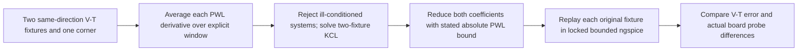

# IBIS switching-weight research

This spike is stacked on `fix/routed-ddr3-level4` (329a32c, PR #75).
The production path is unchanged. `convertPackaged` accepts an optional fourth
research argument `{ windowSeconds, coefficientTolerance }`. No pipeline caller
supplies it. A voltage qualification is required before enabling it generally.

`weight-fit.ts` solves the same two-fixture KCL as the pinned converter. It replaces
nonuniform three-point differentiation on the union of independently sampled V-T
tables with each fixture's exact average PWL derivative over a stated time window.
It samples the solution on a uniform half-window grid and reduces both weight
columns together. The reduction has a continuous absolute coefficient error bound
of `coefficientTolerance` relative to that sampled PWL. This bound does **not**
cover the derivative averaging or imply a bound on arbitrary loaded outputs.
Negative, greater-than-one and nonmonotone coefficients are retained. Near-singular
fixtures are rejected at a dimensionless determinant threshold corresponding to a
condition number of about one million; the spike does not invent missing fixture
information through a prior.

## Sources and interpretation

- [IBIS 8.0 specification](https://ibis.org/ver8.0/ver8_0.pdf), Rising/Falling
  Waveform: up to 1000 rows, increasing time, complete initial/final DC states,
  time correlation between fixtures of the same direction. The specification
  defines the data format; it does not mandate a particular simulator extraction
  or smoothing algorithm.
- [IBIS Modeling Cookbook](https://ibis.org/cookbook/cookbook-v4.pdf), §§3.2.2–3.2.3:
  the normal push-pull recommendation is rising **and** falling into both GND and
  VCC resistive fixtures, package/reactive fixture terms removed, C_comp retained,
  common input reference time, settled endpoints. Versions through 3.2 allow 100
  points; version 4.0 increases this to 1000. §5.3 discusses concentrating points
  where curves change. The point count is a ceiling, not a minimum simulator step.
- [Giacotto/Muranyi, Intel, 2003](https://ibis.org/summits/jun03a/muranyi1.pdf),
  pp.5–8: two equations/two unknowns, including C_comp*dV/dt. The same KU/KD
  across loads is a modeling assumption, rather than an exact transistor identity.
- [Ross, 2004](https://ibis.org/email_archive/0716.html): equal or unsuitable
  fixtures can make the equations singular; EDA vendors use different protection.
  Prefer independently informative GND/VCC fixtures. This is primary historical
  commentary, not a disclosure of current proprietary tool internals.
- [Chen, Synopsys, 2008](https://ibis.org/summits/nov08a/chen.pdf): constrained
  single-waveform extraction is possible only with extra assumptions and is
  compared across loads; it does not establish KU+KD=1 for two-waveform data.
- [Chen, Synopsys, 2016](https://ibis.org/summits/nov16a/chen.pdf): proper reactive
  fixture/DUT de-embedding can make coefficients noisier while improving replay.
  This argues against cosmetic monotonicity/clipping without voltage validation.
- [Wang et al., 2011](https://www.ibis.org/users_archive/3238.html): commercial
  implementations differ in interpolation, endpoint extension and smoothing;
  automatic correction can itself cause incorrect results.

Condition-aware least squares/SVD, regularization and monotonic constraints are
reasonable numerical candidates, but I found no primary public source establishing
one universal commercial recipe or a spec requirement for such processing.
For more than two informative fixtures, a residual-qualified joint fit is sensible;
for rank deficiency, rejection is preferable to silently claiming a unique answer.
This spike addresses derivative sensitivity in well-conditioned equations.

## Preliminary native evidence

Private/vendor-derived data, complete decks and plots stay in the requested local
scratchpad; no vendor tables or board JSON are included in the repository.
Initial Model_352 typical fixture replay: original 196/197 rising/falling knots,
worst peak error 4.820 mV; 10 ps window and 0.001 reduction: 92/83 knots, worst
peak error 1.364 mV. These are sampled ngspice reconstruction measurements, not
an arbitrary-load guarantee. Further model/corner and board qualification follows.

## Reproducing the experiment

Use `scripts/research-ibis-weights.tsx fixtures`, `boards`, or `ddr` with
`IBIS_MODEL_DIR`, `SI_IBIS_EVIDENCE` (a private scratch directory) and
`SI_NGSPICE_LOCK` (the supplied machine-wide lock script). The DDR command also
requires `SI_DDR_NETWORK_INPUT`, a private saved `RouteNetworkSolver` constructor
input. It recompiles that geometry with freshly rebound baseline and fitted
buffers from this branch; it does not use the older archived deck's stitch bug.
Each invocation launches `research-ibis-native.mjs` under the shared lock. Native
execution is capped at 60 seconds per fixture, 120 seconds per small board and
600 seconds per DDR variant, with OMP_NUM_THREADS=1. Waiting for the shared slot
is excluded from the recorded engine wall time.

The fixture command uses every rising/falling waveform in the selected models
(two of each), all three consistent corners, no package, and each table's own
R_fixture and V_fixture. It keeps C_comp, clamps and current signs. The maximum
error is calculated over the union of native samples and original V-T knots:
this is the exact maximum difference between the two **PWL representations**.
RMS uses the analytic integral of their squared PWL difference over time. Native
discretization and arbitrary-load modeling error are separate limitations.

The board command starts from the existing TwoTraceBoard and level1-differential
TSX sources. Geometry, package networks, output sampling policy, tolerances and
integration method are held fixed; only the explicit buffer fit differs.
Measured full-grid maxima so far: two-trace DATA 5.059 mV, victim far 3.479 mV,
victim near 1.391 mV. Differential BUS 11.782 mV, P 14.958 mV, N 14.908 mV.
The differential run stores 278879 → 160673 native samples and takes
49.033 → 18.812 seconds. These are candidate comparisons, without independent
full-board convergence qualification or a promise of sub-mV baseline parity.
