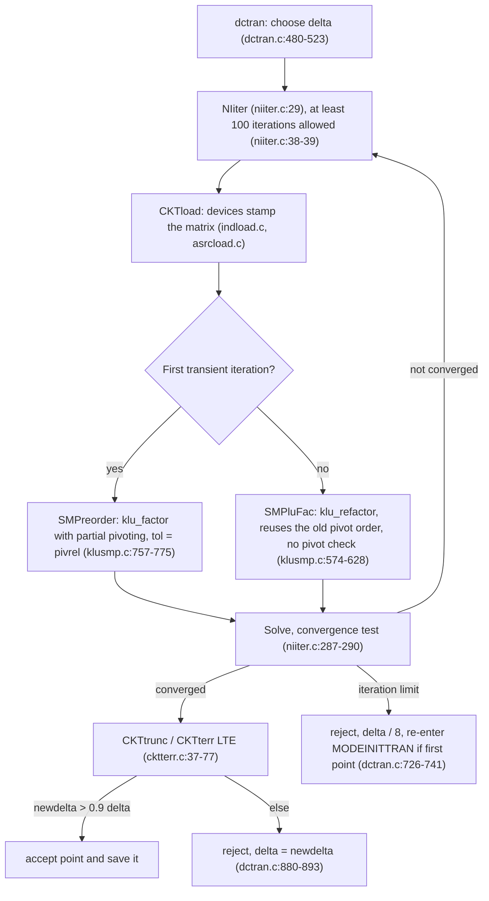

# ngspice step profile of the routed DDR3 level-4 deck

## Verdict

**Root cause found.** On the routed DDR3 address/command deck (PR #75 head
`329a32c`), native ngspice spends its time in **LU refactorization with
8.9 million fill-in entries**, not in extra timesteps, Mutual-inductance
loading or IBIS tables. The fill comes from the deck format: the causal
skin-loss ladder emits **nine pole stages per cell, and every stage repeats the
whole coupled skin matrix** (a normalized resistance multiport plus `K`
couplings). Nine stacked copies of the cell-coupling graph make the KLU factors
12 times denser than the matrix.

Every pole uses the same matrix `S` scaled by a scalar, so the skin impedance is
exactly `Z(s) = z(s) S`. One normalized multiport for `S` driven through a
per-cell unit Foster stage sequence realizes it with a single coupled layer.
That removes 93% of the fill and makes a Newton iteration 25 to 150 times
cheaper. The single-layer realization also needs a stricter KLU pivot
tolerance (`pivrel`) to start reliably. The reason is traced through the
ngspice source below.

| Same 0 to 1 ns quiet window | Base deck | This PR |
|---|---:|---:|
| LU fill-in | 10,939,098 | 2,061,610 |
| Factor time per Newton iteration | 1.442 s | 0.053 s |
| Transient time per saved point | 2.930 s | 0.129 s |
| Total analysis | 314.2 s | 14.1 s |
| Accepted/rejected points, iterations | 90/0, 178 | 90/0, 178 |
| Largest receiver-probe difference | reference | 0.0001 mV |

On a 0 to 150 ps window that includes the driver edge, the two realizations accept
the same 273 points. The largest difference over 48 driver-pad and receiver-probe
voltages is 0.12 µV, on a 46.7 mV swing. Base took 501.0 s and this PR 35.7 s.
This PR's realization also runs the emitted 8 ns window through the switching
activity: all 24 receiver probes switch, and the run was stable through 6.09 ns
when the 540 s bound stopped it. This deck had never produced a switching DDR
waveform before. A completed 8 ns waveform is still open: it needs an estimated 12 minutes,
which is over the 10 minute native bound.

## Setup

| Item | Value |
|---|---|
| Deck | `scripts/run-routed-ddr3.tsx --addr-cmd` compile of PR #75 head `329a32c`, 1,835 cells, 17,520,180 bytes, SHA-256 `937e35f8…`, 36,814 `K` lines (32,866 skin-pole, 3,672 main ladder, 276 IBIS package) |
| ngspice | 47 (`ngspice -v`: "Compiled with KLU Direct Linear Solver"), Homebrew build, tag `ngspice-47`, commit `a80f6e3` used for every source citation |
| Machine | Apple M5, 16 GB, `OMP_NUM_THREADS=1`, one native solve at a time through the shared lock, every run under a 10 min bound |
| Counters | `.options acct` (ngspice's own accepted/rejected points, Newton iterations, reorder/factor/load time, fill) plus `/usr/bin/time -l` |

Measurement caveats. Each row is a single observation. Other agents' CPU load
varied from load average 2 to 12 during this work, and the laptop slept on
battery during some waits. Absolute seconds can therefore differ by up to 2.5x
between rows; the same deck measured 1.21 s/iteration (base4) and 3.12
s/iteration (b1-base). Structural counters (equations, nonzeros, fill,
iterations, points) are deterministic and are the primary evidence. Wall time
excludes lock waiting.

## Measured table: 0 to 123 ps quiet window (10 output steps)

All rows use the same window, `.tran 12.31p 123.1p 0 12.31p`, and the deck's own
options (`klu reltol=1e-4 abstol=1e-9 vntol=1e-6 method=gear maxord=2`) unless
stated. "Factor/it" is transient factor time divided by transient Newton
iterations.

| Run | Deck change | Equations | Matrix nonzeros | LU fill-in | Accepted/rejected points | Newton iterations | Reorder, s | Factor/it, s | Transient/point, s | Total analysis, s |
|---|---|---:|---:|---:|---:|---:|---:|---:|---:|---:|
| base | none (PR #75 head) | 176,270 | 731,842 | 8,903,504 | 21/0 | 40 | 34.71 | 3.124 | 6.397 | 241.3 |
| base, 4 steps, low load | none (reference deck `fabb0f…`) | 176,270 | 731,842 | 8,924,894 | 17/0 | 32 | 20.39 | 1.214 | 2.484 | 103.3 |
| Sparse 1.3 | `.options sparse` | n/a | n/a | n/a | killed at 540 s | n/a | n/a | n/a | n/a | > 540 (KLU: 241) |
| no K | all 36,814 `K` lines removed | 176,270 | 658,214 | 3,436,621 | 21/0 | 40 | 2.52 | 0.270 | 0.588 | 22.6 |
| no skin-pole K | 32,866 `KARCP` removed | 176,270 | 666,110 | 4,646,787 | 21/0 | 40 | 3.53 | 0.523 | 1.096 | 35.2 |
| no skin-pole mutual R | 67,106 `GARCS` mutual stamps removed | 176,270 | 664,736 | 3,135,836 | 21/0 | 40 | 2.23 | 0.277 | 0.600 | 23.1 |
| no skin-pole coupling | both of the above (physics changed) | 176,270 | 599,004 | 447,982 | 21/0 | 40 | 0.12 | 0.012 | 0.055 | 6.3 |
| K top-2 per inductor | keep the 2 strongest `K` per inductor | 176,270 | 680,594 | 8,687,259 | 32/12 | 86 | 12.97 | 1.387 | 3.905 | 162.3 |
| no Debye network | all `ARCG` dielectric-loss elements removed | 48,236 | 321,937 | 5,932,172 | 21/0 | 40 | 17.98 | 0.841 | 1.731 | 89.1 |
| exact skin, E chain | prototype: one VCVS term per mutual entry | 182,242 | 625,956 | 615,441 | 21/0 | 40 | 0.80 | 0.021 | 0.079 | 10.4 |
| exact skin, VCCS | this PR's emitter, default `pivrel` | 169,242 | 590,444 | 1,295,209 | 21/0 | 40 | 0.15 | 0.030 | 0.084 | 5.1 |

Only the "no skin-pole coupling" row changes the physics; its fill is the lower bound for
any exact single-layer realization. The exact rows reach 615k to 1.3M fill.

0 to 1 ns quiet window (the reference research window, `.tran 12.31p 1n 0 12.31p`):

| Run | LU fill-in | Accepted/rejected | Newton iterations | Factor/it, s | Total analysis, s | Result |
|---|---:|---:|---:|---:|---:|---|
| base (PR #75 deck) | 10,939,098 | 90/0 | 178 | 1.442 | 314.2 | complete |
| exact skin, default `pivrel=1e-3` | 584,775 | 427/163 | 2,790 | 0.032 | 63.7 | diverged at 16.7 ps |
| exact skin, `pivtol=1e-30` | 584,775 | 427/163 | 2,790 | 0.023 | 50.2 | same divergence |
| exact skin, `pivrel=0.01` | 1,453,851 | 90/0 | 178 | 0.024 | 8.6 | complete |
| exact skin, `pivrel=0.1` (this PR) | 2,061,610 | 90/0 | 178 | 0.053 | 14.1 | complete |

Full emitted window (0 to 8 ns, switching starts at 2.70 ns):

| Run | Result |
|---|---|
| base | not attempted: about 2.9 s per quiet point; a previous 8 ns attempt in `examples/level4-ddr3-write/README.md` aborted at 1.93 fs |
| exact skin, default `pivrel` | diverged at 14.8 ps (549 accepted, 245 rejected, 3,390 iterations at 0.023 s) |
| exact skin, `pivrel=0.01` | aborted at 2.743 ns, at the driver edge (`xibis0.pkgd0`) |
| exact skin, `pivrel=0.1` (this PR) | stable through 6.09 ns when the 540 s bound stopped it: 4,214 finite points, all 24 receiver probes switch (min -0.597 V, max 2.165 V) |
| exact skin, ideal sources instead of IBIS | quiet 0 to 2.6 ns at the step cap (245 points, 36 s); stopped at the first synthetic PWL corner |

## Where the time goes

All paths are under `src/` of ngspice tag `ngspice-47` (commit `a80f6e3`).

**Solver selection.** `.options klu` sets `TSKkluMODE` and `.options sparse` clears it
(`spicelib/analysis/cktsopt.c:180-185`). The task default is `CKTkluOFF`
(`spicelib/analysis/cktntask.c:142-143`), so the deck's explicit `.options klu` is what selects KLU.
Every run printed "Using KLU as Direct Linear Solver" (`spicelib/analysis/cktsetup.c:152-155`).
In KLU mode a reorder is `klu_factor` with partial pivoting and `Common->tol = pivrel`
(`maths/KLU/klusmp.c:757-775`). Every other factorization is `klu_refactor` (`maths/KLU/klusmp.c:574-628`).
`PivTol` is ignored there (`klusmp.c:578`), and by KLU's own contract the routine
"cannot do any numerical pivoting" (`maths/KLU/klu_refactor.c:8-10`). KLU keeps a
diagonal pivot whenever it is at least `tol` times the column maximum (`maths/KLU/klu_kernel.c:469-475`).
The defaults are `pivrel = 1e-3` and `pivtol = 1e-13` (`spicelib/analysis/cktntask.c:123-124`).

**Newton iteration.** `NIiter` raises any iteration limit below 100 to 100
(`maths/ni/niiter.c:38-39`), so `itl4=100` has no effect; the measured runs with
`itl4=100` repeat the default's 382 iterations exactly. A reorder, meaning a full `klu_factor`, happens only
at `MODEINITJCT`, on the first iteration of `MODEINITTRAN` (`niiter.c:107-111`), or after a singular
refactor (`niiter.c:162-176`). Otherwise each iteration loads, refactors and solves. The
convergence test runs only from the second iteration (`niiter.c:287-290`), so every
accepted point costs at least two loads, two refactors and two solves. The deck
measured 1.9 to 2.0 iterations per quiet point.

**Step choice.** The first step is `MIN(tstop/100, tstep)/10` (`spicelib/analysis/dctran.c:124`),
capped at `tmax` (`dctran.c:480`). It is cut again by 10 at the first time point after the
t = 0 breakpoint (`dctran.c:489-516`). This gives the measured first steps of 1e-13 s
(tstop 1 ns), 1.23e-13 s (tstop 8 ns) and 3e-14 s (tstop 0.3 ns). `delmin` is `1e-11 * tmax`
(`spicelib/analysis/traninit.c:36`). The first accepted point skips the truncation check
(`dctran.c:784-789`). After that, `CKTtrunc` runs `CKTterr` for every capacitor charge and inductor
flux (`dctran.c:795-801`, `spicelib/devices/ind/indtrunc.c:24`). `CKTterr` limits the step to
`trtol * max(abstol + reltol |i|, reltol max(|q|, chgtol)/delta) / max(abstol, c |divided difference|)`,
taking the order-th root (`spicelib/analysis/cktterr.c:37-77`). The defaults are `trtol = 7` and
`chgtol = 1e-14` (`cktntask.c:98-104`). A point is accepted when the new step is more than 0.9 of
the old one, and otherwise redone with the smaller step (`dctran.c:801`, `880-893`). A Newton failure
backs the time up, divides the step by 8 and sets order 1 (`dctran.c:726-741`). Falling under `delmin`
twice is "Timestep too small" (`dctran.c:896-914`). PWL voltage sources register only their next corner
as a breakpoint (`spicelib/devices/vsrc/vsrcacct.c:175-197`). B-source `pwl()` tables register none.

**A failed first point poisons the history.** On a first-point Newton failure, dctran re-enters
`MODEINITTRAN` (`dctran.c:738-740`) without restoring the solution vector; `CKTrhsOp` is
only saved (`dctran.c:327`). The retry's first load computes each inductor flux from the
current, unconverged iterate (`spicelib/devices/ind/indload.c:46-47`). It then copies that flux into the
history slot `state1` (`indload.c:104-106`), and capacitors do the same with their charge
(`spicelib/devices/cap/capload.c:60-62`). The integrator history then no longer equals the
operating point. That is the mechanism behind the start-up runs below: every run whose first attempt
failed was rejected into tiny steps and diverged, and every run whose first attempt converged went on.

**Mutual inductance and B-sources per iteration.** `K` elements are loaded inside the inductor
load: two flux updates and two matrix stamps per coupling per iteration
(`spicelib/devices/ind/indload.c:52-82`). For 36,814 couplings that is about 150k
floating-point operations per iteration, which is negligible. The positive-definiteness check of each
coupled inductor group (Cholesky) runs once at setup (`spicelib/devices/ind/muttemp.c:166-202`). This
deck only ever reported "incomplete set of K couplings", never "not positive definite". Each B-source
evaluates its parse tree with derivatives and stamps `2 * numVars` entries per iteration
(`spicelib/devices/asrc/asrcload.c:38-114`). `pwl()` is a binary search over the table
(`spicelib/parser/ptfuncs.c:342-378`). Measured "transient load time", which covers all devices including
144 B-sources, 36,814 K and the PWL sources, was 0.31 s of a 42.2 s transient (0.7%) on the base deck.

## Root cause

Timestep control is not the cause. ngspice saves every accepted point, and the
counters show 0 rejected points in every quiet base run. After the start-up
ramp (`dctran.c:124`, `489-516`), steps sit at the `tmax = tstep = 12.31 ps` cap.
The deck used 1.9 to 2.0 Newton iterations per point, which is the minimum
(`niiter.c:287-290`). The 1 ns reference run's 90 points are 81 capped steps plus the ramp.
Loosening `reltol`, `chgtol` or `trtol`, or switching to `method=trap`, cannot lengthen a step that is
already at `tmax`, and `itl4` cannot raise the iteration count (`niiter.c:38-39`).

Device loading is not the cause either. Transient load time is 0.7% (0.31 s of 42.2 s),
and a macOS `sample` of 15 s, started 130 s into a bounded base run (after its 50 s
operating point), has 98.4% of 12,738 top-of-stack samples in
`klu_refactor`. `INDload`, which includes all 36,814 `K` couplings, has 0.27%, and B-source
evaluation is below the 5-sample listing threshold. Each iteration is one `klu_refactor`
(`klusmp.c:591`) over 9.6M LU entries.

The fill comes from the skin network. The ladder emits, for every one of 1,835 cells,
nine pole stages (`causalLossPoles`, 10 kHz to 1 THz). For each pole, `seriesEnergy` emitted the full
coupled skin matrix twice: once as a normalized resistance multiport (an
auxiliary node and `GARCS` mutual stamps) and once as `K`-coupled pole inductors. The
unknowns of each stage are coupled to the neighbouring cells in the same stage
and in series with the next stage. That is a three-dimensional graph, cells times
neighbours times nine stages, whose minimum-degree LU fill is 12 times the matrix.
The table isolates the layers. Removing only the pole `K` leaves 4.65M fill, removing only the pole
mutual R leaves 3.14M, and removing both leaves 0.45M, but those runs change the physics. The
dielectric (Debye) network adds 128,034 of the 176,270 equations but only about 3M fill,
because its internal nodes have degree two.

## Fix and parity

`skinEnergy` (`src/simulation/route-energy.ts`) replaces the per-pole loop in
`route-ladder.ts`. Because `R_p = skin_p S` and `L_p = R_p / rate_p` for every pole,
`Z(s) = z(s) S` with the scalar `z(s) = sum skin_p s / (s + rate_p)`. A coupled row `i` emits:

| Element | Equation |
|---|---|
| `GARCSI` series VCCS from the skin input to the skin output | `I_i = x_i / sqrt(S_ii)` |
| `GARCSV` plus `GARCS{i}_{j}` on the auxiliary node `x_i` | `sum_j Sn_ij u_j = (V_in - V_out) / sqrt(S_ii)`, with `Sn_ii = 1` |
| `GARCSF` and nine `RARCF`/`LARCF` R ‖ L stages from `u_i` to ground | `u_i = z(s) x_i` |

Uncoupled rows keep their existing scalar R ‖ L stages (byte-identical lines). The
realization is exact, not a reduction. `tests/simulation/route-energy.test.ts` checks every
emitted branch's complex KCL at the exact AC solution `V = z(jw) S I` at 1 MHz, 1 GHz
and 20 GHz to 1e-12 A, and three deliberate sign/value mutations fail it. The DDR ladder now has one
auxiliary multiport row per coupled cell (1,004) instead of one per coupled cell and pole (9,036),
and no `KARCP` lines. The DDR deck shrinks
from 17,520,180 to 11,657,225 bytes.

Parity (single observations, probe differences interpolated on the union of
native timestamps):

| Case | Window | Base points | New points | Largest difference | Swing |
|---|---|---:|---:|---:|---:|
| TwoTraceBoard default (sn74lvc1g04), with `pivrel=0.1` | 0 to 40 ns | 2,093 | 2,110 | 0.626 mV | 3.77 V |
| DDR3 addr/cmd, 24 receiver probes | 0 to 1 ns quiet | 90 | 90 | 0.0001 mV | 0.0002 mV |
| DDR3 addr/cmd, 24 driver pads + 24 receiver probes | 0 to 150 ps of the driver edge (PWLs advanced 2.68 ns, test-only edit on both decks) | 273 | 273 | 0.00012 mV | 46.7 mV |

The base DDR deck cannot reach a receiver-side edge, which starts at about 3 ns, within the
10 minute native bound. A receiver-side switching parity against base is therefore not
measured. The new deck's receivers switch in the bounded 6.09 ns run.

## Separate finding: start-up boundary

The first version of the fast realization diverged at start-up even though nothing was
switching. In the 0 to 1 ns and 0 to 8 ns windows its first attempted point (1e-13 s and
1.23e-13 s) failed Newton and was cut by 8. Tiny LTE-limited steps followed, and the
receiver probes grew to 1e16 V before "Timestep too small".

What was ruled out:

| Candidate | Check | Result |
|---|---|---|
| Different operating point | compared all 150,165 shared `.op` values | identical within 2.5 nV |
| Non-passive coupled matrices | eigenvalues of skin `Sn`, main `L` (`K`) and IBIS package `L`, per coupled group | all positive definite (smallest normalized eigenvalue 0.34) |
| Negative element values | every `R`, `L`, `C` | none |
| Active IBIS slopes at the operating point | pull-down, clamp tables at the pad voltage | passive |
| Newton iteration limit | `itl4=100` | no effect, forced to at least 100 (`niiter.c:38-39`) |
| `gmin=1e-15`, `method=trap`, `pivtol=1e-30` | same window | same failure |
| IBIS models | ideal Thevenin drivers and 1 pF receivers | quiet hold runs at the step cap |

`pivrel=0.1` removes the failure. The base realization's auxiliary rows each
have a unit resistor on the diagonal. The new auxiliary rows have none. KLU keeps a
diagonal pivot down to `tol` times the column maximum (`klu_kernel.c:469-475`) and then
`klu_refactor` reuses that order without any numerical pivoting
(`klu_refactor.c:8-10`). With `tol=1e-3`, the first transient factorization's pivots are good enough for base but not
for the new rows. `pivrel=0.01` passes 1 ns but aborts at the 2.743 ns driver edge;
`pivrel=0.1` passes both. When the first point fails, the retry starts with a corrupted history
(`dctran.c:726-741` with `indload.c:46-47`, `104-106`, `capload.c:60-62`), which is why the run never
recovers. The divergent mode needs the IBIS models: the same deck with ideal sources does not diverge.
Which IBIS element supplies the growth was not isolated. `pivrel=0.1` raises fill from about
0.6M to 2.1M on this deck; it is still 5 times less than base and 27 times cheaper per iteration.

## Hypotheses checked

| Hypothesis | Bounded measurement | Result |
|---|---|---|
| KLU versus Sparse 1.3 | `ngspice -v`, stdout banner, `.options sparse` | KLU is used (`cktsopt.c:180-185`, `cktsetup.c:155`). Sparse 1.3 did not finish 123 ps in 540 s (KLU: 241 s) |
| `K` coupling alone | all `K` removed; only skin-pole `K` removed; strongest 2 per inductor | fill 8.90M to 3.44M / 4.65M; top-2 keeps 8.69M fill and adds 12 rejected points. Truncation is not a fix: the pole mutual-R layers keep the fill |
| Matrix fill | `acct` nonzeros, reorder and factor time | 731,842 nonzeros, 8.90M fill, reorder 20 to 35 s once, factor 92 to 97% of transient time |
| Timestep control | accepted, rejected and saved points; option sweep on the fast deck | saved = accepted, 0 rejected, steps at `tmax`; `reltol`/`chgtol`/`trtol`/`trap`/`itl4` cannot help a capped step (see Root cause) |
| IBIS B-sources and PWL tables | load time, `sample`, ideal sources | 0.7% load time, 0.27% `INDload`, B-source below listing; ideal sources change start-up stability, not per-step cost |
| macOS sampling | `sample` 15 s of base transient, 10 s of fast-deck switching | base 98.4% `klu_refactor`; fast deck 81.0% `klu_refactor`, 4% `CKTterr`, 1.9% `INDload`, 0.14% B-source |
| Prior negative results not repeated | CPL (PR #78), coupling groups (PR #79), IBIS weights (PR #80) | not rerun |

## Evidence

Raw decks, logs, raw waveforms, scripts and the ngspice source checkout are outside
the repository under the session scratch directory `si-research/step-profile/`.
Vendor IBIS files, board JSON and generated decks are not committed.
