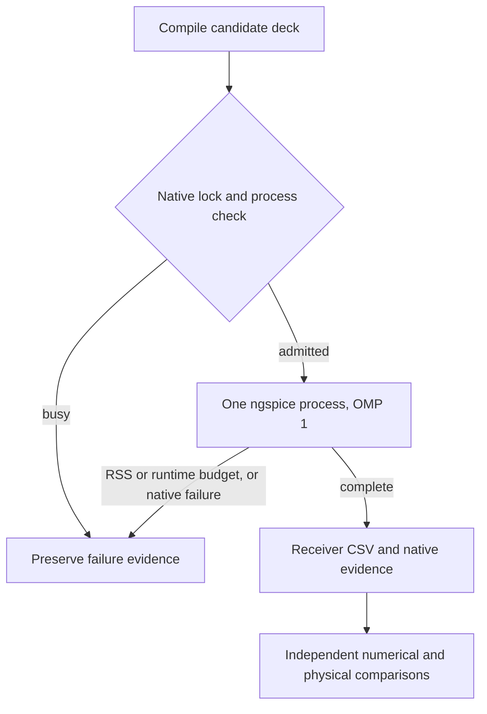

# Routed 2D validation and transient cost (step 3)

The subsequent [step-4 mechanism investigation](routed-2d-step4.md) fixes the
geometric coupling cutoff and records controlled tests, finite-return and full
magnetic hybrid ablations, and updated full-duration verdicts. Both quiet-victim
cases still fail; the path remains unqualified. The measurements below are the
unchanged step-3 baseline.

The owning repository is `tscircuit/signal-integrity-pipeline`, branch
`feat/si-2d-extraction`, starting at `f7c0b68`. These are local experiments;
no push, PR or merge is authorized. Vendor IBIS, original board bytes, generated
decks and waveforms remain ignored. This work does **not** qualify the physical
DDR3 model or enable the before/after route-edit loop.

## Part A: accepted 3D comparison

The unchanged RFC TSX boards were rendered through sibling core
`feat/coupled-package-model`. Model hashes, actual signals/patterns/seeds,
reference archive hashes and per-probe measurements are in
`tests/evidence/signal-levels/routed-2d-comparison.json`. Reference samples come
from each accepted `numerical-refinement-2/waveform.csv.gz` under
`runs/final-rfc/`, **not** the decimated example CSVs. Captures cover the original full durations: **7.2 us** at 20 Mbps or **576 us**
at 250 kbps, including startup. No alignment
or time shift is applied. Squared piecewise-linear differences are integrated
exactly on the union of native adaptive times. Extrema retain every native sample.

| RFC board/block | Native 2D time s | Worst RMS mV | Positive-extremum difference mV | Negative-extremum difference mV | Maximum threshold-edge difference ps | 1% + 1 mV verdict |
| --- | ---: | ---: | ---: | ---: | ---: | --- |
| level1-single-ended | 8.665 | 42.432 | 58.771 | 0.437 | 10.508 | Fail extrema |
| level1-differential | 20.041 | 0.699 | 0.016 | 0.006 | 314.121 | Pass this case |
| level2-two-channels | 22.325 | 124.101 | 260.328 | 26.903 | 49.845 | Fail |
| level3/TRAFFIC | 36.048 | 148.557 | 427.224 | 41.682 | 80.368, D0/D2 only | Fail; D1 crossing counts differ |
| level3/XTALK_LOW | 37.305 | 107.586 | 1175.084 | 877.357 | 41.960 | Fail |
| level3/XTALK_HIGH | 31.269 | 123.585 | 1356.489 | 1428.653 | 41.820 | Fail |

Thresholds are 1.65 V for single-ended RFC channels and 0 V differential.
Edges are paired by direction and ordinal only when counts agree. For TRAFFIC D1 the accepted 3D waveform has 38 falling / 39 rising crossings,
versus 36 / 37 in 2D; its edges cannot be paired reliably. Quiet victims
have no threshold crossings. Extrema differences are also overshoot/undershoot
differences when referenced to the same nominal rails. The differential edge
delta must be interpreted against its much slower transceiver, not a DDR edge.
These are model-to-model differences, not measurement error bounds.

Bounded full-duration checks show that finer single-ended ladders do not resolve
its discrepancy: 3→6 cells changes RMS / extrema by 2.685 / 7.261 mV; 6→12
changes them by 0.652 / 3.113 mV. Halving the timestep changes 1.640 / 1.841 mV.
All self-checks pass the policy, but the 12-cell result still differs from 3D by
45.344 mV RMS / 58.545 mV extrema. The three checks take 10.895, 17.443 and
13.417 s native; `routed-2d-single-convergence.json` retains their measurements.

| Quiet D1 | Accepted 3D positive / negative excursion mV | Routed 2D positive / negative excursion mV |
| --- | ---: | ---: |
| XTALK_LOW far | +1175.084 / -877.357 | <0.00001 / >-0.00001 |
| XTALK_LOW near | +188.505 / -135.213 | <0.00001 / >-0.00001 |
| XTALK_HIGH far | +1356.489 / -1428.654 | <0.00001 / >-0.00001 |
| XTALK_HIGH near | +163.942 / -176.831 | <0.00001 / >-0.00001 |

The accepted independently solved idle levels are used for 3D quiet amplitudes.
The 2D idle is sampled at 10 ns, after startup and before the first 50 ns bit
boundary; its observed excursions remain below 10 nV. The **1 mm coupling
horizon** separates the RFC's parallel traces spaced 4 mm apart, despite their
common relatively distant reference plane. This is an identified omission,
not an effect that can be dismissed as a small quasi-static error.

A diagnostic 8 mm horizon on the shorter **16-bit prefixes** (0.8 / 64 us)
recovers nonzero coupling but still fails: worst RMS
126.298 mV for TRAFFIC, 78.059 mV for XTALK_LOW and 84.008 mV for XTALK_HIGH;
quiet-victim extrema still differ by up to 492.744 mV. Widening a horizon alone
does not qualify the path. Other physical differences include finite 3D return
planes and their edges, ends, bends, via/return transitions and contacts; the 2D
model's assumed planar mask and Debye dispersion; and causal frequency-dependent
loss versus the accepted 3D channel's constant-frequency matrices. Attribution
of the remaining discrepancy to any one term is an inference requiring controlled
ablations. Coplanar pours remain undiscretized in routed 2D; the RFC cases use
bottom references, so coplanar pours do not explain these particular failures.

The differential board also exposed a real admission bug: physical termination
stubs sharing receiver pins were incorrectly passed to the unique-channel-endpoint
check. The TSX reproduction fails at `cdb5029`; its fix maps declared signal
endpoints while cutting all physical route traces, retaining the termination.
No native process is required by that test.

Reproduce with the environment from `docs/routed-2d.md`:

```sh
node --import tsx scripts/compare-routed-levels.tsx
uv run --with numpy --with matplotlib python scripts/summarize-routed-levels.py
SI_ROUTE_COUPLING_MM=8 SI_ROUTE_DURATION_NS=800 node --import tsx scripts/compare-routed-levels.tsx three
```

The local comparison plot is
`runs/routed-2d/step3/part-a-full/comparison.png`; native receiver CSVs,
per-case extraction ledgers and comparisons are under the same directory. The
analysis streams reference archives in 50,000-row chunks; all 105 checked metrics
match the dense calculation. Its first dense pass exceeded the requested memory
limit (1.57 GiB RSS); the replacement full analysis took 12.33 s and 258 MiB RSS.
No native solver exceeded the sampled memory limit.

## Part B: bounded transient experiments

The retained implementation exposes `SI_ROUTE_CELLS_PER_RISE` (runner default 2,
standalone ladder default 10). The existing energy-preserving arc integration
already merges short geometrical slices and protects ports/branches; this change
calibrates its conservative electrical-length bound rather than inventing a
second geometrical simplifier. The cell delay bound is rise time divided by this
factor and spatial refinement. On DQ0 the minimum **tested passing** setting is
2: 52 cells. Settings 0.5 and 1 leave the selected long interval too coarse.
No global accuracy guarantee follows from this board-specific calibration.

Checkpoint output is bounded: a 160 ns capture now writes seven growing native
snapshots instead of 321. Stops resume the same native state. This is not a
process-restart/binary-checkpoint implementation. Gear2, KLU, nine loss poles and
the existing reltol=1e-4 / abstol=1 nA / vntol=1 uV remain. Native execution is
shared by the RFC and DDR runners, with one cross-process lock, a system process
check, forced OMP_NUM_THREADS=1, sampled 1 GiB RSS and 1,200 s runtime/projection
guards. Failed runs preserve actual sampled native usage and checkpoint data.



Times below are **ngspice wall seconds**, including operating point and output,
unless explicitly marked compilation or fitting. They are observations, not a
controlled machine-throughput claim. Some field work and non-native tests ran
concurrently. All successful 4 ns DQ0 voltage errors use the accepted step-2
427-cell / 5 ps receiver as reference, on the complete native union time grid.

| Method on DQ0, 4 ns | Wall s | RMS difference mV | Signed-extrema difference mV | Decision |
| --- | ---: | ---: | ---: | --- |
| Archived step-2 ladder, 218 cells | 117.860 | 0.401 versus 427-cell spatial refinement | 0.425 | Historical baseline; earlier equivalent shunt realization |
| Archived refined ladder, 427 cells | 385.025 | Reference | Reference | Accepted finite-window reference |
| 24 cells, factor 0.5 | 0.943 | 22.687 | 38.533 | Reject accuracy |
| 28 cells, factor 1 | 1.305 | 22.687 | 38.533 | Reject accuracy |
| 52 cells, factor 2, Gear2/KLU | 3.577 | 5.575 | 5.923 | Keep; maximum threshold shift 3.849 ps |
| Same 52 cells, Trap/KLU | 3.389 | 5.537 | 5.798 | No material gain; keep Gear2 |
| Same 52 cells, Gear2 without KLU | 22.993 | 5.575 | 5.923 | Reject performance |
| Same 52 cells, 20 ps maximum step | 3.366 | 5.578 | 5.960 | No material gain; retain 10 ps |
| Uniform-slice modal T lines + full Foster/Debye matrices | 28.747 preparation/compilation | Not measured | Not measured | Reject before native: 1,558 conductor segments, 19.4 MB deck |
| 11-port vector fit, 20 iteration passivity attempt | 4.169 sampling/fitting/enforcement | Not measured | Not measured | Reject passivity; max S-entry error 0.243 |
| Higher-order fit, 40 iteration passivity attempt | 72.344 fitting/enforcement | Not measured | Not measured | Reject passivity and fit accuracy |

The modal prototype diagonalizes the positive L / base-C pair with power-dual
voltage/current transforms, uses ideal delay lines, and retains full matrix loss
networks at each slice end. This avoids silently discarding noncommuting R/G.
It does not merge nonuniform geometry into a single uniform transmission line.
1558 modal conductor segments with two half-Foster networks each exceed the
existing 1024-cell modest-memory admission policy; no native process was started
for that deck. A separate bounded matrix screen across DQ0's coupled sections
took 0.089 s: dropping off-diagonal losses in fixed lossless modes would discard
up to 1.481% of the series-matrix norm and 0.0391% of the shunt-matrix norm over
10 MHz–5 GHz. Those are matrix residuals, **not** receiver-voltage error bounds.
An additional 0.132 s screen matches complex voltage modes by maximum overlap
and phase, using the base-C energy metric: across 85 coupled sections and 41
frequencies, 10 MHz–5 GHz, rotations reach 28.386 degrees. Suppressing transformed
off-diagonal losses changes the squared-propagation generator by up to 1.508%
in relative Frobenius norm. Near-degenerate modes can rotate without comparable
transfer error; neither number establishes a receiver-voltage error bound.
Constant-parameter native LTRA/TXL does not supply the original full causal
matrix losses; see the [ngspice transmission-line manual](https://ngspice.sourceforge.io/docs/ngspice-manual.pdf).
The rejected prototype preserves the original uniform slices; it does not apply
the winning ladder's averaging across nonuniform geometry. Its admission failure
does not establish the cost or accuracy of a further merged modal implementation.

The linear-channel prototype samples all 11 exposed IBIS/package boundary nodes
of the complete passive board network, including vias, pads and oblique C;
packages remain exact in the original IBIS wrappers outside the fitted board
channel. Sparse MNA has 7,386 unknowns and samples 164 frequencies in 1.162 s.
An independent ngspice AC solve at 1.025 GHz agrees with its 11-port column to
2.71e-13 relative (0.094 s native). Original sampled maximum S singular value is
0.999999900. Common-pole vector fitting followed by residue passivity enforcement
fails its continuous-frequency passivity test in both bounded attempts. The
first final fit has maximum / RMS S-entry error 0.243 / 0.0109; the higher-order
attempt deteriorates badly during enforcement. Neither fit is exported into a
nonlinear transient or accepted as passive. There is no claimed ROM waveform
speedup. The local prototype code, samples and rejection evidence are retained
under `runs/routed-2d/step3/rom/` and `rom-refined/`.

This follows [Gustavsen and Semlyen's vector-fitting method](https://www.sintef.no/globalassets/project/vectfit/vf_paper.pdf),
with the bounded implementation and passivity checks from
[scikit-rf](https://scikit-rf.readthedocs.io/en/latest/api/generated/skrf.vectorFitting.VectorFitting.passivity_enforce.html).
Stable poles alone do not establish passivity; the failed passivity gate is
retained, rather than substituting the fitted channel into IBIS.

## Long-window results and remaining admission limits

DQ0 completed **160 ns** (128 UI, exceeding a 127-bit PRBS7 period) with all
original nonlinear buffers, full matrix losses, vias and packages. The 52-cell
capture takes **112.800 s**, 65,217 samples and 40 MiB sampled native RSS. Its
independent 5 ps check takes 124.386 s / 43.7 MiB; its 93-cell spatial refinement
takes 451.482 s / 53.9 MiB. Both cover the **entire 0–160 ns** window:

| Independent check | RMS change mV | Signed-extrema change mV | Maximum 0.75 V edge shift ps | 1% + 1 mV |
| --- | ---: | ---: | ---: | --- |
| 10 ps → 5 ps, same 52-cell network | 0.590 | 0.830 | 0.678 | Pass |
| 52 → 93 cells, same 10 ps maximum step | 5.300 | 2.503 | 5.487 | Pass |

The largest pointwise space difference is 19.16 mV; acceptance uses RMS and both
signed extrema, not a pointwise-error limit. The numerical result remains
`candidate-unqualified` for physical accuracy because Part A fails. The DQ0
receiver range is -0.095477 to 1.595835 V.

The valid lane pilot completes **4 ns**, all 12 receiver vectors (8 DQ, DQM,
DQS differential and both physical DQS pins), with 236 cells in **270.385 s** /
181.25 MiB sampled native RSS. Against the contact-corrected 977-cell original
over its available **0–2 ns** prefix, worst RMS / extrema changes are
0.885 / 3.535 mV and every probe passes. This does not qualify the uncomputed
original 2–4 ns interval. An independent 5 ps pilot completes 2 ns in 115.361 s,
with worst RMS / extrema changes of 0.000094 / 0.000198 mV versus 10 ps. Excluding
the measured 43.978 s startup, it projects **1472.317 s (24.54 min)** for 40 ns.
`lane-40ns-admission.json` therefore records **not admitted**: no 40 ns solve
was started. The requested long full-lane performance target remains unmet.
These short reference/time checks do not exercise a complete received bit stream;
DQ0 has no 0.75 V crossing in their 0–2 ns window.

A candidate using per-arc instead of scope-wide maximum delay gives 147 lane
cells. With original 1 nA current tolerance it either fails at the first edge
or exceeds a bounded 120 s pilot. At 10 nA it completes 4 ns in 119.460 s but
fails accuracy: worst RMS / extrema changes versus the 236-cell pilot are
14.980 / 24.669 mV, with DQS N failing the per-probe policy. Against the 977-cell
0–2 ns reference, multiple probes also fail. The per-arc and uncoupled-resistance
source-elimination candidates are **not retained**. Looser reltol=1e-3 options
on the valid 236-cell grid also fail to produce a competitive bounded pilot;
the Gear variant is stopped at 120 s, and the Trap operating-point attempt is
stopped after 92.397 s without transient progress. These are failures, not
faster completed systems.

Local complete artifacts:

- `runs/routed-2d/step3/dq0-c2-s1-t10-n160/receiver.csv` and `receiver.png`.
- `runs/routed-2d/step3/dq0-convergence.json` and `dq0-convergence.png`.
- `runs/routed-2d/step3/lane-c2-s1-t10-n4/receiver.csv` and `receiver.png`.
- `runs/routed-2d/step3/lane-c2-s1-t10-n4/dqs0-receiver.csv` and `dqs0-receiver.png`.

The committed `tests/evidence/signal-levels/routed-2d-benchmarks.json` records
times, rejected admissions, CSV hashes and convergence summaries. Reproduce the
long capture and its two independent checks sequentially, with the environment
from `docs/routed-2d.md`:

```sh
SI_ROUTE_DURATION_NS=160 node --max-old-space-size=512 --import tsx scripts/run-routed-ddr3.tsx dq0
SI_ROUTE_DURATION_NS=160 SI_ROUTE_STEP_PS=5 node --max-old-space-size=512 --import tsx scripts/run-routed-ddr3.tsx dq0
SI_ROUTE_DURATION_NS=160 SI_ROUTE_REFINEMENT=2 node --max-old-space-size=512 --import tsx scripts/run-routed-ddr3.tsx dq0
```

`SI_ROUTE_CELLS_PER_RISE=0.5`, `1` or `2` selects the bounded section benchmarks;
`SI_ROUTE_DURATION_NS=4` selects their short window. `SI_ROUTE_RUN_DIR` keeps
option variants separate. Convergence comparisons use
`scripts/compare-routed-waveforms.py`; plots use `scripts/plot-routed-waveforms.py`.
The modal and ROM source prototypes remain local rejected experiments, not
production channel implementations.

Validation: typecheck (including the three changed/new TS runners), lint,
module checks, vocabulary checks, focused vendor-backed TSX tests and the full
non-native suite pass. The suite has 240 tests: 214 pass, 26 native/vendor opt-ins
skip. Lint retains the existing 535-line `extraction/mesh.ts` warning.

Before the route-edit loop: resolve the RFC coupling-horizon/3D discrepancies,
obtain an admitted and independently converged long full-lane capture, implement
a usable modal or passive reduced-order channel if needed, and integrate bounded
automatic numerical acceptance into the public result path. Existing material,
coplanar-copper, reference/PDN, oblique magnetic and via-mutual omissions remain.
The AM335x in-memory package sign diagnostic remains conditional evidence;
original vendor bytes are unchanged and never committed. No route edit, push,
PR or merge is performed by this step.
