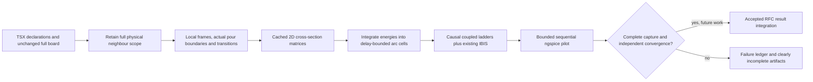

# Routed 2D channel experiment (step 2 candidate)

Step-2 acquisition below is retained as historical evidence. The subsequent
[step-3 comparison and transient benchmarks](routed-2d-validation.md) record RFC
model discrepancies and the current runner's electrical-cell/checkpoint changes.
The [step-4 investigation](routed-2d-step4.md) replaces the fixed coupling cutoff
and adds explicit experimental finite-return hybrids. Both quiet-victim cases
still fail even with full 3D R/L and routed 2D C; the path remains unqualified.

This is an **experimental, incomplete implementation**, not an accepted DDR3
simulation. `pipeline/routed.ts` compiles physical routed copper and the existing
IBIS package/switching models into a candidate ngspice deck. The public RFC entry
still uses the existing 3D stage chain. No vendor models, board JSON, generated
netlists or plots are committed. Run artifacts remain in ignored `runs/routed-2d/`.

## Geometry and scope

`prepareBlocks(..., '2d')` admits whole candidate nets within a 32 mm geometry cap
on the same/adjacent layers, including branched
and unmodelled neighbours. Only the selected channel graph must have supported
endpoint declarations. Quiet mapped IBIS pins retain their existing run states.
Unknown external loads are explicitly recorded as open/ideal-logical terminations;
this does not constitute a complete system/PDN model. Nearby rail wires are ideal
AC electrodes. Their longitudinal impedance is omitted.

The physical route is traversed through wires and explicit vias. A 1 um
Douglas–Peucker chord tolerance reduces dense curved-route tessellation, recording
original and simplified lengths. Width/layer/via boundaries survive. Parallel
overlapping copper of the same electrical net becomes its transverse metal
union, split at branch endpoints. Explicit lateral equipotential joins preserve
original endpoints; lateral spreading R/L
and patch-edge fringing remain omitted and recorded.

Parallel directions have local longitudinal/transverse frames. Sweeps split at
all longitudinal endpoints and intersections with actual pour outer/inner rings.
Groups use actual reference identity and solved pair coupling: retain a pair
when either normalized mutual C or L is at least 0.5%, then solve its connected
component. The 32 mm cap and 40-conductor admission limit are explicit; omitted
fields beyond the cap and aggregate waveform error are not bounded. Cache keys contain
only relative slice geometry and material profiles, not net names or position.
Actual PCB ports and branch junctions protect electrical cell boundaries.
Coplanar pours are not discretized into finite strip conductors in this revision;
pours supply vertical references only. Lateral coplanar shielding/coupling is
therefore an explicit remaining model gap, not a qualified full-copper solution.

The nearest *actual pour copper surface* on each side supplies the references.
Inner4 therefore sees intervening inner5 copper before inner6 when a power pour
is present; `power_references` records every such interval. A different-net plane
is an ideal AC reference approximation with an explicit PDN warning. Centre-line
boundary checks do not calculate 3D lateral edge fields. Where every vertical
reference is void, the nearest actual edge within 2 mm is replaced by a surface
at `hypot(vertical gap, lateral edge distance)`; every such surface records
`lateralGapMm`. This is an unqualified return-detour estimate. Larger unsupported
voids fail. Absent copper-layer volume is filled with the nearest laminate.

Oblique selected-net/neighbour encounters on the same/adjacent layers use a
local parallel electrostatic surrogate at their closest finite-segment points.
Effective length is bounded by both segment lengths and `2h/abs(sin(angle))`.
Pair C is placed at the nearest electrical nodes; placement error, angle, length,
C and outward 1 um spacing rounding are recorded. Magnetic oblique coupling and
neighbour-to-neighbour oblique interactions are explicitly omitted. Touching bend
endpoints are recorded without an invalid parallel-strip substitution. When a
local infinite reference intersects the neighbour strip height, the encounter is
recorded as shielded; finite aperture/plane-edge fringing is omitted. Adding
pair C to isolated self C is a weak-coupling approximation, not an accuracy bound.

## Lines, causal losses and numerical cost

[ngspice's manual, transmission lines](https://ngspice.sourceforge.io/docs/ngspice-manual.pdf)
provides single-line TXL/LTRA and CPL with at most eight coupled lines, constant
losses, and diagonal R/G matrices. Modal
TXL/LTRA requires nontrivial broadband transformations when R/L/C/G do not commute
and discontinuities change conductor sets. The candidate instead uses passive
coupled RLGC ladders with stable Foster loss branches and no native field solver.

Every solved slice contributes its matrix energy by physical overlap length.
Signed congruences map longitudinal current directions onto route-arc electrical
cells. Node-potential projections assemble shunt C and dielectric-loss matrices.
AC-grounded rail conductors first undergo a Schur reduction of series L, with
the induced return-current congruence applied to skin loss. Fixed-potential C/G
use their principal submatrices. Ground rails are never treated as magnetically
open wires. This preserves the local positive-energy form while integrating many short
geometric sections into one electrical cell. The conservative delay bound is
`sqrt(normInf(L)*normInf(C))`; cell delay is at most rise time/10, divided by the
requested spatial refinement. Physical geometry remains in the extraction ledger.
This reduced the DQ0 experiment from 1,186 geometrical electrical cells to 218
with physical branch and port boundaries protected.

Series matrices use ordinary R, current-controlled H sources and signed K
inductors. Shunts use exact sparse energy branches for diagonally dominant
matrices, including positive mutual terms as common-mode branches. For C(Va+Vb), a linear
VCVS referenced to Va provides the sum voltage and its physical current loads Va;
one current-controlled source returns the same current to Vb. No nonlinear
voltage expression is needed for these linear energy terms. General PSD
matrices fall back to LDL energy factors, never a silent sign correction.

Nine logarithmically spaced poles (10 kHz–1 THz) approximate the Stieltjes integral
`sqrt(s) = integral(s/(s+p)/sqrt(p), p=0..infinity)/pi`.
Each skin branch is an R matrix in parallel with L=R/p; the positive coefficient
is `sqrt(p)*delta(log p)/(pi*sqrt(pi))` times Wheeler's skin matrix. The result is
DC R plus a causal finite-band skin impedance, including the required reactive
part. It deliberately differs from the standalone solver's real-only hypot
interpolation near the DC crossover. Mutual skin loss is retained.

Dielectric loss uses positive series-RC Debye branches with matrix capacitance
`2*delta(log p)/pi * dielectricLoss`. The base C is reduced so the reactive C
matches the 2D result at 1 GHz. The finite-band dispersion is an assumption, not
measured laminate data. Numerical tests bound real skin error below 5% and real
G error below 6% over 10 MHz–5 GHz; these are loss-fit bounds, not board accuracy.

KLU and Gear order 2 are selected. Receiver vectors and all IBIS voltage-source
branch dependencies are saved. Tolerances are reltol=1e-4, abstol=1 nA and
vntol=1 uV; the earlier 1 pA setting failed at the first switching edge. These
settings still require an independent waveform refinement check. A 1 Gohm DC
anchor per coarse route/mapped package node fixes open-neighbour
common-mode singularities; it does not substitute a vendor die termination.
A cross-process lock serializes ngspice, OMP_NUM_THREADS=1 is forced, and each native
run has hard limits of at most 1,200 seconds and 1 GiB native RSS. Electrical
assembly is bounded to 1,024 arc cells. The runner also stops on an observed
progress projection beyond 20 minutes. Stateful stop/resume checkpoints at
1 ps and every 0.5 ns save partial output. Projections exclude measured startup
and conservatively use the next unreached checkpoint. A short pilot must precede
a long capture.
An earlier tessellation-sized pilot was stopped when its projection exceeded that
budget. Cross-sections have a bounded 40-conductor admission limit; the lane's
largest retained slice has 33. No FastHenry/FasterCap runs were performed.

Refinement is explicit and bounded: `SI_ROUTE_REFINEMENT=1,2,4` changes space;
`SI_ROUTE_STEP_PS` changes time independently. Completed native output remains
`candidate-unqualified` until independent waveform comparisons establish the
existing 1% + 1 mV RMS/signed-peak policy. Independent DQ0 refinements and the
full-lane execution blocker are recorded below. A bounded automatic acceptance controller and RFC result integration remain
unimplemented. `SI_ROUTE_REUSE_DIR` reuses a hashed-board/model-compatible compiled
deck for time-only refinement without repeating field extraction. Reuse cannot
extend the compiled switching history or change its field mesh.

## Transitions and materials

`simulation/route-transitions.ts` adds actual physical via barrels, drilled-span
stubs, pads, and a signal-referred return-loop estimate. Via-to-via and
via-to-trace mutual coupling are omitted; the barrels use self L/C. It uses:

- Regularized short-barrel L: `0.2*h*(log(1+4h/d)+1)` nH, h/d in mm, based on the
  familiar [TI via formula](https://e2e.ti.com/cfs-file/__key/CommunityServer-Discussions-Components-Files/130/0830.Texas_5F00_Instruments_5F00_DisplayPort_5F00_Design_5F00_Guide_5F00_Rev1.1.pdf).
  The added 1 inside the logarithm is a short-barrel regularization.
- Coaxial C: `2*pi*epsilon0*er*h/log(D/d)`, with SI lengths, from the [coaxial capacitor relation](https://openstax.org/books/university-physics-volume-2/pages/8-1-capacitors-and-capacitance). Antipad D is explicitly
  assumed to be outer pad diameter + 0.20 mm; no fabricated clearance is claimed.
- [DC barrel R](https://openstax.org/books/university-physics-volume-2/pages/9-3-resistivity-and-resistance): `h/(sigma*pi*(r_outer^2-r_hole^2))`. Hole plating is the core
  preset's 0.018 mm. Inactive drilled spans are short open-stub LC estimates. Connected-end annular
  via pads add parallel-plate C to each actual local reference; unspecified
  nonfunctional internal pads are omitted.
- [Pad C](https://openstax.org/books/university-physics-volume-2/pages/8-1-capacitors-and-capacitance): `epsilon0*er*area/gap` using actual circle/rectangle/polygon area;
  breakout wire R/L remains in the distributed path. Fringing/current crowding
  and bend excess capacitance are omitted.
- Return-loop L: `mu0/(2*pi)*vertical_distance*log(1+2*stitch_distance/drill_diameter)`.
  The nearest electrically GND-associated physical via spanning the local
  reference layers is recorded. Missing stitches use a warned 10 mm spreading
  distance. The formula is a heuristic regularized partial-inductance estimate; the TI guide
  supports using nearby return vias, not this exact spreading equation. It is
  signal-referred, without shared plane/PDN extraction.

Results are labeled **JLC standard stackup (assumed)**, JLC08121H-3313. Its material
sum is 1.1776 mm for the nominal 1.2 mm board; it is not rescaled. The current core
preset defines no soldermask thickness. The experiment uses a planar 20 um
above-copper overcoat, er=3.3 and tan(delta)=0.025. Laminate tan(delta)=0.02 is
assumed. If the preset supplies a mask thickness the candidate uses it; asymmetric
outer masks currently fail explicitly. Roughness is omitted.

Via-in-pad contacts are explicit even when the pad-layer wire has zero length.
Every selected endpoint must touch a physical wire or via before field solves.
DQS exports differential voltage and both physical DRAM pin voltages.

## Run and evidence (2026-11-11)

Build sibling core first, then provide the read-only board and local models:

```sh
SI_CORE_MODULE="$PWD/../core/dist/index.js" \
TSX_TSCONFIG_PATH=examples/tsconfig.json IBIS_MODEL_DIR=models \
NGSPICE_BIN=/opt/homebrew/bin/ngspice OMP_NUM_THREADS=1 \
SI_DDR3_BOARD=/absolute/path/to/circuit.json \
SI_ROUTE_DURATION_NS=2 SI_ROUTE_NATIVE_LIMIT_SECONDS=60 \
node --import tsx scripts/run-routed-ddr3.tsx dq0
```

Use `lane` for all DQ0–7, DQM0 and differential DQS0. `SI_ROUTE_EXTRACT_ONLY=1`
prevents native execution. Default duration is 10 ns; short captures are finite
PRBS7 fragments, not full 127-bit periods or compliance eyes. Seeds are distinct
(DQ0 seed 85); bit rate is 800 Mbps with the existing DQS phase/polarity. Every
run records input hashes, whole-net scope, matrices, physical contacts, references,
transitions, assumptions, probe identities and wall timings. Errors preserve a
failure ledger and any checkpoint output as `receiver-incomplete.csv`.

The final DQ0 baseline uses 4 ns, 10 ps maximum step and 218 electrical cells;
independent 5 ps and 427-cell refinements use the same physical network. Final
measurements and comparisons are written to `runs/routed-2d/dq0-convergence.json`.
Both comparisons pass over 0–4 ns: timestep RMS/peak change 0.111/0.260 mV;
space RMS/peak change 0.401/0.425 mV. The 427-cell run completed in 385.025 s.
Its linear shunt realization is algebraically equivalent to the coarse cases.
These are finite-window numerical results; physical board-model accuracy remains
unqualified.

The lane compiles 2,634 sections / 1,981 unique slices into 977 electrical cells.
A via-in-pad mapping defect was exposed by flat receiver traces and fixed with
an actual TSX reproduction. The earlier completed 2 ns / 569.9 s pilot has six
floating receiver contacts and is **rejected**, retained only in
`runs/routed-2d/lane-via-contact-invalid-diagnostic/`. It is not a lane result.

The first contact-corrected run was stopped at a 24.1 minute projection; its
ledger remains in `runs/routed-2d/lane-s1-t5-n2/`. Replacing behavioural linear
shunt expressions with ordinary VCVS elements then allowed the final network to
advance through **2 ns**. It stopped after **765.179 s**, when its 4 ns projection
reached **1,206 s**. This is an incomplete baseline, with no lane convergence or
full write-burst result. The 1,534 retained native samples contain real physical
receiver voltages for all 11 nets, including DQS differential and both P/N pins.
The CSV/PNG are explicitly marked incomplete, with the uncomputed 2–4 ns region
shaded. Full spatial refinement needs 1,906 cells, exceeding the configured
1,024-cell guard; the admission-only check started no native process.

Observed wall times for the final model cases (some preparation/field work ran
concurrently; these are not controlled throughput benchmarks):

| Stage | DQ0, 218 cells / 10 ps | DQ0, 427 cells / 5 ps | Lane, 977 cells / 10 ps |
|---|---:|---:|---:|
| Preparation | 4.906 s | 2.890 s | 6.272 s |
| Segmentation | 1.490 s | 0.958 s | 2.221 s |
| Unique 2D solves, including oblique | 514 / 33.269 s | 514 / 26.340 s | 1,981 / 125.852 s |
| Section-geometry overhead | 0.015 s | 0.012 s | 0.051 s |
| IBIS compilation | 1.535 s | 1.355 s | 2.448 s |
| Netlist construction | 1.719 s | 1.276 s | 3.975 s |
| ngspice | 117.860 s | 385.024 s | 765.179 s, budget stopped |
| Peak native RSS, sampled | 136.3 MiB | 311.0 MiB | 528.8 MiB |

The independent DQ0 time-only check reused the coarse extraction and took
96.257 s in ngspice. The coarse cases use the algebraically equivalent earlier
shunt implementation. DQ0's final receiver range is 0.001103–1.499998 V.

Artifacts (ignored, not committed):

- `runs/routed-2d/dq0-s2-t5-n4/receiver.csv` and `receiver.png`.
- `runs/routed-2d/dq0-convergence.json` and `dq0-convergence.png`.
- `runs/routed-2d/lane-s1-t10-n4/receiver-incomplete.csv`,
  `receiver-incomplete.png`, `failure.json` and `extraction.json`.
- `runs/routed-2d/lane-space-refinement-limit.json`.

The cheap independently refined **local-slice** check uses actual DQ0 width,
thickness and JLC reference gap: bare 65.276 ohm / 5.529 ps/mm, assumed planar mask
59.528 ohm / 6.063 ps/mm. Masked single-slice mesh/domain changes are 0.0018% /
0.0059%. This supports the quasi-static slice, not the complete channel. The
provided trace map selected DDR_D0 / pcb_trace_387. No expensive 3D run was used.

Before a before/after route-edit loop: reduce full-lane native cost (loss-pole
compression and a faster coupled-line realization are candidates), complete the
lane capture and independent refinement, add finite coplanar pour electrodes, qualify return,
aperture/oblique and external-load approximations against a stronger oracle,
then integrate the opt-in path and its acceptance evidence into the RFC workflow.
Persistence of cross-section caches between route edits also remains to be added.


