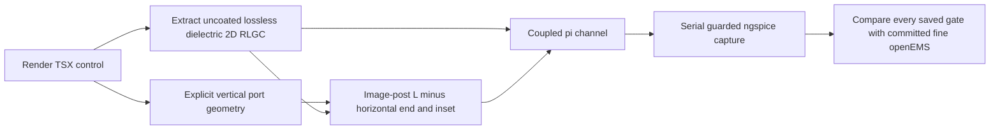

# Explicit local-return terminal inductance

The TSX reproduction is `tests/support/terminal-inductance.test.tsx`, using
the unchanged `ReturnAgreement` board and the committed fine-mesh
`openems-referee-data.json`. Run it with `OMP_NUM_THREADS=1`,
`TSX_TSCONFIG_PATH=examples/tsconfig.json`, and `NGSPICE_BIN` set. Each of
the three ngspice cases runs serially. No new openEMS solve is claimed.
The capture ends at 7.499 ns, inside the measured-step first-pulse window.

`terminalInductance` computes external magnetic energy for the referee's
explicit vertical circuit connections: the inward half of the TSX 0.15 mm
pad, 0.4 mm above the plane. Its PEC image doubles the post length; half
the rectangular-bar self / parallel-filament mutual is retained. Subtract
the horizontal infinite-line end excess and the line length to the port
volume centre. The calculation yields about 0.101 nH self and 0.0174 nH
adjacent mutual for the tight case. No constant is fitted to openEMS.
This is a short-post approximation, not a full discontinuity extraction.

`channelSpice` accepts explicit input/output terminal matrices and adds
them to the first/last series section. Omitting them preserves the existing
channel. Ordinary BGA pads do not specify a port-to-plane current path and
receive no inferred vertical post. Real-board vias retain their existing
geometry-derived barrel, pad, stub and return-loop models; this change does
not add the same transition twice. The routed board still has the limits
documented in `routed-2d.md`.

The following errors are corrected 2D minus fine openEMS, in mV, with
the original 100 MHz channel resistance retained. Peak gates are
1% of the reference absolute peak + 1 mV; minimum gates use the reference
minimum magnitude. **This is partial improvement, not qualification.**

| Case | Driven peak error / gate | Driven minimum error / gate | Quiet near peak error / gate | Quiet far peak error / gate |
|---|---:|---:|---:|---:|
| 1-0.3 | −3.604 / 39.494 | +4.903 / 6.507 | — | — |
| 3-0.3 | −6.451 / 39.770 | +6.349 / 6.766 | −5.883 / 6.268 | **−12.983 / 7.103 FAIL** |
| 3-1-short | +3.630 / 36.003 | **−3.565 / 3.004 FAIL** | **−2.702 / 2.187 FAIL** | **−3.319 / 1.901 FAIL** |

Before correction, driven peak errors were −27.2, −21.1 and −27.5 mV;
far-victim errors were −21.9 and −3.95 mV. The short-case reference far
peak is **90.077 mV**, the full first pulse's absolute peak, rather than
the investigation's 89.1 mV rising-step figure. Signed minima and all gates
are retained in `tests/evidence/signal-levels/terminal-inductance-{before,after}.json`.
Changing 16 to 32 sections (`SI_TERMINAL_SECTIONS=32`) changes any recorded
extremum by at most 0.818 mV. Neither the residual coupling error nor the
fine-mesh sensitivity in the referee study is hidden by that check.

The saved corrected native traces were also compared point by point with
the hash-verified fine probes over the first 3 ns after ramp onset, using
only the prescribed 2 ns source delay and no fitted timing alignment.
These are waveform errors, separate from the extrema bands above:

| Case | Driven RMS / maximum error, mV | Quiet near RMS / maximum, mV | Quiet far RMS / maximum, mV |
|---|---:|---:|---:|
| 1-0.3 | 2.272 / 6.957 | — | — |
| 3-0.3 | 4.496 / 11.249 | 4.735 / 15.380 | 5.397 / 13.518 |
| 3-1-short | 2.536 / 8.067 | 1.062 / 4.699 | 1.107 / 3.644 |

For example, the single-line driven RMS/maximum errors were
15.045/37.812 mV in the committed uncorrected referee comparison.
All probes and fine raw-file hashes are retained in
`tests/evidence/signal-levels/terminal-inductance-waveform.json`.

