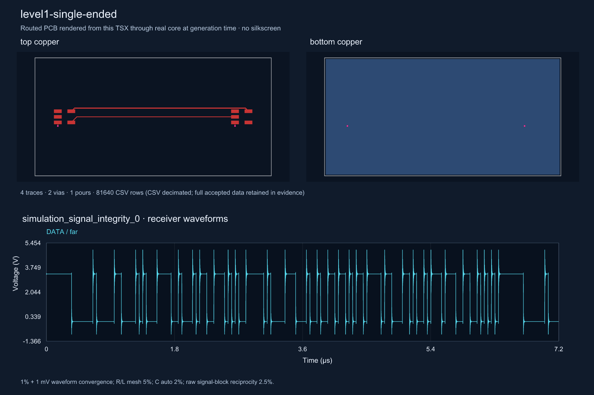
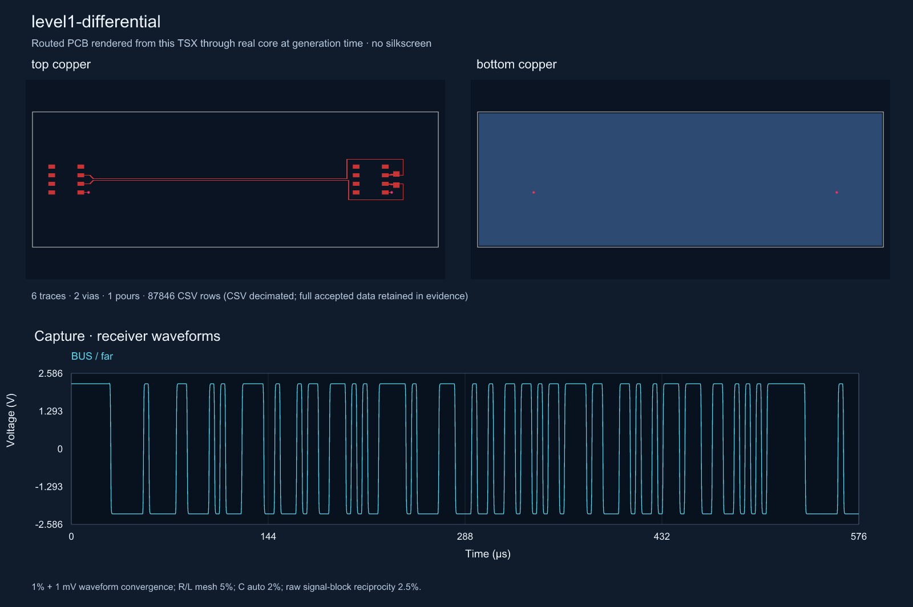
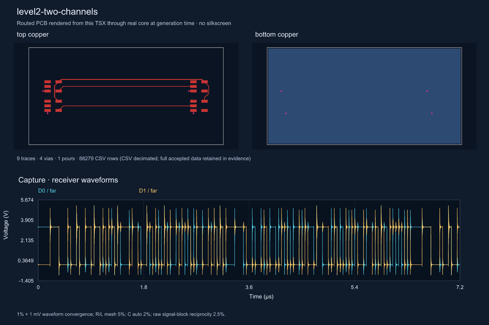
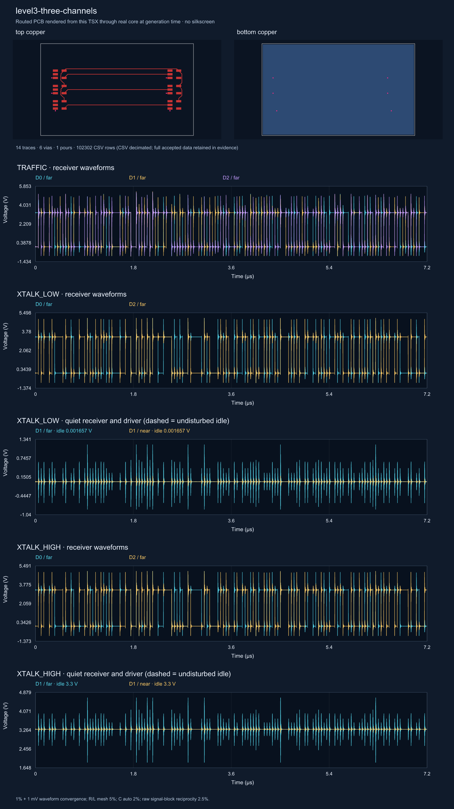
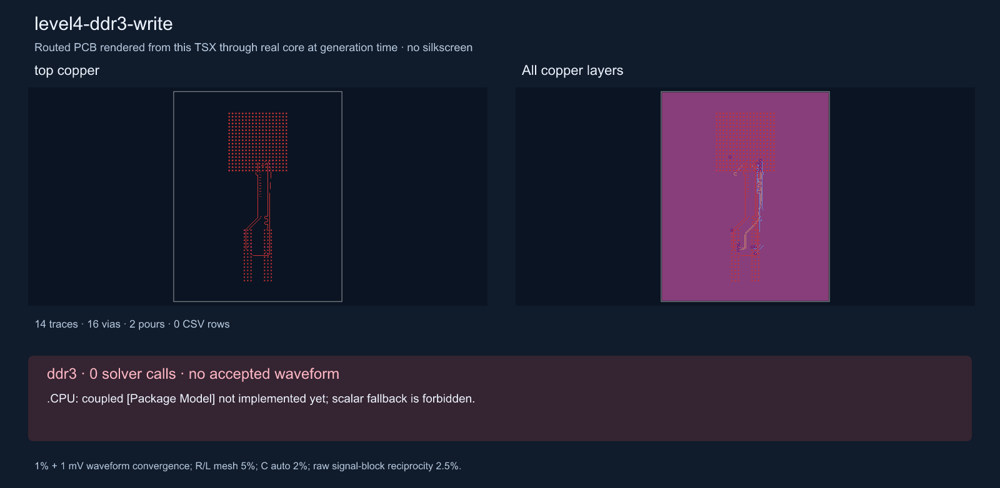

# Native transient channel examples

With the built sibling overlays and local vendor files, run `OMP_NUM_THREADS=1 IBIS_MODEL_DIR=models SI_CORE_MODULE="$(cd ../core && pwd)/dist/index.js" TSX_TSCONFIG_PATH=examples/tsconfig.json NGSPICE_BIN=/opt/homebrew/bin/ngspice node --max-old-space-size=6000 --import tsx scripts/render-example-images.tsx` to regenerate every PNG and CSV from the full accepted evidence in `runs/final-rfc`. To recreate that evidence first, use the same environment with `scripts/run-signal-levels.tsx`; every case/block runs sequentially, each process has a 1200000 ms bound, and DDR3 must stop before native execution. Exact completed native requests can be reused with `SI_EXTRACTION_CACHE=<directories separated by colons> SI_REPLAY_COMPLETE_NATIVE=1`. PNG lower panels plot the exported CSV in actual time and volts.

**level1-single-ended.** simulation_signal_integrity_0: 7.2 µs accepted; wall 400.7 s (387.6 s fresh native calls); convergence deltas RMS ≤ 0.001542 V, signed extrema ≤ 0.001987 V. R/L mesh deltas 1.294%/0.0003708%, C auto residual 1.724%, signal-block reciprocity 0%. CSV only is decimated by native min/max buckets (81640 rows; full CSV would be 153522407 bytes). Full data: `runs/final-rfc` (local, ignored); hashes and convergence: `tests/evidence/signal-levels/`.

**level1-differential.** simulation_signal_integrity_0: 576 µs accepted; wall 758.8 s (746.8 s fresh native calls); convergence deltas RMS ≤ 1.887e-7 V, signed extrema ≤ 1.747e-7 V. R/L mesh deltas 0.0504%/0.02507%, C auto residual 1.796%, signal-block reciprocity 0.0327%. CSV only is decimated by native min/max buckets (87846 rows; full CSV would be 207858929 bytes). Full data: `runs/final-rfc` (local, ignored); hashes and convergence: `tests/evidence/signal-levels/`.

**level2-two-channels.** simulation_signal_integrity_0: 7.2 µs accepted; wall 761.9 s (745.9 s fresh native calls); convergence deltas RMS ≤ 0.001653 V, signed extrema ≤ 0.004791 V. R/L mesh deltas 1.338%/0.1588%, C auto residual 1.371%, signal-block reciprocity 0.01556%. CSV only is decimated by native min/max buckets (88279 rows; full CSV would be 508199921 bytes). Full data: `runs/final-rfc` (local, ignored); hashes and convergence: `tests/evidence/signal-levels/`.

**level3-three-channels.** TRAFFIC: 7.2 µs accepted; wall 1939 s (1907 s fresh native calls); convergence deltas RMS ≤ 0.001694 V, signed extrema ≤ 0.00633 V. XTALK_LOW: 7.2 µs accepted; wall 1451 s (1397 s fresh native calls); convergence deltas RMS ≤ 0.001395 V, signed extrema ≤ 0.002795 V. XTALK_HIGH: 7.2 µs accepted; wall 2178 s (2127 s fresh native calls); convergence deltas RMS ≤ 0.001476 V, signed extrema ≤ 0.002603 V. R/L mesh deltas 1.329%/0.1003%, C auto residual 0.5493%, signal-block reciprocity 0.01459%. CSV only is decimated by native min/max buckets (102302 rows; full CSV would be 3124304397 bytes). Full data: `runs/final-rfc` (local, ignored); hashes and convergence: `tests/evidence/signal-levels/`.

**level4-ddr3-write.** ddr3: stopped after 1.701 s, 0 solver calls: `.CPU: coupled [Package Model] not implemented yet; scalar fallback is forbidden.`.  CSV retains all 0 native sample rows. Full data: `runs/final-rfc` (local, ignored); hashes and convergence: `tests/evidence/signal-levels/`.

