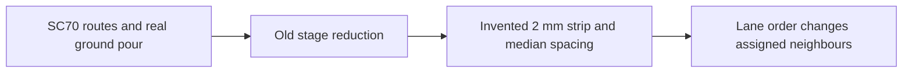

# Three SC70 links

`index.circuit.tsx` renders three SN74LVC1G04 output/input links, a ground pour and explicit
20 Mbps TI IBIS stimulus/probe/eye declarations. `makeBoard(true)` holds the middle output low;
NEXT1 and FEXT1 measure its near/far end crosstalk. Vendor bytes are not redistributed: use the URL,
archive member and SHA-256 in `../vendor-models.lock.json`.

The reproduction commit deliberately keeps old numerical controls inside its test. Run
`node --import tsx --test tests/support/2d-reproduction.test.ts` for the lane-order failure oracle.
The physical neighbours move in the old synthesized geometry when only the API ordering changes.
The ground pour is reduced to an invented 2 mm strip.

Historical native measurements (2026-11-07, `si-api-review/iter1/e2e/report.md`, M6):

| Case | Straightened | Actual routed copper |
|---|---:|---:|
| RS-485 mutual L | 11.7 nH | 4.2 nH |
| RS-485 mutual C | -0.91 pF | -0.19 pF |
| SC70 R refinement residual | N/A | 0.271606591 versus 0.05 target |
| SC70 routed attempt | N/A | 664.197 s, convergence failure |
| Three SC70 routed attempt | N/A | historical 3600 s harness timeout |

These are prior measurements, not reruns of this new board. Raw evidence remains outside the
repository in `si-api-review/iter1/e2e/out` and `logs`. A fresh baseline can be run on this commit
with `SI_3D_BASELINE=1 node --import tsx --test tests/support/2d-baseline.native.mjs`.
It runs a single extraction with no harness timeout and saves the result/error and elapsed time.
Do not enable it on the fix branch: 3D extraction is removed there.

