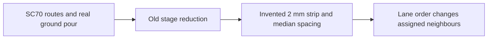

# Three SC70 links

`index.circuit.tsx` renders three SN74LVC1G04 output/input links, a ground pour and explicit
20 Mbps TI IBIS stimulus/probe/eye declarations. The TSX `fabricatorPreset` produces the stackup. `makeBoard(true)` holds the middle output low;
NEXT1 and FEXT1 measure its near/far end crosstalk. Vendor bytes are not redistributed: use the URL,
archive member and SHA-256 in `../vendor-models.lock.json`.

The reproduction commit deliberately keeps old numerical controls inside its test. Run
`node --import tsx --test tests/support/2d-reproduction.test.ts` for the lane-order failure oracle.
The physical neighbours move in the old synthesized geometry when only the API ordering changes.
The ground pour is reduced to an invented 2 mm strip.

Historical native measurements (2026-11-07, `si-api-review/iter1/e2e/report.md`, M6):

| Case | Straightened | Actual routed copper |
|---|---:|---:|
| RS-485 mutual L | 11.7 nH | 4.2 nH |
| RS-485 mutual C | -0.91 pF | -0.19 pF |
| SC70 R refinement residual | N/A | 0.271606591 versus 0.05 target |
| SC70 routed attempt | N/A | 664.197 s, convergence failure |
| Three SC70 routed attempt | N/A | historical 3600 s harness timeout |

These are prior measurements, not reruns of this new board. Raw evidence remains outside the
repository in `si-api-review/iter1/e2e/out` and `logs`. A fresh baseline can be run on this commit
with `SI_3D_BASELINE=1 node --import tsx --test tests/support/2d-baseline.native.mjs`.
It runs a single extraction with no harness timeout and saves the result/error and elapsed time.
Each native request and response is also saved immediately, so an interrupted later solve does not
discard completed evidence.

`SI_3D_GAP=1 node --import tsx --test tests/support/2d-baseline.native.mjs` renders the original
RS-485 TSX board in `tests/fixtures/rs485-gap.tsx` and checks both reductions against the historical
11.716/4.169 nH results at the original 5% refinement tolerance. Native failures propagate; a
different failure cannot pass as the expected SC70 convergence result.
Do not enable it on the fix branch: 3D extraction is removed there.

Fresh native rerun on Apple M5, 2026-11-09 (CPU-contended):

| Original RS-485 board | Mutual L | Mutual C | Extraction wall time |
|---|---:|---:|---:|
| Straightened | 11.716323 nH | -0.909219 pF | 1.427 s |
| Routed copper | 4.169378 nH | -0.187355 pF | 2592.909 s |

The native opt-in gap test passed. Its source is the original physical TSX; requests and outputs
are in `runs/2d-baseline/rs485-*/native-*`. This board differs from the repository's default
RS-485 example, whose original explicit 0.35 mm return profile gives 30.447940 nH in the separate
BEFORE run. These layouts/settings must not be conflated.

The fresh three-link SC70 routed-copper check also completed with its expected named failure:
`mesh_convergence`, R refinement residual **0.128292996947 > 0.05**, after **3667.640 s**.
This is the current three-link TSX with its fabricator-preset stackup, not the historical single-link
0.271606591 measurement. It used the explicit BEFORE controls in the opt-in test (5/9 filaments,
0.765/0.3825 mm ground meshes), without a harness timeout. The test passed by observing this exact
class of R convergence diagnostic; unrelated native errors cannot satisfy it. Its two actual native
requests/responses and elapsed time are retained in `runs/2d-baseline/crosstalk*`.
