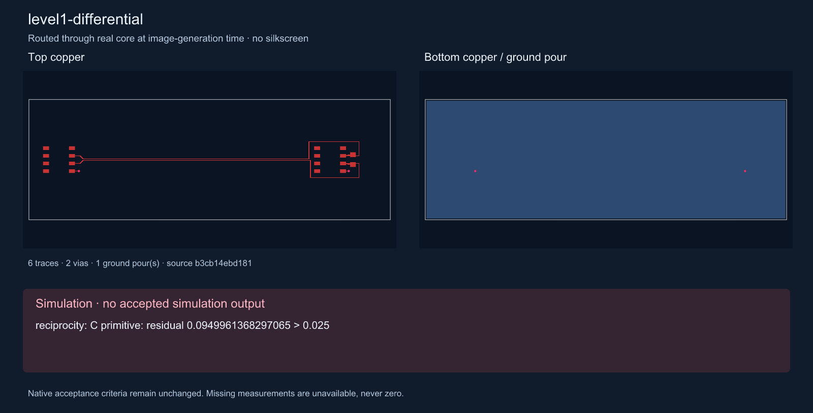
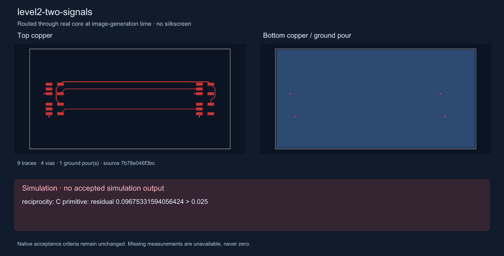
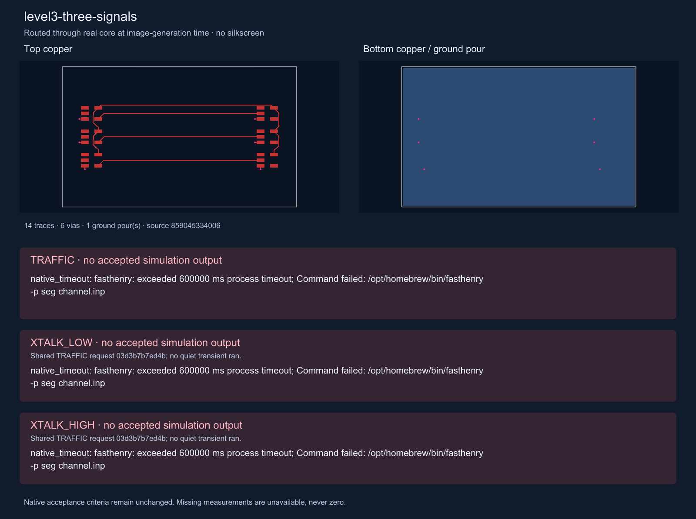
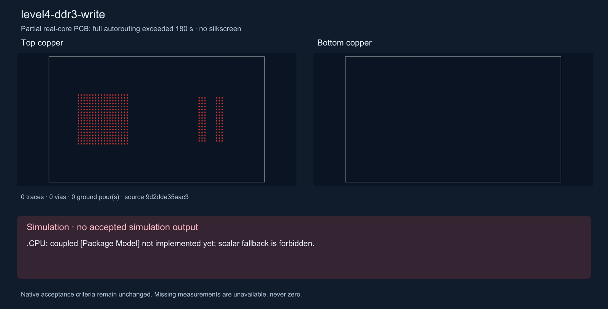

# Signal-integrity API levels

The sources match RFC `a235ddd` byte-for-byte except the differential example, which now uses explicit paths, ground vias and ideal model power rails. Images are regenerated from these TSX sources through real core at image-generation time. Top and bottom copper are shown separately, without silkscreen. All numerical labels and blocking messages come from committed native evidence.

**No RFC channel currently passes all native acceptance checks.** The images therefore show the blocking messages instead of fabricated eyes or quiet-victim waveforms. Missing measurements are unavailable, never zero. See [native evidence and limits](../../docs/native-signal-levels.md).

### Level 1 — single-ended

One TI inverter sends 20 Mbps traffic over its routed trace and full bottom GND plane. Native R/L refinement passes; the layered capacitance matrix fails the unchanged reciprocity check, so no eye is accepted.


### Level 1 — differential

One SN65HVD72 pair drives a real 120 ohm 0603 termination. Explicit 0.15 mm traces have 0.25 mm pitch along their parallel trunks, then fan out around RX; all four pair/tap traces and the two ground-via leads render without autorouting. The pipeline retains the receiver pins as internal channel taps. Ideal model rails supply power; power copper is omitted. Native R/L passes, but C reciprocity rejects the channel before its eye simulation. The separate autorouter reproduction remains unchanged.



### Level 2 — two signals

Two TI inverter channels switch at 20 Mbps over the same full return plane. Native R/L refinement passes; C reciprocity fails, so neither eye is accepted. This example declares no quiet victim and therefore requests no standalone quiet-victim NEXT/FEXT measurement.



### Level 3 — traffic and quiet victims

TRAFFIC switches all three signals; XTALK_LOW and XTALK_HIGH hold D1 quiet while D0/D2 switch. TRAFFIC's refined FastHenry solve reached its 600 s deadline. Both quiet blocks require the identical refinement request; their duplicate attempts were cancelled after confirming that identity. No transient, eye, NEXT or FEXT is accepted. The picture identifies the shared extraction failure explicitly.



### Level 4 — DDR3 write illustration

The AM335x/Winbond write example still stops at `.CPU: coupled [Package Model] not implemented yet; scalar fallback is forbidden.` Source preflight makes zero native solver calls. The image attempts the unchanged full board through real core with a 180 s layout deadline; an incomplete layout is labelled partial. No DDR eye or protocol-compliance result is claimed.



Regenerate all five 1600 px PNGs with one script after installing dependencies and building the sibling overlays. Vendor models stay local; no vendor bytes or overlays are committed.

```sh
export IBIS_MODEL_DIR=models
export SI_CORE_MODULE="$(cd ../core && pwd)/dist/index.js"
export TSX_TSCONFIG_PATH=examples/tsconfig.json
node --import tsx scripts/render-example-images.tsx
```

The runner writes compact adaptive receiver samples to `plot-evidence.json.gz` only after a fully accepted native run; measurements always use full-resolution data. The image script folds those committed samples over two UI windows after the measurement gate, overlays the voltage mask and labels full-resolution eye height/width. Quiet plots subtract the separately solved idle and mark signed full-resolution peaks. There are currently no accepted example waveforms to commit or plot.
