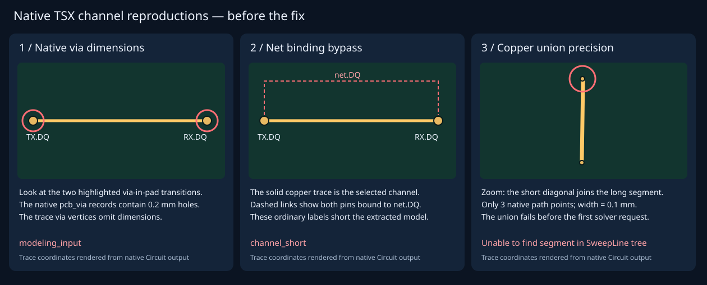

# Native DDR channel preparation failures

Start with [the real TSX board](../../fixtures/native-channel.tsx), then
[the three tests](../../native-channel.test.ts). No Circuit JSON is authored or
imported by these reproductions: `Circuit.renderUntilSettled()` emits the board,
ports, net bindings, via dimensions, reference pour and fabrication stackup.
The dev dependency update provides native stackup rendering; `thickness={1.6}`
selects a supported four-layer fabrication template.

Run `node --import tsx --test tests/native-channel.test.ts`. On the reproduction
branch, the tests pass by asserting the **observed failures**. The stacked fix
changes these assertions to the required successful behavior.

1. **Look at the red circles in panel 1.** `pcbPath` creates two via-in-pad
   transitions. The hole diameter is present on their associated `pcb_via`
   records and absent from the route vertices. `geometryFromCircuitJson` rejects
   the unmodified native output with `modeling_input`.
2. **Look at the dashed red net binding in panel 2.** Each chip's `connections`
   binds DQ to `net.DQ`; the named `DQ_ROUTE` supplies the physical copper.
   Skipping just that selected source trace leaves an ideal bypass through the
   two logical net bindings, causing `circuitNodes` to report `channel_short`.
   A fix must preserve detection of a separate actual bypass and avoid guessing
   which end an extra net attachment or net-based voltage probe belongs to.
3. **Look at the circled upper bend in panel 3.** The three points were reduced
   from a sampled DDR_DQS1 route. A 0.1 mm path is sufficient to break the union
   of the segment rectangles and rounded end caps in `surfacePanels`.
   `fasterCapDeck` throws `Unable to find segment ... in SweepLine tree` before
   any native solver request. No route simplification is performed by the test.

[failure.txt](failure.txt) contains the exact captured errors. Regenerate it and
the coordinate-derived SVG on the reproduction branch with
`node --import tsx scripts/render-native-channel-repro.ts`.

These are preparation regressions, not accepted DDR simulations. They do not
establish field-solver convergence or produce eye plots. Keep the solver,
mesh-refinement, resistance and reciprocity acceptance checks when fixing them.
